# K5 Producer/Consumer Generation Timeline

Status date: 2026-09-02

Repository baseline:

```text
branch: tma-impl
HEAD:   dd7c43a
```

This analysis document records the evidence and execution plan for the K5
producer/consumer cycle-accuracy investigation.

## 1. Scope boundary

Opt 12 (Producer-consumer mbarrier WaitBlock/spin-fold modeling) is complete.
Do not reopen its dependency-correctness design while investigating this issue.

The next task is a separate cycle-accuracy optimization:

```text
Why does K5 producer progress advance through a later mbarrier generation
before the corresponding consumer reaches its exact-generation wait action?
```

The current behavior is dependency-safe:

```text
current_generation < target_generation  -> hold
current_generation = target_generation  -> dependency satisfied
current_generation > target_generation  -> dependency already satisfied;
                                            continue and count late arrival
```

The last case is not a correctness failure. It is evidence that the simulated
producer/consumer relative timeline differs from the hardware-derived
generation ordering.

Primary objective: improve K5 cycle accuracy without weakening the completed
WaitBlock, TMA ownership, or lifecycle contracts.

## 2. Canonical artifacts

Use the final Opt 12 regression as the starting point.

```text
K5 stderr: simulator-remodeled/sim_run_12.8/
  flashattn-fa3-bf16-bwd-causal-b1-s2048-hd64-nh24/
  flashattn_fa3_bf16_bwd_causal_b1_s2048_hd64_nh24___warmup_0___iters_1/
  H100_80GB-OnlyKernel5/*.e93

K5 stdout: same directory, *.o93

K10 control stderr/stdout: same run root,
  H100_80GB-OnlyKernel10/*.e69 and *.o69

Initial first-late run: K5 *.e91 and *.o91
Earlier exact-generation run: K5 *.e90 and *.o90
Historical pre-exact timing evidence: K5 *.e85 and *.o85
```

Authoritative trace artifacts:

```text
simulator-remodeled/hw_run/traces/device-0/12.8/
  flashattn-fa3-bf16-bwd-causal-b1-s2048-hd64-nh24/
  flashattn_fa3_bf16_bwd_causal_b1_s2048_hd64_nh24___warmup_0___iters_1
  -mbarrier-contract-v2/traces/extra_info/
```

Important files in that directory:

```text
spin_wait_sidecar.json
wait_block_exact_generation_tickets.json
```

Validated artifact summary:

```text
WaitBlock sidecar schema/version       = wait_block_sidecar / 5
sidecar validation_complete            = true
discovered/passed/failed/skipped        = 43/36/0/7
INJECT_MISSING_WAIT/FOLD_CAPTURED_POLL = 22/14

ticket schema/version/status            =
  wait_block_exact_generation_tickets / 2 / PASS
ticket streams/slots                    = 5,172 / 816,411
exact targets/fallback slots            = 90,868 / 725,543
```

Simulator configuration:

```text
simulator-remodeled/gpu-simulator/gpgpu-sim/configs/tested-cfgs/
  SM90_H100_L2_50MB_80GB/gpgpusim.config

-wait_block_enable 1
-wait_block_exact_generation_enable 1
-wait_block_late_arrival_instrument_enable 1
-spin_wait_observe_enable 0
```

The `.e93/.o93` run used code at `7ac4d23`. Later commits through `dd7c43a`
changed documentation and BAR diagnostic emission, not modeled timing, so
`.e93/.o93` remains the canonical timing baseline.

## 3. Baseline result

| Metric | K5 `.e93/.o93` | K10 `.e69/.o69` |
|---|---:|---:|
| Completed CTAs | 132/132 | 384/384 |
| Simulator cycles | 84,906 | 140,003 |
| H100 cycles | 67,696 | 132,901 |
| Cycle error | +17,210 (+25.42%) | +7,102 (+5.34%) |
| Exact-generation late arrivals | 10,221 | 0 |
| First-late records | 132 | 0 |
| WaitBlock/TMABIND/BAR/SR-M0A | PASS | PASS |

The late-arrival count is schedule-sensitive and is not a conservation metric:

| Run | K5 cycles | Late arrivals | First-late records |
|---|---:|---:|---:|
| `.e90/.o90` | 85,172 | 9,542 | not instrumented |
| `.e91/.o91` | 84,358 | 10,064 | 132 |
| `.e93/.o93` | 84,906 | 10,221 | 132 |

Use `.e93/.o93` for new comparisons. Older counts explain existing notes but
must not replace the final baseline.

## 4. What the final K5 run proves

### 4.1 All late events

All 10,221 records are
`[WAITBLOCK][exact-generation-late-immediate]`. They occur when the consumer
issues the action, not when a previously held wait is released.

| Action PC | Count | Principal barrier pair |
|---|---:|---|
| `0x5a50` | 4,707 | `0x16c30` / `0x16c38` |
| `0x5bc0` | 4,774 | `0x16c50` / `0x16c58` |
| `0x3750` | 269 | `0x16c50` / `0x16c58` |
| `0x35e0` | 255 | `0x16c30` / `0x16c38` |
| `0x13b0` | 128 | `0x16c30` / `0x16c38` |
| `0x74e0` | 88 | `0x16c50` / `0x16c58` |

Generation distance:

```text
current - target = 1: 6,616
current - target = 2: 3,486
current - target = 3:   119
```

All late events are in consumer warps 4-7:

```text
warp 4: 2,644
warp 5: 2,550
warp 6: 2,545
warp 7: 2,482
```

`0x5a50` and `0x5bc0` account for 9,481/10,221 events (92.76%), so start there.

### 4.2 First divergence per CTA

The observe-only probe emits exactly one
`[WAITBLOCK][late-timing-first]` record per affected CTA.

Final `.e93` distribution:

```text
132/132 CTAs affected
first action_pc 0x5a50: 127 CTAs
first action_pc 0x5bc0:   5 CTAs
generation distance +1: 131 CTAs
generation distance +2:   1 CTA (global CTA 89)
```

The five `0x5bc0` first-divergence CTAs are 29, 42, 57, 86, and 96.

For the 127 dominant `0x5a50` first-divergence records, `.e93` medians are:

```text
target completion -> next contract open    10,734 cycles
next contract open -> next completion         364 cycles
next completion -> consumer action             874 cycles
target completion -> consumer action         12,189 cycles
last producer semantic anchor -> action         796 cycles
last consumer semantic anchor -> action          73 cycles
```

The next TMA transfer is already complete before the consumer reaches its
target-generation action. The final wait issue and release phase are therefore
not the source of the first divergence.

### 4.3 Representative CTA 0 timeline

CTA 0's first late action is `0x5a50` on consumer warp 5, barrier `0x16c38`.

```mermaid
flowchart LR
    T2["Target gen 2 complete<br/>cycle 18,521"]
    O3["Next gen 3 contract open<br/>cycle 26,749"]
    I3["Next TMA issue<br/>cycle 26,771"]
    PA["Producer anchor UTMALDG 0xa5f0<br/>cycle 26,817"]
    C3["Next gen 3 complete<br/>cycle 27,159"]
    CA["Consumer anchor MUFU.EX2 0x7420<br/>cycle 27,481"]
    W["Consumer action 0x5a50<br/>cycle 27,536<br/>target 2, current 3"]

    T2 -->|"8,228 cyc"| O3
    O3 -->|"22 cyc"| I3
    I3 -->|"46 cyc"| PA
    PA --> C3
    C3 -->|"322 cyc"| CA
    CA -->|"55 cyc"| W
```



This is the core symptom: producer warp 0 opens the generation-3 TMA contract
and the modeled barrier completes generation 3 while the consumer action still
carries exact target generation 2.

### 4.4 Role-lifetime direction is also inverted

From `.o93` CTAFIN records:

```text
producer_minus_consumer = producer_last_drain_cyc - consumer_last_drain_cyc

samples = 132
negative samples = 132
mean   = -1,884.6 cycles
median = -1,503 cycles
range  = -4,615 .. -1,208 cycles
```

Thus every simulated K5 CTA drains the producer before the consumer.

The accepted low-overhead H100 EXIT-only measurement is:

```text
samples = 396 across three runs
negative samples = 0
mean   = +7,950.9 cycles
median = +7,916 cycles
p95    = +8,074 cycles
range  = +7,798 .. +10,024 cycles
```

The exact drain/EXIT definitions should remain visible when comparing absolute
numbers, but the sign inversion is unambiguous: hardware retains a producer
tail while the final simulator run retains a consumer tail.

## 5. Current interpretation

What is established:

1. Exact ticket identity is valid and dependency safety is closed.
2. The K5 consumer often reaches a wait after the modeled producer has completed
   one or more additional generations.
3. At the first divergence, the next TMA transfer itself is short (median 364
   cycles) and finishes before the consumer action.
4. The consumer has issued semantic work very recently (median anchor age 73
   cycles), so this is not a stale warp sitting idle immediately before the
   wait.
5. K10 is a strong control: it has zero exact-generation late arrivals.
6. K5 role lifetime has the opposite sign from hardware.

What is not established:

1. The ticket does not contain a hardware completion timestamp. It identifies
   the required generation, not when hardware completed that generation.
2. A late record alone cannot distinguish an early simulated producer from a
   late simulated consumer.
3. The first-late event is a localization marker, not a cycle predictor.
   Preliminary `.e93/.o93` correlations between first-late interval fields and
   CTA elapsed cycles are all weak (`|r| < 0.16`).
4. The total late-arrival count is not an optimization objective by itself.
   Its correlation with elapsed cycles changes sign after grouping by workload.

One useful secondary signal is `captured_poll_hold_cycles_total`. Its raw
correlation with CTA elapsed cycles is 0.853; within the two largest equal-work
cohorts it remains 0.783 (`tensor_ops=2592`) and 0.633
(`tensor_ops=2736`). This justifies examining FOLD hold placement and consumer
progress together, but does not prove that reducing hold time is correct.

## 6. Ranked hypotheses

### H1: Consumer issue/compute progress is too slow relative to the producer

This is the leading hypothesis.

Supporting evidence:

- all 132 simulator CTAs drain consumers after the producer, opposite to H100;
- consumer work remains active immediately before the first late action;
- historical `.e85` analysis measured about 3,300 simulator cycles per
  consumer tile versus about 1,700 on H100 and 0.71x matched issue density;
- the extra generation is usually already complete hundreds of cycles before
  the action.

Candidate sub-axes are HGMMA/MUFU issue cadence, scoreboard exposure, operand
collector/issue-port pressure, warp eligibility, and cross-subcore contention.

### H2: Producer replay/FOLD pacing advances the next contract too early

The exact-generation implementation restores dependency identity but does not
restore the original cross-warp hardware timeline. Captured-poll folding can
change when producer warp 0 reaches the next `ARRIVE_EXPECT_TX`/TMA command.

Measure this against consumer progress before changing it. Do not infer that a
shorter producer hold is better merely because it lowers total cycles.

### H3: Shared pipeline, L2, or TMA arbitration skews relative progress

The rejected reverse-subcore experiment proved that issue traversal can alter
L2/TMA arbitration and timing populations. This does not implicate B1, but it
shows that a scheduler or pipeline perturbation can move the generation
timeline indirectly.

### H4: Ticket or TMA ownership identity is wrong

This is low probability and must not be the default hypothesis. Exact ticket
coverage, K5/K10 conservation, per-binding ownership, and K10's zero-late
control all pass. Reopen identity only if a concrete tuple mismatch is found.

## 7. Do not repeat these approaches

- Do not force barrier phase/generation.
- Do not clear or release a wait through a watchdog escape.
- Do not add a K5/action-PC whitelist.
- Do not treat `current_generation > target_generation` as a correctness abort.
- Do not inflate TMA latency. Historical K5 target-generation TMA intervals
  were about 392 cycles versus an independently measured roughly 402-cycle
  hardware mean; `.e93` first-late next-generation median is 364 cycles.
- Do not use whole-subcore traversal reversal as a B1 or timing-isolation test.
  It changes instruction issue, cache contention, and TMA arbitration.
- Do not use final cycle reduction alone. Preserve role timing and all semantic
  work/conservation gates.
- Do not obtain cross-warp hardware timing by adding full NVBit `clock64()`
  callbacks. Prior instrumentation changed the producer tail by orders of
  magnitude. The accepted hardware evidence is the low-overhead EXIT-only
  measurement and aggregate NCU counters.
- Do not blindly reuse the old pre-exact-generation magnitudes. The earlier
  `-37.9K` simulator producer-minus-consumer tail has narrowed to `-1.9K` in
  `.o93`, although the direction is still wrong.

Historical producer-spin over-capture and offline trimming were real, but they
are not automatically the cause of the current exact-generation divergence.
Keep capture-time clock skew, simulator replay timing, and current mbarrier
generation timing as separate causal layers.

## 8. Code map

Main timing probe and decision points:

```text
simulator-remodeled/gpu-simulator/gpgpu-sim/src/gpgpu-sim/remodeling/sm.cc

is_wait_block_timing_semantic_opcode()
  selects HGMMA/MUFU/TMA/memory/sync semantic anchors

SM::record_wait_block_timing_issue()
  records the last semantic issue per hardware warp

SM::record_wait_block_first_late_arrival()
  emits one first-late record per CTA

SM::handle_sync_instruction() exact-generation branch
  wait_ready = current_generation >= exact_target
  counts/logs current_generation > exact_target

SM::recompute_sync_barrier_ready_and_maybe_flip_phase()
  records generation completion cycle

SM::open_tma_assignment_contract()
  records contract-open cycle and producer identity

SM::claim_tma_completion_target()
  records first/last TMA issue cycle
```

Supporting state:

```text
remodeling/tma_types.h
  WaitBlockGenerationTiming
  HopperMBarrierObject::wait_block_timing

remodeling/sm.h
  WaitBlockSemanticAnchor
  m_wait_block_last_semantic_anchor_by_warp
  m_wait_block_first_late_reported_by_cta_slot

remodeling/subcore.cc
  calls record_wait_block_timing_issue() only for the selected instruction
```

Relevant commits:

```text
9e92fe9  capture exact TMA completion-barrier identity
527af10  capture barrier-local contract ordinals
9bb9630  restore NVBit callback ABI for the accepted v2 trace
9f21f72  consume exact generation tickets
087b53f  cover all exact FOLD waits
865d36d  add first-late timing instrumentation
ed51a5b  centralize the SM release phase
8a5cfa2  remove the invalid reverse-subcore validation
7ac4d23  final functional simulator baseline used by `.e93/.o93`
```

The first-late logger is observe-only. If it is extended, build each line
off-stream and emit it with one stderr call; concurrent SM output can otherwise
interleave.

## 9. Next-session execution plan

### Phase A: offline analysis only

Do not start with a simulator change.

1. Parse `.e93` first-late records and `.o93` CTAFIN/WAITBLOCK summaries into
   one per-CTA table.
2. Include at least:

```text
global_cta, sm, tensor_ops, elapsed_cyc
first action_pc, barrier, source_index, target_gen, current_gen
target_open, target_issue, target_complete
next_open, next_issue, next_complete, consumer_action
producer_anchor_pc/cycle/age
consumer_anchor_pc/cycle/age
producer_last_drain, consumer_last_drain
captured_poll_hold_cycles_total
late_arrival_divergences
```

3. Normalize comparisons by equal `tensor_ops` or identical TRACECHECK work.
   K5 CTA workload varies, so ungrouped correlations are confounded.
4. Start with these cohorts:

```text
CTA 0:  representative early 0x5a50 first divergence
CTA 89: only first-divergence generation distance +2
CTA 96: representative 0x5bc0 first divergence
CTA 60: final/critical CTA in `.o93`
CTA 114: maximum consumer-minus-producer drain gap
CTA 24: minimum consumer-minus-producer drain gap
```

Use temporary commands or files outside the repository for analysis. The
previous local `verify_wait_block_run.py` and its test were intentionally
deleted and must not be recreated as tracked project files.

### Phase B: reconstruct the causal generation window

For each selected CTA/barrier/generation, join:

```text
consumer semantic progress
  -> consumer arrival/empty-buffer release
  -> producer FOLD release
  -> producer next contract open
  -> TMA issue
  -> TMA completion / generation flip
  -> consumer semantic progress
  -> exact-generation action issue
```

Use existing `[SYNCDBG]`, `[TMABIND]`, `[WAITBLOCK]`, `[CTAFIN]`, and
`[STALLALIGN]` records first. The key question is where the producer gains the
generation of lead:

```text
consumer compute/issue interval?
producer wait released too early?
producer selected too aggressively after release?
TMA/resource arbitration?
consumer eligible but not selected?
consumer blocked by scoreboard/FU/operand collection?
```

### Phase C: add bounded observe-only instrumentation only if needed

If existing logs cannot partition the interval, add one bounded record per
`(global_cta, barrier, generation)` rather than per-cycle logging.

Useful additions:

- producer and consumer eligible/selected cycles between target completion and
  consumer action;
- sole blocking reason counts for consumer warps 4-7;
- producer FOLD release to next contract-open interval;
- consumer HGMMA/MUFU issue counts and gap distribution in the same window;
- L2/TMA service occupancy only when it overlaps that window.

Instrumentation must be default-off, launch-reset, observe-only, and use atomic
record emission. Implement and locally source-test it before requesting a
server run.

### Phase D: one causal correction at a time

Do not combine scheduler, compute latency, FOLD pacing, and TMA changes.

For each candidate:

1. State the predicted movement in generation window, role tail, and cycles.
2. Implement one mechanism-level change without PC/kernel special cases.
3. Add focused unit/source-contract coverage.
4. Run K5 first.
5. Run K10 only after K5 preserves correctness and moves the intended metric.

Keep instrumentation and behavioral changes in separate commits.

## 10. Acceptance gates

Correctness gates remain mandatory:

```text
K5 132/132 CTAs and K10 384/384 CTAs
no WAITBLOCK/TMABIND/BAR abort
zero residual hold/replay/TMA/named-BAR state
holds == releases
partial_deferred == partial_replayed + partial_folded
bindings_created == bindings_completed
assigned_credit_bytes == completed_credit_bytes
release fingerprints == released holds
TRACECHECK warp instructions == retired + captured-poll skipped
STALLALIGN FINAL status=PASS
exact ticket/action identity unchanged
semantic HGMMA/MUFU/TMA/memory/BAR work unchanged
```

Timing gates:

```text
K5 cycles move down from 84,906 toward 67,696
K5 producer-minus-consumer tail moves from -1,884.6 toward +7,950.9
K5 first-late generation distance/population moves in the predicted direction
K10 late arrivals remain zero
K10 cycles do not regress materially from 140,003
```

Late-arrival count is supporting evidence, not a standalone acceptance metric.
A patch that lowers it by changing semantic work, forcing generations, or
worsening role lifetime is invalid.

## 11. First questions for the next session

Answer these in order:

1. In the dominant `0x5a50` cohort, which upstream consumer event permits
   producer warp 0 to open the next contract?
2. Between that event and the consumer's `0x5a50` issue, is the consumer ready
   but not selected, or blocked by a modeled dependency/resource?
3. Does producer FOLD release-to-contract-open timing vary with the consumer
   delay, or is producer progress effectively fixed?
4. Why does the simulator end every producer before its consumers while H100
   consistently retains an approximately 8K-cycle producer tail?
5. Can one general timing correction improve both the local generation window
   and global role-tail direction without changing K10's zero-late behavior?

Do not choose a fix until questions 1-3 have direct runtime evidence.

## 12. Reference documents

- `.plan/WAIT_BLOCK.md`
  - final Opt 12 status;
  - first-late instrumentation and `.e91` summary;
  - exact-generation correctness and acceptance gates.
- `.plan/WAIT_BLOCK_HISTORY.md`, section 6B
  - `.e85` phase-window and producer/consumer timing measurements;
  - rejected hardware timestamp route and TMA-latency explanation.
- `.plan/WAIT_BLOCK_TMA_OWNERSHIP.md`
  - authoritative TMA contract/generation ownership.
- `.plan/WAIT_BLOCK_SIMULATOR.md`
  - WaitBlock runtime and partial replay behavior.
- `.plan/HW_VS_SIM_SFU.md`, sections 16-27
  - H100 EXIT-only role-tail measurement;
  - historical producer spin and consumer-compute analysis.
- `.plan/Lighter_NVbit_Tracing.md`
  - capture observer effect, sparse trace, and cross-warp timing limitations.

## 13. Analysis continuation (2026-09-02)

### 13.1 Phase A join result

The canonical K5 `.e93/.o93` records were joined directly from the raw logs.
Coverage is complete:

```text
first-late records       132/132 CTAs
CTAFIN records           132/132 CTAs
WAITBLOCK summaries      132/132 CTAs
TRACECHECK records       132/132 CTAs
missing joined fields      0
```

The main equal-work correlations with CTA elapsed cycles are:

| Metric | tensor_ops=2448 (n=15) | 2592 (n=62) | 2736 (n=44) |
|---|---:|---:|---:|
| captured-poll hold cycles | +0.572 | +0.783 | +0.633 |
| SM idle cycles | +0.904 | +0.928 | +0.899 |
| tensor-FU occupied cycles | +0.588 | +0.656 | +0.563 |
| first-late count | -0.034 | -0.569 | +0.085 |

This confirms that the late-arrival count is not a monotonic optimization
target. CTA elapsed time follows the broader consumer progress/idle envelope
much more closely.

### 13.2 Upstream event that opens the next producer contract

For every first-late tuple, the paired empty barrier is the full/TMA barrier
plus `0x10`:

```text
0x16c30 -> 0x16c40
0x16c38 -> 0x16c48
0x16c50 -> 0x16c60
0x16c58 -> 0x16c68
```

Joining `[SYNCDBG]` arrival/phase-flip records to the 132 first-late records
shows:

```text
paired empty-barrier arrivals per window = 3 for all 132 CTAs
last arrival warp:
  warp 4   6 CTAs
  warp 8  31 CTAs
  warp 12 95 CTAs

empty-barrier arrival span:
  min / median / max = 968 / 3,485 / 5,522 cycles

empty flip -> next TMA contract open:
  min / median / max = 48 / 65 / 335 cycles

empty flip -> next TMA completion:
  min / median / max = 343 / 454 / 689 cycles

next TMA completion -> first late action:
  all actions: min / median / max = 15 / 796 / 5,864 cycles
  0x5a50:     min / median / max = 69 / 874 / 5,864 cycles
```

For CTA 0 specifically:

```text
consumer arrivals to empty barrier 0x16c48 gen 1:
  warp 12 @ 24,613
  warp  4 @ 25,874
  warp  8 @ 26,698 -> generation flips to 2

producer FOLD release                  26,699
next contract open on 0x16c38 gen 2   26,749
next TMA complete / full gen 3        27,159
consumer warp 5 action 0x5a50         27,536
```

Thus the direct upstream event is the third consumer arrival on the paired
empty barrier. The producer does not bypass its FOLD dependency; it opens the
next contract shortly after the consumer-driven release.

The arrival sequence is not always one unique leader per consumer warpgroup:

```text
(12, 8, 12): 89 CTAs
(12, 4, 8):  25 CTAs
other:        18 CTAs
```

This is a useful phasing signal, not yet evidence of an mbarrier correctness
bug. Hopper mbarrier semantics are count-based, and the exact-generation and
conservation gates pass. Do not add unique-arriver enforcement without an
independent kernel contract proving that requirement.

### 13.3 Intra-warpgroup action skew

The ticket stream and runtime wait events were joined by ordered occurrence for
warps 4-7 at the first-late `(action_pc, barrier, target_generation)`. The
reported first-late event matches the reconstructed action cycle in all 132
CTAs.

```text
same-action issue spread across warps 4-7:
  min / median / max = 903 / 4,114 / 14,978 cycles

warps reaching the action after next-generation completion:
  1 warp: 25 CTAs
  2 warps: 29 CTAs
  3 warps: 56 CTAs
  4 warps: 22 CTAs
```

CTA 0 demonstrates the split:

```text
0x5a50, barrier 0x16c38, target gen 2:
  warp 4 @ 23,568  (-3,591 before next completion)
  warp 5 @ 27,536  (+377 after)
  warp 6 @ 27,538  (+379 after)
  warp 7 @ 27,682  (+523 after)
```

The first divergence is therefore primarily a consumer intra-warpgroup progress
spread, with the producer advancing only after consumer-generated empty-barrier
credit. H1 is strengthened. A generic "delay producer after FOLD release"
change is not justified by the current evidence.

### 13.4 Bounded stall-window probe

The existing SR-M0A snapshot computes the required per-warp pre-issue state but
only emits kernel-global totals. A local source change now reuses that
classification without changing issue decisions:

```text
[WAITBLOCK][late-stall-window]
  target_complete_to_next_open
  next_open_to_next_complete
  next_complete_to_action
```

Each record contains consumer and producer:

```text
active/population conservation
selected total and tensor/SFU/other selected counts
eligible-but-not-selected cycles
no-valid, drain, WaitBlock-hold, and blocked-valid cycles
sole blocker counts by wait barrier, stall count, FU class, issue gate,
named barrier, membar, ldgdepbar, TMA flush, scoreboard, result queue, and L1C
multi-blocker cycles
```

The probe is active only when both
`-wait_block_late_arrival_instrument_enable` and
`-stall_reason_align_instrument_enable` are enabled. It snapshots cumulative
per-warp counters at TMA contract-open/completion boundaries and emits only
three atomic lines for the first late action in an affected CTA.

Local source-contract checks pass. A simulator build cannot be performed on
the current macOS host because CUDA/nvcc is unavailable; compile and runtime
validation remain for the server.
