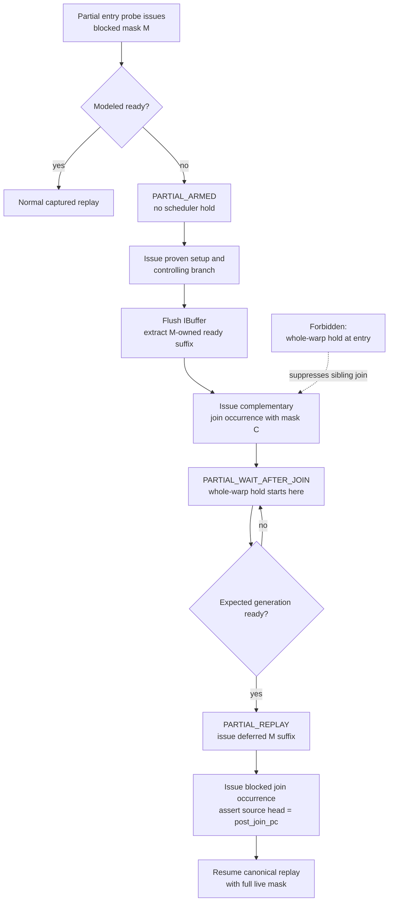

# WaitBlock: Two-Strategy Post-Processing and Simulator Design

**Status:** POST-PROCESSING V5 IMPLEMENTED AND FULL-TRACE VALIDATED;
SIMULATOR V1 IMPLEMENTED; FIRST SERVER RUN EXPOSED AND FIXED A PREDICATED-OFF
PAYLOAD GUARD; SECOND SERVER RUN EXPOSED A FALSE CURSOR-ACCOUNTING AUDIT;
CAPTURED-POLL PROOF HARDENING IMPLEMENTED AND FULL-TRACE VALIDATED;
THIRD SERVER RUN CONFIRMED AN ACTUAL K5 PARTIAL MODELED MISS AND STOPPED AT THE
INTENTIONAL V1 GUARD;
PARTIAL-MISSING-WAIT V2 POST-PROCESSING IMPLEMENTED AND FULL-TRACE VALIDATED;
SIMULATOR V2 LOADER AND DEFERRED-REPLAY IMPLEMENTATION COMPLETE;
K10 SERVER REGRESSION PASSED; K5 `.e81` EXPOSED A STALE REPLAY FETCH BASE AND
AN INDEPENDENT ALL-LIVE CROSS-WARP DEADLOCK; THE FETCH-BASE FIX AND REPLAY
LIFECYCLE GUARDS ARE IMPLEMENTED; K5 `.e82` CONFIRMED SUCCESSFUL CAPSULE
REPLAY/CLOSE BUT EXPOSED AN OUT-OF-ORDER REPLAY-DECODE RESERVATION GAP; K5
`.e83` CONFIRMED THE RESERVATION FIX AND EXPOSED AN INDEPENDENT TMA
COMPLETION-BINDING AND TX-SIZE CONTRACT FAILURE; POST-REVIEW K5/K10 TRACE
ANALYSIS RESOLVED THE SIZE FAILURE AS A DESCRIPTOR-SITE MISCLASSIFICATION AND
CONFIRMED THAT A DIRECT TMA COMPLETION-BARRIER TRACE FIELD REQUIRES RETRACING;
THE RETRACE AT `9e92fe9` IS COMPLETE AND VALIDATES 100% COMPLETION-TARGET
COVERAGE; B0-A/B/C ARE COMPLETE; B0-D EXACT COMPLETION OWNERSHIP AND ITS
BARRIER-LOCAL ASSIGNMENT-OVERLAP REPAIR ARE COMPLETE AND VALIDATED; K5 `.e85`
VALIDATES OWNERSHIP-CLEAN OUT-OF-ORDER COMPLETION; K10 `.e62` COMPLETES ALL
384 CTAS WITH CLEAN WAITBLOCK AND TMABIND SUMMARIES; K5 `.e85` ALSO CONFIRMS A
SEPARATE ALL-LIVE CROSS-WARP WAITBLOCK CYCLE; B0-E IS REOPENED ON A
CTA-ORDERED CANDIDATE-SET TICKET DESIGN AFTER TRACE-ONLY CAUSAL PRUNING PROVED
THAT CROSS-WARP ORDER IS THE MISSING INPUT; THE EARLIER EXACT-TICKET V1 REMAINS
REJECTED; THE TRACE-GENERATION/OFFLINE-PROOF STAGE IS IMPLEMENTED LOCALLY AND
AWAITS THE SERVER TRACE GATE; SIMULATOR CHANGES ARE FROZEN UNTIL THAT STAGE
PASSES AND A SEPARATE IMPLEMENTATION APPROVAL IS GIVEN; RETRACE AND B1 REMAIN
PENDING.

This document is the authoritative, self-contained design and execution record
for WaitBlock, partial replay, and the post-`.e83` TMA/barrier work. The linked
[`SPIN_WAIT_SIM_MODELING.md`](SPIN_WAIT_SIM_MODELING.md),
[`SPIN_WAIT_POSTPROCESS.md`](SPIN_WAIT_POSTPROCESS.md), and older `.trae`
planning documents are historical/supporting material only; they are not
required to implement or validate this document.

**Debug record:** [`../debug-k10-wait-fold-deadlock.md`](../debug-k10-wait-fold-deadlock.md).

This document intentionally reduces WaitBlock modeling to two runtime
strategies:

```text
INJECT_MISSING_WAIT
FOLD_CAPTURED_POLL
```

The strategies solve two different trace shapes and must not share an action
site.

`INJECT_MISSING_WAIT` handles a ready-only captured gate. The trace contains no
dynamic wait arm, but the simulator observes not-ready at the entry probe. The
simulator issues the entry probe, wait-holds the warp until the expected modeled
generation arrives, and then resumes the captured ready arm without moving the
trace cursor.

The handler is mask-aware at runtime:

```text
modeled ready:
    normal replay, regardless of entry mask

modeled not-ready and effective entry mask covers all live lanes:
    inject a whole-warp wait hold

modeled not-ready and effective entry mask is partial:
    print UNSUPPORTED_PARTIAL_MISSING_WAIT and abort
```

The last branch is a guard, not a third runtime strategy. It detects when the
current warp-level scheduler cannot faithfully represent the required
lane-group wait.

`FOLD_CAPTURED_POLL` handles a captured polling loop. The simulator leaves the
entry probe unchanged, applies the existing successful fold behavior at the
poll probe, and consumes only residual captured poll-loop occurrences after the
modeled release.

The original failed implementation made both shapes use an entry hold and then
advanced toward semantic convergence. That caused:

- K10 `0xa9c0`: a captured-poll record was incorrectly treated as a missing-wait
  record and held at the entry instead of folding at `0xb980`;
- K5 `0x9e80`: release advanced toward convergence `0x9ea0` instead of stopping
  before the local poll-loop exit instruction `0xb210`.

The unified WaitBlock database remains useful for Stage 1.9. Unified metadata
does not require unified runtime behavior.

Terminology:

- **entry probe:** first `TRYWAIT` that tests the wait condition;
- **captured ready arm:** path recorded when the entry probe was ready;
- **captured poll loop:** recorded repeated probe/backoff/backedge sequence;
- **poll probe:** probe whose result controls the poll-loop backedge;
- **poll-loop exit PC:** first instruction after the poll loop; it must execute;
- **wait hold:** remove the warp from scheduler eligibility after an issued
  probe until the modeled event is ready.

Hard invariants:

- Every selected probe executes once before a wait hold can begin.
- The all-live `INJECT_MISSING_WAIT` path never advances either trace cursor.
- The approved partial extension never holds the whole warp at the partial
  entry. It may extract blocked-lane occurrences into an owned replay queue,
  but it never discards or semantically consumes them.
- A partial whole-warp hold begins only after the complementary join occurrence
  has actually issued.
- `FOLD_CAPTURED_POLL` never acts at the entry probe.
- Poll folding stops before `poll_loop_exit_pc`.
- Mainline, complementary-lane, reconvergence, and semantic instructions are
  never consumed by poll folding.
- Under the historical v1 implementation, a ready-only partial-mask modeled miss
  never silently continues and never becomes a whole-warp wait hold; it aborts
  with a complete diagnostic. Under the approved v2 design, it may hold only
  after the complementary join occurrence has issued and all extracted blocked
  occurrences are owned by the replay queue.
- Generation overshoot and a 32,000-cycle wait-hold timeout abort.
- With a fixed TMA implementation baseline, `wait_block_enable=0` is
  bit-identical to that baseline. A separately approved cross-subsystem
  correctness repair such as B0-D establishes a new baseline; disabling
  WaitBlock must not restore the known-wrong TMA FIFO.

## 1. Trace Post-Processing: Classify One of Two Runtime Strategies

### 1.1 Purpose

Post-processing reads static SASS metadata and compact dynamic traces. It does
not mutate the trace.

Its runtime-facing job is limited to:

1. Detect a valid missing-wait gate and emit `INJECT_MISSING_WAIT`.
2. Detect a valid captured polling loop and emit `FOLD_CAPTURED_POLL`.
3. Report which ready-only gates have observed partial effective masks so the
   runtime guard is visible before simulation.
4. Keep other discovered WaitBlocks as metadata without enabling a runtime
   action.

Admission as a WaitBlock is not itself a runtime strategy.

### 1.2 Input and identity

Required inputs:

- `enhanced_execution_info.json`: static PC, opcode, predicate, operands,
  direct branch target, and dependency metadata;
- `sync_operand_resolver.json`: normalized sync kind and barrier operand;
- compact `.pb` traces: dynamic PC order, active mask, predicate mask, runtime
  barrier address, and runtime wait state;
- existing spin-region records: proven captured poll loops and their local exit
  PCs.

Every runtime-enabled record is keyed by:

```text
(trace_kernel_id, unique_function_id, action_pc)
```

`action_pc` is:

- `entry_probe_pc` for `INJECT_MISSING_WAIT`;
- `poll_probe_pc` for `FOLD_CAPTURED_POLL`.

Records from different kernel launches must not overwrite each other even when
they share a function ID and PC.

### 1.3 Classification order

Classification is deliberately ordered.

```text
if the WaitBlock owns a captured, foldable poll loop:
    strategy = FOLD_CAPTURED_POLL

else if every validated visit is ready-only
     and the runtime wait target/state are decodable
     and the gate condition is proven:
    strategy = INJECT_MISSING_WAIT

else:
    no runtime strategy
```

The first rule prevents a Type-2/captured-poll block from being converted into
an entry hold.

Current intended action sets:

```text
22 ready-only records     -> INJECT_MISSING_WAIT
14 captured-poll records  -> FOLD_CAPTURED_POLL
```

The earlier "8 missing-wait targets" count referred only to the initially
identified compound Type-1 subset. It is not the total ready-only count. Full
v4 validation finds 22 ready-only records. The additional K10 `0xa810` gate was
excluded by v3 because its uncaptured wait arm contains local memory; v4
correctly admits the entry because `INJECT_MISSING_WAIT` neither executes nor
skips that wait arm.

The v4 generator remains authoritative for the final strategy and visit counts
and must print:

```text
ready_only_records
captured_poll_records
ready_only_all_live_visits
ready_only_partial_visits
ready_only_records_with_partial_visits
```

### 1.4 Strategy A: `INJECT_MISSING_WAIT`

#### Required trace shape

The validated dynamic trace contains only the ready arm:

```text
entry probe
-> controlling branch
-> captured ready continuation
```

The not-ready behavior is not dynamically present. This is the missing wait the
simulator must inject when modeled readiness disagrees with the capture.

#### Required static proof

The detector proves:

- `entry_probe_pc` is a wait-class probe;
- a direct predicate-controlled branch consumes its result;
- the captured path is the ready arm;
- all validated visits take the ready arm;
- the barrier-address and wait-state operands are resolvable;
- any second static probe associated with the same gate tests an equivalent
  condition;
- no unresolved indirect control is involved in arm selection.

The detector does not need to make the uncaptured wait arm cursor-consumable.
Runtime never enters or advances through that arm.

#### Required dynamic proof

For every validated visit:

```text
effective_mask = active_mask & predicate_mask
```

Post-processing records the effective entry mask and the corresponding live
warp mask for every visit. A partial mask does not reject the ready-only record:
when the simulator is also ready, no wait action is required and normal replay
is correct.

A partial mask becomes unsupported only when runtime observes modeled not-ready.
The simulator scheduler can wait-hold a warp, not an independent lane group, so
that dynamic combination must abort instead of silently over-holding the warp.

The dynamic barrier address and normalized wait state must be stable for the
gate identity used by runtime.

#### Runtime metadata

```text
runtime_strategy = INJECT_MISSING_WAIT
entry_probe_pc
entry_branch_pc
captured_ready_pc
canonical_wait_condition
observed_effective_masks
observed_live_masks
partial_modeled_miss_action = ABORT
```

`captured_ready_pc` is diagnostic metadata. Runtime does not jump to it.

### 1.5 Strategy B: `FOLD_CAPTURED_POLL`

#### Required trace shape

The trace contains a repeated polling loop:

```text
poll_loop_head
-> wait/backoff instructions
-> poll_probe
-> loopback or poll_loop_exit
```

This is the behavior already modeled successfully by the original spin-fold
implementation.

#### Required static proof

Reuse the existing spin-region requirements:

- the loopback is a direct branch to `poll_loop_head_pc`;
- `poll_probe_pc` defines the exact predicate consumed by the loopback;
- the loopback uses the not-ready polarity, targets `poll_loop_head_pc`, and
  falls through to `poll_loop_exit_pc`;
- every wait in the skipped loop uses the same normalized barrier operand,
  wait-state operand, and destination predicate;
- the body contains only reviewed wait/control/backoff/setup instructions;
- the body contains no semantic, memory, reconvergence, dependency, call,
  return, or unknown operation;
- an `IMAD.U32` or `IMAD.MOV.U32` setup is allowed only when it is an
  idempotent zero-product register copy;
- dependency barriers are self-tied across the complete skip set, including the
  loopback branch;
- `poll_loop_exit_pc` is the first instruction after the loopback and exists in
  the trace.

The exact runtime allow set is:

```text
poll_loop_body_pcs U {poll_loopback_pc}
```

It does not contain `poll_loop_exit_pc` or semantic convergence.

#### Required dynamic proof

The dynamic trace must show repeated loop visits and a reachable local exit.

Post-processing verifies:

- every active wait occurrence has a runtime payload;
- active waits in one loop iteration agree on runtime barrier address and wait
  state;
- every loop occurrence belongs to the expected loop body or loopback;
- the next local exit occurrence is `poll_loop_exit_pc`;
- no complementary-lane instruction occurs inside a cursor interval that is
  declared consumable.

Disjoint-lane instructions before the poll probe remain in the trace and execute
normally.

#### Runtime metadata

```text
runtime_strategy = FOLD_CAPTURED_POLL
fold_proof_version = 1
poll_loop_head_pc
poll_loop_body_pcs
poll_wait_pcs
poll_probe_pc
poll_loopback_pc
poll_loop_exit_pc
poll_advance_allowed_pcs
control_safe = true
control_proof
wait_condition_safe = true
wait_condition_proof
effect_safe = true
effect_classes
effect_proof
barrier_self_tied = true
scoreboard_proof
```

There is no entry action for this strategy.

The v4 loader independently rechecks the wait operands, predicate-owned
loopback, idempotent-copy shape, and scoreboard arm/wait closure against
`enhanced_execution_info.json`. Required proof objects are evidence, not trusted
substitutes for loader validation.

### 1.6 Simplified CFG design

The post-processor does not need one universal WaitBlock CFG algorithm.
It needs two bounded recognizers.

**Missing-wait recognizer**

```text
entry probe -> predicate branch -> captured ready continuation
```

It proves the gate identity, all-live-lane mask, and ready-only capture.

**Captured-poll recognizer**

```text
loop head -> poll body -> poll probe -> loopback / local exit
```

It reuses the existing spin-region detector and strengthens its opcode,
dependency, and local-exit guards.

Basic CFG requirements still apply:

- branch target and fallthrough are explicit;
- branch predicate ownership is proven;
- a backward branch is not accepted merely because its target PC is lower;
- unresolved control rejects the runtime strategy.

No semantic convergence PC is needed for cursor movement.

### 1.7 PC and cursor contract

`INJECT_MISSING_WAIT` uses PCs only to identify the issued entry probe.

```text
entry_probe_pc
entry_branch_pc
captured_ready_pc
```

Release resumes from the trace's existing next dynamic occurrence. It performs
no cursor edit.

`FOLD_CAPTURED_POLL` uses:

```text
poll_loop_head_pc
poll_probe_pc
poll_loopback_pc
poll_loop_exit_pc
```

The trace has two authoritative cursors:

```text
used_insts
map_warp_traces[pc].num_used_instructions[0]
```

Poll folding advances both cursors over residual allowed loop occurrences and
stops when the current head equals `poll_loop_exit_pc`. It does not consume the
exit instruction.

K5 example:

```text
0xb1d0 TRYWAIT              poll-loop head
0xb1e0 NANOSLEEP
0xb1f0 PHASECHK             poll probe
0xb200 BRA -> 0xb1d0        loopback
0xb210 BRA -> 0x9ea0        poll-loop exit PC; execute normally
```

The cursor stops before `0xb210`. Normal replay then executes its branch to
`0x9ea0`.

### 1.8 Canonical wait-condition checks

Both strategies require:

- normalized barrier-address expression;
- normalized wait-state/parity expression;
- runtime barrier-address equality at the action PC;
- runtime wait-state compatibility;
- static opcode and function identity.

For `INJECT_MISSING_WAIT`, equivalent static probes belonging to the same gate
must have equivalent reaching definitions. Equal immediate offsets alone are not
sufficient.

For `FOLD_CAPTURED_POLL`, the runtime payload at an active `poll_probe_pc`
occurrence remains the authority used by the already-successful fold path.
A predicated-off occurrence has `effective_mask == 0`, is an architectural
no-op, and may legitimately omit the runtime payload. Strict post-processing
must prove that every active poll occurrence has a valid payload while counting
predicated-off occurrences separately.

### 1.9 Sidecar schema

The redesigned runtime requires a schema bump because existing version-3 records
implicitly enable entry holds.

```json
{
  "version": 4,
  "schema": "wait_block_sidecar",
  "wait_block_report": {
    "discovered": 43,
    "passed": 36,
    "failed": 0,
    "skipped": 7,
    "inject_missing_wait": 22,
    "fold_captured_poll": 14,
    "metadata_only": 0,
    "ready_only_all_live_visits": 76224,
    "ready_only_partial_visits": 4596,
    "ready_only_records_with_partial_visits": 11
  },
  "kernels": [
    {
      "trace_kernel_id": 5,
      "unique_function_id": 3,
      "wait_blocks": [
        {
          "block_id": "wb_k5_fid3_e0x74e0",
          "runtime_strategy": "INJECT_MISSING_WAIT",
          "entry_probe_pc": 29920,
          "observed_effective_masks": ["0xffffffff"],
          "observed_live_masks": ["0xffffffff"],
          "partial_modeled_miss_action": "ABORT",
          "canonical_wait_condition": {}
        },
        {
          "block_id": "wb_k5_fid3_e0x9e80",
          "runtime_strategy": "FOLD_CAPTURED_POLL",
          "fold_proof_version": 1,
          "poll_loop_head_pc": 45520,
          "poll_wait_pcs": [45520, 45552],
          "poll_probe_pc": 45552,
          "poll_loopback_pc": 45568,
          "poll_loop_exit_pc": 45584,
          "poll_advance_allowed_pcs": [
            45520,
            45536,
            45552,
            45568
          ],
          "control_safe": true,
          "wait_condition_safe": true,
          "effect_safe": true,
          "barrier_self_tied": true
        }
      ]
    }
  ]
}
```

The `22/14` record split and visit-level mask counts are measured from all 516
K5/K10 CTAs in the current compact trace. Generated output remains the
authority.

Metadata-only WaitBlocks omit `runtime_strategy`. They remain available for
reporting and future work but create no runtime lookup.

### 1.10 Reporting and fail-closed rules

The report must satisfy:

```text
discovered = passed + failed + skipped
passed = inject_missing_wait + fold_captured_poll + metadata_only
```

Closed strategy failure reasons:

```text
ENTRY_GATE_UNRESOLVED
ENTRY_NOT_READY_ONLY
ENTRY_WAIT_CONDITION_MISMATCH
ENTRY_WAIT_TARGET_UNDECODABLE
POLL_LOOP_UNRESOLVED
POLL_EFFECT_UNSAFE
POLL_DEPENDENCY_UNSAFE
POLL_LINEAR_CURSOR_UNSAFE
POLL_EXIT_UNREACHABLE
TRACE_IDENTITY_MISMATCH
```

`--strict` fails when an intended runtime target is not emitted with its expected
strategy. `wait_block_report.failed` is the single report-level authority:

```text
failed == 0  -> no strategy-proof strict failure
failed != 0  -> strict exits nonzero before publishing output
```

A semantic-bearing, local-memory-bearing, single-shot, or dependency-unsafe
region that is not an intended runtime target remains non-foldable/skipped. Its
existence alone does not make strict generation fail.

Runtime rejects:

- missing or malformed sidecar;
- any schema other than v4 when WaitBlock modeling is enabled;
- duplicate runtime keys;
- nonzero `failed`;
- missing required strategy fields.

Partial ready-only entries are not generation failures. They are emitted with
`INJECT_MISSING_WAIT` plus `partial_modeled_miss_action=ABORT`, and their visit
counts are mandatory report fields.

### 1.11 Current K5/K10 anchors

Required `INJECT_MISSING_WAIT` anchor:

- K5 `0x74e0`: ready-only capture, all-live-lane entry probe, release resumes
  normal trace replay with no cursor advance.

Required `FOLD_CAPTURED_POLL` anchors:

- K5 `0x9e80`: no entry action; poll probe `0xb1f0`; local exit `0xb210`;
  `BSYNC 0xa150` is never in the advance set.
- K10 `0xa9c0`: no entry action; poll probe `0xb980`; local exit `0xb9a0`;
  `WARPSYNC 0xb2c0` is never in the advance set.

The current K10 `0xa9c0` record has observed path counts `A/B/C=0/0/1344`.
It is therefore unambiguously `FOLD_CAPTURED_POLL`, not
`INJECT_MISSING_WAIT`.

K5 `0x9e80` has both ready and poll-loop visits. Because it owns a captured
foldable poll loop, v1 assigns only `FOLD_CAPTURED_POLL`. Entry-level modeled
misses on its captured ready visits are outside this version.

### 1.12 Measured ready-only mask and convergence findings

The current trace was scanned across all K5/K10 CTAs. Live masks were initialized
from block dimensions and updated by dynamic `EXIT` occurrences before each
entry. Every measured entry count matches the v3 sidecar's
`active_entry_visits`.

```text
K5:  12 ready-only records, 24,564 visits
     23,616 all-live, 948 partial

K10: 10 ready-only records, 56,256 visits
      52,608 all-live, 3,648 partial

Total: 80,820 visits
       76,224 all-live
        4,596 partial
```

Eleven ready-only records contain partial visits:

| Kernel | Entry PC | Partial visits | Effective mask |
|---|---:|---:|---:|
| K5 | `0x93b0` | 264 | `0x1` |
| K5 | `0x9930` | 144 | `0x1` |
| K5 | `0x9aa0` | 144 | `0x1` |
| K5 | `0xab40` | 132 | `0x1` |
| K5 | `0xabc0` | 132 | `0x1` |
| K5 | `0xac00` | 132 | `0x1` |
| K10 | `0x9ef0` | 384 | `0x1` |
| K10 | `0xa460` | 1,344 | `0x1` |
| K10 | `0xa810` | 1,344 | `0x1` |
| K10 | `0xac10` | 192 | `0x1` |
| K10 | `0xb000` | 384 | `0x1` |

Mask value alone is not the criterion. K10 `0xb430` executes with
`effective_mask=0x1` after lanes 1-31 have exited, so its live mask is also
`0x1` and all 384 visits are all-live.

The same full-trace scan tested whether both all-live and partial entries could
delay their wait hold to a later all-live convergence:

- For all 4,596 partial visits, the sidecar `resume_pc` occurrence remains
  partial (`effective_mask=0x1`, `live_mask=0xffffffff`). It is a lane-0 path
  resume, not warp reconvergence.
- A later all-live occurrence exists before the next same entry for only 2,580
  partial visits.
- K10 `0xa460` and `0xa810` each have no such occurrence for 1,008 of their
  1,344 partial visits, for 2,016 missing-boundary visits total.
- Every one of the 2,580 visits with a later all-live occurrence executes
  waiting-lane work before that boundary.

Representative waiting-lane work before the later all-live occurrence:

```text
K5 0x93b0 -> IMAD, R2UR, ...
K5 0x9930 -> IMAD, ISETP, UIADD3, R2UR, ...
K10 0xa460 -> LEA, LDC, ...
K10 0xa810 -> LDL, R2UR, UMOV, IADD3, ...
K10 0xac10 -> LDL, LDC, IMAD, R2UR, ...
K10 0xb000 -> LDL, R2UR, LDC, ...
```

Therefore "always wait-hold at the next all-live convergence" is rejected. It
would allow the waiting lane to execute work that the modeled miss is supposed
to block, and some visits have no usable all-live boundary at all.

### 1.13 Explicit v1 non-goals

This version does not implement:

- lane-group-only scheduler holds;
- per-dynamic-visit switching between the two strategies;
- entry wait injection for mixed ready/poll records;
- convergence-PC monitoring;
- a universal ready/wait-arm state machine.

These can be added only if current K5/K10 evidence shows they are required.
They are not prerequisites for the two requested functions. A ready-only
partial-mask modeled miss is still detected at runtime and aborts; it is not
silently treated as supported.

### 1.14 Server full-trace acceptance

The v4 post-processor was rerun on the server against the production compact
trace, without a kernel filter:

```text
python3 simulator-remodeled/util/tracer_nvbit/build_spin_wait_sidecar.py \
    --traces <TRACE_ROOT>/traces \
    --validate-ctas all \
    --strict
```

For every normal (non-warp-lifetime-only) trace, `run_hw_trace.py` requires
`enhanced_execution_info.json` and `sync_operand_resolver.json`. Missing
metadata aborts trace post-processing instead of silently omitting the sidecar.
It passes `--validate-ctas all --strict`; `subprocess.run(check=True)` makes any
proof or completeness failure fail the trace-generation workflow instead of
publishing a new sidecar.

The automatic order is:

```text
NVBit trace
-> TMA/sync operand mapping
-> optional TRIM_SPIN rewrite
-> strict WaitBlock v4 generation on the final simulator-facing trace
```

`TRIM_SPIN` copies `extra_info` while rewriting dynamic protobuf streams.
Generating v4 only after that rewrite prevents full-trace counts and proofs
from being copied unchanged into a different trimmed trace.

The strict run completed successfully and published a schema-v4 sidecar with:

```text
discovered=43 passed=36 failed=0 skipped=7
INJECT_MISSING_WAIT=22
FOLD_CAPTURED_POLL=14
metadata_only=0
ready-only all-live visits=76,224
ready-only partial visits=4,596
ready-only records with partial visits=11
```

After publishing the sidecar, the generator repeats the complete acceptance
result as its final log line:

```text
[wait-block] FINAL status=PASS validation_complete=true discovered=43 passed=36 failed=0 skipped=7 inject=22 fold=14 metadata=0 all_live=76224 partial=4596 records_with_partial=11 output=<SIDECAR_PATH>
```

Consequently `tail -n 1` is sufficient to inspect a successful run; no `grep`
is required. A strict proof failure exits before publishing a sidecar and never
prints `status=PASS`.

Kernel-level acceptance:

```text
K5:  INJECT_MISSING_WAIT=12, FOLD_CAPTURED_POLL=8
K10: INJECT_MISSING_WAIT=10, FOLD_CAPTURED_POLL=6
```

All skips are expected and fail-closed:

- K5 `0x96c0` is `CAPTURED_POLL_ENTRY_NOT_REQUIRED`; its runtime action is the
  independently proven captured poll at `0xb0b0`.
- K5 `0xac40` and `0xac60`, K10 `0xb480` and `0xb4a0`, and K11 `0x5a0` and
  `0x5c0` are unresolved single-shot/internal shapes and create no runtime
  action.

The report invariants hold:

```text
43 = 36 passed + 0 failed + 7 skipped
36 = 22 inject + 14 fold + 0 metadata
```

The captured-poll proof hardening was revalidated against the same complete
trace. All 14 fold records passed control ownership, static and dynamic wait
condition, idempotent-copy effect, and complete skip-set scoreboard checks.
Across those records, 754,859 active wait occurrences had zero payload omissions
and zero per-iteration condition mismatches. The runtime action projection
(strategy key, body, loopback, and exit) is unchanged from the previous v4
sidecar.

Because the command omitted `--out`, it wrote
`extra_info/spin_wait_sidecar.json`. That server artifact is schema v4 and must
not be consumed by the reverted baseline simulator. It is a post-processing
acceptance artifact until the v4 loader and runtime are implemented.

This acceptance proves classification, payload extraction, mask census,
strategy ownership, and strict report completeness. It does not prove simulator
hold/release or cursor behavior.

## 2. Simulator Redesign: Two Independent Runtime Paths

### 2.1 Runtime maps

Load two disjoint maps:

```text
missing_wait_by_entry:
    (trace_kernel_id, unique_function_id, entry_probe_pc)
    -> INJECT_MISSING_WAIT record

captured_poll_by_probe:
    (trace_kernel_id, unique_function_id, poll_probe_pc)
    -> FOLD_CAPTURED_POLL record
```

A record cannot appear in both maps for the same runtime action.

The old captured spin-region runtime owner is replaced only after its
`captured_poll_by_probe` entry is installed. This prevents a captured loop from
losing its fold owner.

### 2.2 Minimal pending state

Only two pending hold modes are required:

```text
NONE
MISSING_WAIT_HOLD
CAPTURED_POLL_HOLD
```

Common state:

```text
strategy and block identity
runtime barrier key
normalized wait state
expected generation
action PC
hold start cycle
```

`CAPTURED_POLL_HOLD` additionally stores:

```text
poll_loop_exit_pc
poll_advance_allowed_pcs
```

There is no deferred-observation state.

### 2.3 Runtime path A: `INJECT_MISSING_WAIT`

Lookup occurs only at `entry_probe_pc`.

The entry probe executes normally. Runtime then evaluates the modeled wait.

```text
if effective_mask == 0:
    treat the instruction as a predicated-off no-op
    do not require runtime payload
    do not create a hold or advance a cursor

if modeled ready:
    continue normal trace replay

if modeled not-ready and effective_mask == live_mask:
    pin expected generation
    enter MISSING_WAIT_HOLD

if modeled not-ready and effective_mask != live_mask:
    print UNSUPPORTED_PARTIAL_MISSING_WAIT diagnostic
    abort
```

While held, the warp is ineligible and other warps/async engines continue.

On release:

```text
assert current generation == expected generation
clear MISSING_WAIT_HOLD
continue from the existing trace head
```

No IBuffer flush is needed solely for release. No linear or per-PC cursor is
advanced. The captured ready branch executes normally after release.

The partial-mask abort is explicit (`fprintf` plus `abort()` or the repository's
equivalent fatal helper), not a C/C++ `assert()` that can disappear under
`NDEBUG`.

Required partial-miss diagnostic:

```text
cycle
trace kernel and unique function ID
SM, CTA, warp, and entry_probe_pc
active_mask, predicate_mask, effective_mask, and live_mask
barrier address and normalized wait state
current and expected generation
captured ready/poll visit counts
```

This is the entire missing-wait feature and its unsupported-case guard.

### 2.4 Runtime path B: `FOLD_CAPTURED_POLL`

There is no lookup or action at the WaitBlock entry.

Lookup occurs only when the captured trace reaches `poll_probe_pc`.

The poll probe executes normally.

```text
if effective_mask == 0:
    treat the instruction as a predicated-off no-op
    do not require runtime payload
    do not fold, hold, or advance a cursor

if modeled ready:
    fold residual captured poll-loop occurrences immediately

if modeled not-ready:
    pin expected generation
    enter CAPTURED_POLL_HOLD
```

On release:

```text
assert current generation == expected generation
flush IBuffer and roll back prefetched occurrences
advance residual allowed poll-loop occurrences
assert trace head == poll_loop_exit_pc
clear CAPTURED_POLL_HOLD
resume normal replay at poll_loop_exit_pc
```

This reuses the previously successful captured-spin fold path.

### 2.5 Exact cursor advance

Cursor advance is used only by `FOLD_CAPTURED_POLL`.

```text
while trace_head_pc != poll_loop_exit_pc:
    assert trace is not exhausted
    assert trace_head_pc in poll_advance_allowed_pcs
    assert current opcode/effect is reviewed
    advance map_warp_traces[pc].num_used_instructions[0]
    advance used_insts

assert trace_head_pc == poll_loop_exit_pc
```

The operation stops before the exit instruction.

The IBuffer flush rolls back prefetched-but-unissued trace occurrences before
the forward skip. Cursor accounting is therefore phase-aware:

```text
cursor_after_flush <= cursor_before_flush
prefetched_rollback = cursor_before_flush - cursor_after_flush
cursor_after_skip >= cursor_after_flush
cursor_after_skip - cursor_after_flush == skipped
trace_head_pc == poll_loop_exit_pc
```

It is invalid to compare `cursor_after_skip - cursor_before_flush` directly
with `skipped`; that net delta also includes the reverse prefetch rollback and
may be negative.

It aborts before consuming:

- `BSYNC`, `BSSY`, or `WARPSYNC`;
- memory, TMA, HGMMA, MUFU, BAR, arrive, or exchange;
- dependency/fence operations;
- indirect control, call, return, exit, or unknown opcode;
- any PC not present in the exact allow set.

The runtime guard is an exact allow check, not a broad denylist.

### 2.6 Generation and watchdog

Both strategies use the existing generation auditor.

```text
current_gen < expected_gen:
    remain held

current_gen == expected_gen and modeled condition ready:
    release

current_gen > expected_gen:
    abort generation overshoot
```

Generation never force-releases a wait.

The shared wait-hold watchdog threshold is 32,000 cycles. At 32,001 cycles,
emit a full diagnostic and abort.

For long runs, print a low-rate heartbeat every 4,096 held cycles:

```text
cycle, SM, CTA, warp, strategy, block, action PC,
barrier, expected/current generation, held cycles
```

### 2.7 Scheduler and lifecycle

Wait hold means whole-warp scheduler ineligibility.

`INJECT_MISSING_WAIT` creates a hold only when the current entry occurrence
covers all live lanes. A partial occurrence may replay only when modeled ready;
a partial modeled miss aborts before scheduler state changes.

`FOLD_CAPTURED_POLL` retains the existing poll-site behavior that already
completed K5/K10 before the entry-hold redesign.

Release is owned by one authoritative service. Scheduler sorting,
instrumentation, and stall queries use a non-mutating held-state query.

Before CTA cleanup or warp-slot reuse:

```text
assert pending mode == NONE
assert hold start cycle is clear
assert holds == releases
```

Assertions execute before cleanup resets any state.

### 2.8 Metrics and debug logs

Keep strategy counters separate.

```text
missing_wait_ready
missing_wait_holds
missing_wait_releases
partial_missing_wait_model_misses

captured_poll_immediate_folds
captured_poll_holds
captured_poll_releases
captured_poll_advanced_occurrences

generation_overshoots
watchdog_aborts
```

A ready `INJECT_MISSING_WAIT` entry is a passthrough, not a fold.
Generation overshoot is not a watchdog event.

Required events:

```text
[WAITBLOCK][missing-wait-hold]
[WAITBLOCK][missing-wait-release]
[WAITBLOCK][UNSUPPORTED_PARTIAL_MISSING_WAIT]
[WAITBLOCK][poll-hold]
[WAITBLOCK][poll-release]
[WAITBLOCK][poll-advance]
[WAITBLOCK][heartbeat]
[WAITBLOCK][abort]
[WAITBLOCK][summary]
```

Poll-advance logs include:

```text
used_insts before/after
per-PC occurrences consumed
skipped opcode counts
expected exit PC
actual landing PC
```

### 2.9 Feature gating

The v5 runtime has one canonical feature gate and one debug gate:

```text
-wait_block_enable
-wait_block_debug
```

The former `-spin_wait_fold_enable` and `-spin_wait_fold_debug` options are
removed. `FOLD_CAPTURED_POLL` is a strategy selected by v5 sidecar metadata, not
a separately enabled runtime mode. `-spin_wait_observe_enable` remains an
independent read-only measurement option and never creates a hold or advances a
cursor.

With `-wait_block_enable 0`:

- do not require sidecar v5;
- do not build either strategy map;
- do not create pending wait state;
- do not change scheduler eligibility;
- do not flush or advance cursors;
- retain trace replay and metrics exactly relative to the same TMA ownership
  implementation.

With the feature enabled, schema, identity, generation, cursor, or lifecycle
violations abort. Runtime does not silently revert after a hold or cursor
mutation. The partial missing-wait guard is feature-on only; feature-off
remains bit-identical to the same TMA ownership implementation.

### 2.10 Partial-lane v1 policy and future design boundary

Partial ready-only visits are present in the current trace, but modeled-miss
occurrence cannot be established offline. V1 therefore detects the unsupported
dynamic combination exactly:

```text
captured shape is ready-only
AND effective_mask != live_mask
AND modeled_ready == false
```

V1 behavior is a mandatory diagnostic followed by `abort()`. It must not:

- continue the captured ready path;
- convert the event into a whole-warp wait hold;
- defer blindly to the next all-live occurrence;
- force-release or consume trace occurrences.

This abort is the temporary correctness boundary while partial-lane execution is
designed. It is not the final support mechanism.

Full support requires a separate design for one of:

1. lane-group trace cursors; or
2. a deferred-occurrence queue that preserves blocked-lane instructions and
   their per-PC payloads while allowing disjoint-lane occurrences to issue.

That design must preserve:

- per-lane instruction order;
- the linear and per-PC trace occurrence cursors;
- IBuffer prefetch and rollback;
- branch/reconvergence ordering;
- scoreboard/dependency state;
- execution counters and semantic-work invariants;
- deterministic merge of deferred occurrences after modeled release.

No lane-group implementation is part of this v1 document. The
`UNSUPPORTED_PARTIAL_MISSING_WAIT` abort remains enabled until a separately
reviewed design replaces it.

#### K5 `.e80`: actual partial modeled miss confirmed

The third server run reached the previously hypothetical v1 boundary. Its first
fatal event was:

```text
[WAITBLOCK][UNSUPPORTED_PARTIAL_MISSING_WAIT][SM103]
cyc=44865
block=wb_fid3_e0x93b0
trace_kernel=5
function=3
cta=0
global_cta=103
warp=0
entry_probe_pc=0x93b0
active_mask=0x1
predicate_mask=0x1
effective_mask=0x1
live_mask=0xffffffff
barrier=0x16c48
wait_state=0x0
current_gen=4
expected_gen=5
captured_ready_visits=264
all_live_entry_visits=0
partial_entry_visits=264
scheduler_mutation=none
cursor_mutation=none
action=abort
```

This proves that a captured partial entry can become a modeled miss. The
partial-lane design is therefore required for K5 completion and is no longer a
hypothetical future extension.

The abort is not a regression in the captured-poll path:

- K5 completed 2,669 poll advances before the guard;
- all 2,667 non-interleaved poll-advance records satisfy rollback direction,
  forward-skip distance, per-PC/opcode accounting, and exact local-exit landing;
- two poll-advance log lines were split by concurrent stderr output and are not
  runtime invariant failures;
- maximum completed hold duration was 7,625 cycles and maximum heartbeat age was
  8,192 cycles, both below the 32,000-cycle watchdog;
- no generation, payload, sidecar, or cursor fatal preceded the partial guard;
- the subsequent signal 11, undefined `UIADD3`, and final signal 6 are secondary
  failures after the deliberate abort.

The source trace for global CTA 103, warp 0 shows why the guard cannot be
replaced by passthrough or cursor advance. After the active lane-0 `0x93b0`
probe, the captured ready path contains lane-0 IMAD/R2UR/UIADD3 setup,
`SYNCS.ARRIVE.TRANS64` at `0x94d0`, `UTMALDG.4D` at `0x94e0`, and lane-0
`WARPSYNC.ALL` at `0x9500`; the complementary `0xfffffffe` WARPSYNC occurrence
follows. A modeled miss must not execute or consume that lane-0 semantic suffix
before release.

For SM103, barrier `0x16c48` is configured for three arrivals and prior
generations are completed by warps 4, 8, and 12. The failing occurrence had one
of three arrivals for generation 5. This makes a conservative whole-warp hold
worth evaluating, because the known producer warps are distinct from held warp
0, but it does not prove timing equivalence for the live sibling lanes.

This result requires deferred handling of the blocked lane suffix. A direct
whole-warp hold at the partial entry is rejected because the complementary join
occurrence has not yet issued in the simulator's linear trace stream. The
approved v2 design is specified below. Until it is implemented, `0x93b0` and
every other partial modeled miss must continue to abort without scheduler or
cursor mutation. K5 should not be rerun with the same v1 policy. K10 validation
can continue independently.

#### Approved v2 partial policy: defer blocked suffix, issue join, then hold

The design review selected a bounded deferred-occurrence implementation. It
does not add general lane-group cursors and it does not permit a whole-warp hold
at the partial entry.

The action remains a sub-policy of a ready-only `INJECT_MISSING_WAIT` record:

```text
partial_modeled_miss_action = DEFER_BLOCKED_SUFFIX_THEN_HOLD
partial_hold_proof_version = 1
```

This metadata changes the mandatory partial action from `ABORT` to a
cursor-owning replay contract and therefore requires a sidecar schema bump.
Schema v4 remains the current implemented format; the approved implementation
must emit and require schema v5.

The entry probe still owns the modeled readiness observation. The scheduler
hold, however, starts only after the complementary lane group has issued its
proven join occurrence.

##### Partial-miss execution flow



The two lane groups have different logical positions while the scheduler hold
is active:

```text
blocked lanes M:
    virtual uncaptured wait arm

complementary lanes C:
    join occurrence already issued

canonical source cursor:
    parked at post_join_pc

deferred replay queue:
    owns every blocked-lane occurrence from captured_ready_pc through the
    blocked join occurrence
```

This distinction is mandatory. The earlier K10 failure demonstrated:

```text
clean:
    0xa9c0 miss
    -> complementary WARPSYNC 0xb2c0 issues
    -> lane 0 reaches captured poll 0xb980
    -> hold and release

failed:
    whole-warp hold at partial entry 0xa9c0
    -> complementary 0xb2c0 never issues
    -> barrier 0x31020 remains at generation 0
    -> watchdog
```

A static branch target at a join proves the sibling lane's logical destination.
It does not prove that the corresponding dynamic join occurrence has already
issued in the linear trace-driven simulator.

##### Post-processing proof

Post-processing combines static CFG/SASS proof with the existing full dynamic
mask scan. It does not attempt to prove EXCH, ARRIVE, TMA, or transitive release
dependencies. Release liveness remains guarded by the runtime generation audit
and 32,000-cycle watchdog.

For each partial-capable ready-only record, emit:

```text
entry_probe_pc
entry_setup_pcs
entry_branch_pc
entry_branch_not_ready_polarity
miss_arm_entry_pc
miss_arm_wait_pcs
miss_arm_loopback_pc
miss_arm_exit_pc
captured_ready_pc

sibling_branch_pc
sibling_branch_target_pc
join_pc
post_join_pc
join_kind

observed_entry_masks
observed_sibling_masks
observed_live_masks

complementary_masks_complete
sibling_join_only
blocked_path_reaches_same_join
linear_capsule_safe
```

The static proof must establish:

1. `entry_probe_pc` defines the predicate consumed by `entry_branch_pc`.
2. The not-ready branch targets `miss_arm_entry_pc`.
3. The not-ready arm is a bounded pure wait/control/backoff region.
4. All arm waits use the same normalized barrier and wait-state expressions as
   the entry.
5. The arm exits to `captured_ready_pc`.
6. A dominating sibling branch sends the complementary path to `join_pc`.
7. The blocked path also reaches `join_pc`.
8. `join_pc` is `WARPSYNC` or a statically matched `BSSY`/`BSYNC`.
9. `post_join_pc` is the first instruction after the join.
10. There is no unresolved indirect control, call, return, or exit inside the
    capsule boundary.

For each validated dynamic partial visit:

```text
M = entry effective_mask
C = live_mask & ~M
```

The dynamic proof must establish:

1. `M` and `C` are both nonzero, disjoint, and their union is `live_mask`.
2. Before the entry, the sibling branch occurrence executes with mask `C` and
   targets `join_pc`.
3. From that branch through the capsule, the only `C` occurrence is the sibling
   join occurrence.
4. Every blocked-path occurrence has raw active mask contained in `M`.
   Ownership uses raw `active_mask`, not `effective_mask`, so predicated-off
   instructions retain their lane-group identity.
5. The blocked and sibling join occurrences use the same `join_pc`, have
   disjoint masks, and their union is `live_mask`.
6. The next occurrence at `post_join_pc` covers `live_mask`.
7. No mixed-mask occurrence, unclassified lane group, or trace exhaustion is
   encountered before `post_join_pc`.
8. Every deferred occurrence retains its complete dynamic payload. Semantic
   instructions are moved to replay storage, never skipped.

The full K5/K10 trace currently has four proven sibling-quiescence regions:

```text
K5  0x93b0:
    sibling branch 0x9220 -> WARPSYNC 0x9500
    post-join 0x9510

K5  0x9930, 0x9aa0:
    sibling branch 0x97b0 -> BSYNC 0x9c20
    post-join 0x9c30

K5  0xab40, 0xabc0, 0xac00:
    sibling branch 0xaaf0 -> BSYNC 0xac80
    post-join 0xac90

K10 0x9ef0, 0xa460, 0xa810, 0xac10, 0xb000:
    sibling branch 0x9ea0 -> WARPSYNC 0xb2c0
    post-join 0xb2d0
```

Across all 4,596 observed partial visits, complementary lanes perform no
semantic work after their branch. They wait at the listed join while lane 0
executes the blocked path. K10 `0xa460` and `0xa810` may revisit the same entry
before the distant `0xb2c0` join; this is a long blocked-lane path, not evidence
of runnable sibling work.

The implemented schema-v5 generator passes a strict K5/K10 full-trace scan:

```text
[wait-block] TOTAL discovered=41 passed=36 failed=0 skipped=5
[wait-block] READY visits all_live=76224 partial=4596
[wait-block] PARTIAL defer_records=11
             join_pending=2076
             join_already_issued=2520
[wait-block] FINAL status=PASS validation_complete=true
```

The pending/already-issued split is visit-specific. A K10 entry may first occur
before the complementary `0xb2c0` occurrence and later repeat after that
occurrence has issued. The simulator must track the region's runtime join state;
it must not infer it from the entry PC alone.

If any static or dynamic condition is not proven, retain:

```text
partial_modeled_miss_action = ABORT
```

##### Runtime state

The partial sub-policy needs one bounded per-warp capsule:

```text
NONE
PARTIAL_ARMED
PARTIAL_EXTRACT
PARTIAL_WAIT_AFTER_JOIN
PARTIAL_REPLAY
```

Common capsule state:

```text
block and action identity
blocked mask M
sibling mask C
barrier key and wait state
expected generation
entry branch PC
captured ready PC
join PC and post-join PC
hold start and heartbeat cycles
owned deferred-occurrence queue
sibling-join-issued flag
source cursor audit coordinates
```

There is still one authoritative linear source cursor. The deferred queue is a
temporary owner of already-extracted occurrences, not a second lane-group trace
cursor.

##### Entry and arming

At `entry_probe_pc`:

```text
effective_mask == 0:
    architectural no-op

modeled ready:
    normal replay

modeled miss and effective_mask == live_mask:
    existing MISSING_WAIT_HOLD

modeled miss and effective_mask != live_mask
and partial proof is absent:
    UNSUPPORTED_PARTIAL_MISSING_WAIT
    abort

modeled miss and effective_mask != live_mask
and partial proof is complete:
    pin barrier key, wait state, expected generation, M, and C
    enter PARTIAL_ARMED
    do not change scheduler eligibility
    do not change either trace cursor
```

`PARTIAL_ARMED` permits the sidecar-listed `entry_setup_pcs` and the controlling
entry branch to issue normally. The captured branch occurrence may be
predicated off because the hardware capture was ready. Runtime treats it as the
control marker for the modeled not-ready arm; it does not redirect the canonical
trace to uncaptured PCs.

If any PC other than the proven setup sequence and branch occurs while armed,
abort before extraction.

##### Blocked-suffix extraction

After the controlling branch issues:

1. Flush the warp IBuffer.
2. Audit that every prefetched traced occurrence rolls both source cursors back.
3. Starting at `captured_ready_pc`, inspect source occurrences in linear order.
4. Move every occurrence owned by `M` into the deferred queue, preserving its
   PC, opcode, active/predicate masks, sync payload, memory payload, and original
   sequence identity.
5. Continue until the complementary `join_pc` occurrence owned by `C` is found.
6. Stop with the canonical source head at `post_join_pc`.

Extraction is not poll folding:

```text
fold:
    consume a proven effect-free occurrence permanently

partial extraction:
    transfer ownership of a semantic occurrence from the source stream to the
    deferred replay queue
```

Every extracted source occurrence advances both authoritative source cursors
exactly once:

```text
map_warp_traces[pc].num_used_instructions[0]++
used_insts++
```

Deferred replay must not advance either source cursor again.

##### Sibling join and hold activation

Issue the complementary join occurrence through the normal pipeline. Only after
that issue succeeds:

```text
sibling_join_issued = true
mode = PARTIAL_WAIT_AFTER_JOIN
begin whole-warp scheduler hold
```

The reordered complementary join and the later replayed blocked join still use
the normal instruction pipeline for timing and accounting, but they bypass the
legacy whole-warp barrier rendezvous update. The capsule itself owns this
two-group rendezvous and prevents `post_join_pc` from issuing until both join
occurrences have issued. Canonical, non-replayed joins keep the existing barrier
behavior unchanged.

At this point the scheduler-level hold is valid:

```text
blocked lanes:
    logically waiting in the uncaptured pure wait arm

complementary lanes:
    have actually issued their join occurrence

runnable lanes:
    none
```

The whole-warp hold must never begin in `PARTIAL_ARMED` or
`PARTIAL_EXTRACT`.

##### Release and deferred replay

The existing generation and watchdog service owns release:

```text
current_gen < expected_gen:
    remain held

current_gen == expected_gen and modeled condition ready:
    enter PARTIAL_REPLAY

current_gen > expected_gen:
    abort generation overshoot
```

On release, issue deferred occurrences through the normal pipelines in their
original blocked-lane order. They retain their captured dynamic payloads and
therefore execute semantic work such as ARRIVE, TMA, local memory, and
WARPSYNC normally.

If a deferred suffix contains a sidecar-owned `FOLD_CAPTURED_POLL`, its
residual polling occurrences are folded inside the deferred replay stream.
They must not advance the canonical source cursor, which already landed at
`post_join_pc` during capsule extraction.

For K5 `0x93b0`, the capsule is:

```text
deferred:
    0x9400 ... 0x9500, mask 0x1

sibling join:
    0x9500, mask 0xfffffffe

canonical landing:
    0x9510, mask 0xffffffff
```

The deferred `0x94d0` ARRIVE and `0x94e0` UTMALDG execute only after release.

When the deferred blocked join occurrence issues:

```text
assert sibling_join_issued
assert deferred queue is empty
assert canonical source head == post_join_pc
clear partial capsule
resume canonical replay at post_join_pc
```

##### Nested partial entries

A long deferred blocked path may contain another ready-only partial entry. This
occurs in the current K5 and K10 traces.

The implementation does not create a second capsule or a second source cursor.
During `PARTIAL_REPLAY`, a later partial modeled miss with the same blocked mask
may suspend the existing replay queue and enter another
`PARTIAL_WAIT_AFTER_JOIN`, because the complementary join has already issued.
After release, replay resumes from the same queue head.

Abort if:

- the nested blocked mask differs;
- a second complementary join is requested;
- the nested record names a different capsule boundary;
- any source-cursor extraction is attempted while replaying an existing
  capsule.

##### Cursor, lifecycle, and runtime guards

Required invariants:

```text
extracted_blocked == replayed_blocked at capsule close
each source occurrence is extracted at most once
each deferred occurrence is issued exactly once
deferred replay never increments a source cursor
sibling join issues exactly once
post_join_pc never issues before both lane groups reach the join
no capsule survives CTA cleanup or warp-slot reuse
```

Any mismatch aborts with:

```text
trace kernel, function, CTA, warp
entry and join PCs
blocked, sibling, and live masks
source cursor before/after flush and extraction
deferred queue size and replay index
expected/current generation
```

Post-processing deliberately does not admit or reject this policy from EXCH,
ARRIVE, TMA, or producer-warp dependency analysis. A release dependency cycle
is a runtime liveness failure and is handled by the existing generation audit,
4,096-cycle heartbeat, and 32,000-cycle watchdog abort.

Before this v2 design was implemented, the v1
`UNSUPPORTED_PARTIAL_MISSING_WAIT` abort remained mandatory.

### 2.11 Focused tests

Post-processing:

- missing `enhanced_execution_info.json` aborts automatic generation;
- missing `sync_operand_resolver.json` aborts automatic generation;
- an empty resolver with no static wait opcode emits a valid empty v5 sidecar;
- an empty resolver with static wait opcodes aborts;
- `failed=0` cannot produce a strategy-proof strict failure;
- `failed>0` exits before output publication;
- a published sidecar prints the complete `FINAL` summary as the last log line;
- `TRIM_SPIN` runs before strict sidecar generation;
- ready-only/all-live gate emits `INJECT_MISSING_WAIT`;
- ready-only/partial-mask gate emits `INJECT_MISSING_WAIT`, records its masks,
  and declares `partial_modeled_miss_action=ABORT`;
- partial visit and partial-record report counts reconcile with raw trace visits;
- a v2 partial candidate emits
  `partial_modeled_miss_action=DEFER_BLOCKED_SUFFIX_THEN_HOLD` only when all
  static CFG, wait-arm, join, and full-trace mask proofs pass;
- every v2 partial visit has a complementary branch occurrence before the entry,
  a complementary join occurrence, a blocked join occurrence, and a full-mask
  `post_join_pc`;
- a complementary semantic occurrence, mixed pre-join mask, unresolved join,
  mismatched wait arm, or incomplete payload retains `ABORT`;
- the current 4,596 partial visits reconcile with the four reviewed
  sibling-quiescence regions;
- any record owning a foldable captured loop emits
  `FOLD_CAPTURED_POLL`, never `INJECT_MISSING_WAIT`;
- unsafe loop effects or dependency barriers reject poll folding;
- a loopback predicate unrelated to the selected poll rejects poll folding;
- wait probes with different barrier or wait-state operands reject poll folding;
- a non-idempotent `IMAD` rejects poll folding;
- a loopback scoreboard wait on an externally armed barrier rejects poll folding;
- K5/K10 action counts and PC anchors match the reviewed sidecar;
- duplicate kernel/function/action-PC identities are rejected.

Runtime path A:

- ready entry performs no hold and no cursor change;
- ready partial entry performs no hold and replays normally;
- not-ready all-live entry holds and releases at the expected generation;
- under the historical v1 implementation, a not-ready partial entry prints the
  complete diagnostic and aborts before scheduler or cursor mutation;
- release preserves both trace cursors;
- the guard remains disabled when `-wait_block_enable 0`.

Runtime partial v2:

- a partial miss enters `PARTIAL_ARMED` without a scheduler hold;
- only proven entry setup PCs and the controlling branch may issue while armed;
- IBuffer rollback precedes extraction;
- blocked occurrences are moved with complete payloads and are not issued;
- the complementary join occurrence issues before any whole-warp hold begins;
- the canonical source cursor lands exactly at `post_join_pc`;
- release replays every deferred occurrence exactly once without advancing a
  source cursor again;
- semantic, TMA, local-memory, and join occurrences in the deferred queue issue
  normally after release;
- nested partial misses may suspend one existing replay queue only when their
  blocked mask and capsule boundary agree;
- no partial capsule or deferred occurrence survives CTA cleanup or warp-slot
  reuse;
- any extraction, mask, landing, replay-count, generation, or lifecycle
  mismatch aborts.

Runtime path B:

- ready poll folds immediately to the local exit;
- not-ready poll holds, releases, and folds to the local exit;
- both cursors advance consistently;
- the exit instruction is not consumed;
- an unexpected complementary-lane or semantic occurrence aborts before it is
  consumed.

K5:

- `0x74e0` uses `INJECT_MISSING_WAIT`;
- `0x9e80` has no entry action;
- `0xb1f0` uses `FOLD_CAPTURED_POLL`;
- landing PC is `0xb210`;
- `BSYNC 0xa150` executes normally.

K10:

- `0xa9c0` has no entry action;
- `0xb980` uses `FOLD_CAPTURED_POLL`;
- landing PC is `0xb9a0`;
- `WARPSYNC 0xb2c0` executes normally;
- consumer warps reach their `0x31020` arrives.

Cross-kernel:

- feature-off output is bit-identical to the same TMA implementation baseline;
- every hold has one release;
- every poll advance has a successful landing audit;
- semantic instruction and TMA command/byte counts are unchanged;
- with zero partial modeled misses, K5 and K10 exit without generation
  overshoot or watchdog abort;
- under v1, a partial modeled miss stops at the first
  `UNSUPPORTED_PARTIAL_MISSING_WAIT` diagnostic;
- under v2, every admitted partial miss issues the complementary join before
  holding, releases or reaches the watchdog, replays all blocked semantic work,
  and resumes at the exact post-join occurrence;
- partial visits without a complete v2 proof continue to abort before scheduler
  or cursor mutation.

### 2.12 Implementation order

1. [done] Approve this simplified design.
2. [done] Revert the failed universal WaitBlock implementation.
3. [done] Change post-processing classification and emit sidecar v4.
4. [done] Generate a full-CTA candidate sidecar with:

   ```text
   build_spin_wait_sidecar.py --traces <TRACE_DIR> --kernels <IDS>
       --validate-ctas all --strict
       --out <TRACE_DIR>/extra_info/spin_wait_sidecar.v4.candidate.json
   ```

5. [done] Review the strategy counts, missing-wait mask report, and captured
   poll records (`discovered=43`, `passed=36`, `failed=0`, `skipped=7`;
   `inject=22`, `fold=14`).
6. [done] Repeat full-CTA strict generation on the server without a kernel
   filter and verify the same report and strategy counts.
7. [done] Integrate full-CTA strict sidecar generation into `run_hw_trace.py`
   after sync operand mapping, with mandatory metadata and post-trim ordering.
8. [done] Restore captured-poll ownership at poll probes in the v4
   simulator.
9. [done] Implement `INJECT_MISSING_WAIT` and its partial-miss diagnostic
   abort as a
   separate entry-only path.
10. [done] Add strict loader, identity, generation, landing, and lifecycle
   guards.
11. [done] Static sidecar-accounting, stale-field, whitespace,
    hardcoding, metadata-only serialization, and closed cursor-opcode audits
    pass. Full-CTA strict regeneration on the compact trace passes with the
    reviewed `43/36/0/7`, `22/14`, and `76,224/4,596` results. A local C++ build
    is unavailable because this macOS environment has no CUDA headers; compile
    validation remains a server step.
12. [done] The first server K5/K10 run identifies a common
    `runtime-action-payload-missing` abort. Raw protobuf census proves payload
    omission occurs only on predicated-off poll probes: K5 has `3,169`
    active+payload, `897` predicated-off+no-payload, and zero active omissions;
    K10 has `1,901`, `1,879`, and zero respectively.
13. [done] Treat zero-effective mbarrier instructions as architectural
    no-ops and retain fail-closed payload validation for active actions. The
    second K10 run confirms this fix and reaches captured-poll release, then
    exposes a false cursor audit: `215 - 2 rollback + 1 skip = 214` lands
    correctly at `0xb530`, but the old audit expected a net `+1`.
14. [done] Audit IBuffer rollback and forward skip as separate cursor phases.
    The next K10 snapshot passes all observed phase-aware cursor audits.
15. [done] Confirm the first actual partial modeled miss in K5 `.e80` at
    `0x93b0`, with no scheduler or cursor mutation before the intentional v1
    abort.
16. [done] Approve the partial v2 design: defer the blocked suffix, issue the
    complementary join, begin the whole-warp hold, and replay the deferred
    suffix after release.
17. [done] Extend post-processing and bump the sidecar schema to v5 with static
    wait-arm/join proof, full-trace complementary-mask proof, and linear capsule
    proof. The K5/K10 strict scan passes for all 11 partial records and all 4,596
    visits (`join_pending=2,076`, `join_already_issued=2,520`).
18. [done] Extend the strict schema-v5 loader and implement `PARTIAL_ARMED`,
    `PARTIAL_EXTRACT`, `PARTIAL_WAIT_AFTER_JOIN`, and `PARTIAL_REPLAY`, including
    replay-aware IBuffer rollback, nested waits, and captured-poll folding inside
    a deferred stream.
19. [done] Build and run K5/K10 on the server. K10 completes at 136,997 cycles
    with all 132 WaitBlock summaries passing. K5 `.e81` exercises 49 partial
    releases but exposes a stale canonical fetch cursor after replay activation.
20. [done] Fix the initial replay fetch base, add replay-drain logging, and add
    fail-closed synthetic-issue, progress, watchdog, post-join, cleanup, and
    warp-slot lifecycle checks.
21. [done] K5 `.e82` proves that seven released capsules drain and close, then
    exposes an out-of-order replay decode reservation bug at cycle 50,173.
    Replay-occurrence reservation was added to IBuffer fetch entries.
22. [done] K5 `.e83` passes the old cycle-50,173 failure, completes 48 real
    replay drains/closes, and has no replay reservation or synthetic-issue
    abort. It then exposes the independent TMA completion-credit failure
    described in Section 5.
23. [in progress] Complete the consolidated Batch B design in Section 6:
    prove the `0x96b0` 24-KiB/16-KiB contract, bind each TMA command to its
    exact barrier/generation, remove anonymous FIFO completion routing, and
    rerun K5/K10 before timing signoff.

## 3. First simulator v5 full-run result

Server runs:

- K10: `.o55/.e55`, completed after 136,997 cycles and 6h30m.
- K5: `.o81/.e81`, aborted at cycle 69,031.

K10 completed with all 132 final SM summaries at `status=PASS`, balanced
missing-wait and captured-poll hold/release counts, zero generation overshoots,
and zero watchdog aborts. It had no modeled partial misses. The 384 observed
partial sibling joins followed the captured ready path and closed normally, so
K10 is a regression result but did not exercise deferred replay.

K5 exercised deferred replay:

```text
partial arms/extractions/holds:
  entry 0x93b0: 36
  entry 0x9930: 38

partial releases:
  entry 0x93b0: 11
  entry 0x9930: 38

deferred occurrences:
  entry 0x93b0: 17 per capsule
  entry 0x9930: 46 per capsule
```

No partial-specific assertion fired. However, none of the 49 released capsules
reached its `post_join_pc`. The release path flushed the IBuffer while the
canonical source was still selected, then activated the deferred stream.
`get_next_pc_to_fetch_request()` selected the first replay PC correctly but
advanced its internal fetch cursor from the stale canonical PC. The fix is to
compute the next fetch PC from the selected `res`:

```text
m_next_pc_to_fetch_request = res + fetch_width * instruction_size
```

A `partial-replay-drained` event is emitted after the final deferred occurrence
issues. The next server run must show one drain and one region close for every
partial release.

The K5 primary fatal was separate from partial replay:

```text
SM124 global_cta=124 warp=6
entry=0x5a50 barrier=0x16c38
expected_gen=5 current_gen=4
held_cycles=32001
strategy=INJECT_MISSING_WAIT
```

SM124 had no modeled partial miss. At abort, warp 0 was held at captured poll
`0xb370` waiting on `0x16c60`, while warps 4-15 were held at existing all-live
missing-wait entries waiting on `0x16c38`, `0x16c50`, and `0x16c58`. No CTA
warp remained runnable, so increasing the watchdog threshold is not a fix.
After verifying the replay-cursor correction, this all-live cross-warp
dependency cycle remains a separate design problem.

## 4. Second K5 v5 run: replay progress confirmed, reservation gap exposed

### 4.1 Run result

The K5 `.o82/.e82` server run includes both the initial replay fetch-base fix
(`9f8e4fd`) and the replay lifecycle hardening (`f5168dd`). It aborts earlier
than `.e81`:

```text
[WAITBLOCK][abort][SM117] cyc=50173
reason=partial-replay-synthetic-issued
trace_kernel=5 function=3 cta=0 warp=0
requested_pc=0x9970 expected_pc=0x9970
```

The primary failure is the intentional fail-closed guard. The later signal 11
and `undefined instruction: UIADD3` messages are secondary failures emitted by
other simulator threads after the primary abort. This run does not reach the
old cycle-69,031 all-live watchdog, so it provides no new evidence about that
separate deadlock.

Observed partial lifecycle totals before the abort:

```text
partial-arm=23
partial-extract=21
partial-join-hold=23
partial-join-release=11
partial-replay-drained=7
partial-region-close with replay_progress_closed=1: 7
partial-replay-heartbeat=0
partial replay accounting/watchdog aborts=0
synthetic issue aborts=1
```

Seven capsules therefore complete the entire sequence:

```text
release -> replay all deferred occurrences -> replay drain -> post_join close
```


Representative successful cases:

```text
SM113:
  cycle 46450 release, remaining=17
  cycle 46502 drained at 0x9500
  cycle 46511 close at 0x9510, replay_occurrences=17

SM103:
  cycle 48164 release, remaining=46
  cycle 48324 drained at 0x9c20
  cycle 48328 close at 0x9c30, replay_occurrences=46
```

This proves that `9f8e4fd` fixed the original stale-base failure from `.e81`.
It does not prove that the replay frontend is correct for every instruction
cache response order.

### 4.2 Failing SM117 capsule

SM117 follows the expected partial state machine until replay:

```text
cycle 47362  arm at 0x9930
cycle 47371  extract 46 blocked occurrences and one sibling join
cycle 47374  issue sibling BSYNC 0x9c20 and begin hold
cycle 50154  release generation 6 and activate 46-entry blocked replay
cycle 50173  reject synthetic 0x9970 before issue
```

The source trace for CTA 117 warp 0 contains this exact blocked suffix:

```text
0x9950, 0x9960, 0x9970, 0x9980, ...,
0x9aa0, 0x9ab0, 0x9ac0, ..., 0x9c20
```

`0x9970` is therefore a real replay occurrence, not an absent or wrong-path
instruction.

### 4.3 What a synthetic instruction means

Synthetic instructions predate partial replay. The remodeled frontend can
speculatively request sequential instruction PCs before an older branch
resolves. Dynamic traces contain only executed-path occurrences, so a fetched
wrong-path PC may have no matching dynamic record. The legacy trace reader
materializes a zero-active synthetic NOP for such a response:

```text
pc = requested speculative PC
opcode = NOP
active mask = 0
dynamic payload = absent
is_instruction_traced = false
```

The synthetic instruction is not intended to issue. The older branch should
issue first and flush all younger wrong-path IBuffer entries. Returning no
instruction would leave an IBuffer entry unfillable after its cache response
has already been consumed.

This is compatible with in-order warp issue:

```text
IBuffer allocation order:  A, B, C
response/fill order:       C, A, B   (allowed)
issue order:               A, B, C   (FIFO)
```

Only response completion and IBuffer filling may be out of order. Warp
instruction issue remains in order.

### 4.4 Why replay misclassifies an early response

The current replay reader has one sequential decode cursor:

```cpp
if (pc != m_partial_replay[m_partial_replay_decoded].m_pc) {
  // construct a synthetic instruction
}
```

The server configuration has:

```text
fetch_decode_width=1
ibuffer_remodeled_size=5
ibuffer_coalescing=0
```

One request is generated at a time, but up to five IBuffer entries and fetches
may be outstanding. Their cache responses are not required to return in PC
order. A valid failing ordering is:

```text
replay sequence: 0x9950 -> 0x9960 -> 0x9970

decode 0x9950:
  expected=0x9950
  bind real occurrence
  replay decoded cursor now expects 0x9960

response 0x9970 arrives before 0x9960:
  requested=0x9970
  expected=0x9960
  current code incorrectly creates synthetic 0x9970
  replay decoded cursor remains at 0x9960

decode 0x9960:
  expected=0x9960
  bind real occurrence
  replay decoded cursor now expects 0x9970

issue:
  real 0x9950
  real 0x9960
  synthetic 0x9970 reaches the FIFO head
```

The abort prints `requested_pc=expected_pc=0x9970` because those values are
sampled at issue time. They differed when the synthetic object was created;
the real `0x9960` decode advanced the replay cursor before the synthetic
`0x9970` reached the issue head.

The fail-closed guard must remain. Allowing the synthetic instruction to issue
would silently replace a real deferred occurrence with a zero-active NOP and
violate exact-once replay.

### 4.5 Required fix: reserve replay occurrences at fetch allocation

The replay queue is not a new execution model. It is a temporary source of
ordinary traced instructions; the existing IBuffer may still fetch, fill, and
issue them with its normal timing. The missing contract is stable identity
between an IBuffer slot and the replay occurrence that the slot represents.

At IBuffer allocation time, reserve the next replay occurrence:

```text
IBuffer entry:
  requested_pc
  replay_epoch
  replay_occurrence_index
  replay_origin
```

Then bind a response using the entry's reservation rather than the global
`m_partial_replay_decoded` head:

```text
fetch allocation:
  reserve replay[index]
  entry.pc = replay[index].pc
  entry.replay_index = index

response/decode:
  locate the matching unfilled IBuffer entry
  decode replay[entry.replay_index]
  require replay PC/function/origin/epoch identity

issue:
  require entry.replay_index == replay_issued
  commit exactly one occurrence
  replay_issued++
```

Out-of-order fill is then safe:

```text
entries:        [index 0:0x9950] [index 1:0x9960] [index 2:0x9970]
response order: index 0, index 2, index 1
issue order:    index 0, index 1, index 2
```

The implementation must not derive later replay requests as `previous_pc +
instruction_size`; it must obtain every requested PC from the reserved dynamic
occurrence. This also supports a branch target or repeated PC inside the
deferred stream.

### 4.6 Reservation lifecycle and guards

A robust implementation needs these monotonic bounds:

```text
0 <= replay_issued <= replay_reserved <= replay_size
```

Decoded readiness belongs to each IBuffer entry and need not be represented by
a single monotonic `replay_decoded` cursor. Required invariants:

1. Reservation advances once when an IBuffer slot is allocated.
2. A cache response may fill only the slot carrying the same replay epoch and
   occurrence index.
3. Filling a slot never consumes or commits the replay occurrence.
4. FIFO issue requires `entry.replay_occurrence_index == replay_issued`.
5. Issue advances `replay_issued` exactly once.
6. IBuffer flush cancels every unissued reservation, including entries whose
   cache response has not arrived, and resets `replay_reserved` to
   `replay_issued`.
7. A replay epoch changes whenever a replay stream is activated, drained, or
   replaced. A response from an older epoch cannot fill a new replay entry even
   when its PC is identical.
8. FOLD inside replay first flushes/cancels reservations, then advances
   `replay_issued` over the proven poll occurrences.
9. Nested partial hold preserves the active replay and its issued position but
   cancels younger speculative reservations before resuming.
10. No synthetic instruction may issue while a replay owner or post-join
    progress record is active.

Serializing replay to one outstanding IBuffer entry would avoid this specific
response reordering, but it is only a conservative stopgap. Occurrence-index
reservation preserves the normal IBuffer behavior and is the selected design.

### 4.7 Next-session implementation checklist

1. Extend `IBuffer_Entry` with optional replay epoch/origin/index metadata.
2. Replace replay's global decode-head lookup with fetch-time occurrence
   reservation and reservation-indexed decode.
3. Keep canonical trace lookup unchanged.
4. Make flush cancel both decoded and not-yet-decoded replay reservations.
5. Tag or otherwise reject late instruction-cache responses from an older
   replay epoch.
6. Make commit verify FIFO replay index and exact PC/function identity.
7. Make deferred FOLD reconcile reserved, issued, and skipped positions.
8. Add focused tests for in-order response, `0x9970`-before-`0x9960` response,
   branch flush, repeated PC, stale response after release, nested hold, and
   replay drain to post-join.
9. Rerun K5 and require:

   ```text
   synthetic issue aborts=0
   partial replay accounting/watchdog aborts=0
   partial-replay-drained == extracted capsules that release
   replay_progress_closed=1 == partial-replay-drained
   ```

10. Only after replay passes the `.e82` failure point should the independent
    all-live cross-warp deadlock be analyzed again. Passing cycle 50,173 proves
    only that this reservation failure did not recur; it does not resolve the
    old cycle-69,031 dependency cycle.

The design is complete when each runtime action is explained by exactly one of
the two strategies. No entry action is permitted for a captured-poll record, and
the all-live missing-wait path performs no cursor action. The partial
missing-wait sub-policy may move source occurrences only into an owned replay
queue under the approved extraction and replay invariants.

### 4.8 Reservation implementation review: flush-vs-commit ordering bug

The reservation design of 4.5-4.6 was implemented and then re-reviewed against
the actual issue/commit ordering in `SM::issue_warp`. One real bug was found and
fixed; the rest of the reservation logic checked out.

Ordering fact: `issue_warp` calls the IBuffer `issued()` **before**
`commit_trace_inst`:

```text
ibuffer->issued();          // pop_front; may trigger flush(true) on a
                            // non-sequential next_traced_pc
commit_trace_inst(inst);    // replay_issued++ only here
```

Checklist item 4.7.4 ("flush cancels both decoded and not-yet-decoded replay
reservations") was first implemented literally, as a bulk
`reserved = decoded = issued` cancel at the end of flush. That is wrong because
the just-issued replay occurrence has already been `pop_front`'d by `issued()`
but its `replay_issued` has not advanced yet. A bulk cancel rewinds `reserved`
onto that in-flight occurrence, and the following `commit_trace_inst` then makes
`issued > reserved`, so the next fetch re-reserves an already-issued index and
double-issues it (or trips the FIFO identity assert).

This is triggered in practice: the K5 `0x9930` blocked suffix is not fully
sequential (`... 0x9ac0 -> 0x9c20`), so `next_traced_pc != pc + isize` fires
`flush(true)` from inside `issued()` mid-replay.

Fix: reservation rollback is per-removed-entry, not bulk. The flush loop calls
`unreserve_last_partial_replay()` once for every removed IBuffer slot that
carries a replay reservation (both filled and never-filled slots, so unfilled
reservations do not leak). The in-flight occurrence is already out of the deque,
so it is not un-reserved, and the subsequent commit advances `issued` past it
correctly. This mirrors the original per-entry `rollback_trace_inst` semantics
that the bulk cancel had replaced. The unused bulk
`cancel_partial_replay_reservations()` was removed.

Items confirmed correct during the review:

- The `.e81` stale-fetch-base fix still holds: flush sets `m_is_init_next_pc =
  false`, so the next fetch re-derives its base from `get_pc()` after the replay
  stream is activated, not from a stale canonical cursor.
- Stream activation (`extract_partial_wait_capsule`,
  `activate_partial_blocked_replay`) is always preceded by a flush, so a
  stale-epoch response never survives to decode; the epoch assert is a
  fail-closed guard, not a normal path.
- `RESERVATION_FAIL` in `remove_entry` gives back exactly one reservation via
  the same `unreserve_last_partial_replay()`.
- Deferred FOLD (`skip_partial_replay_to_exit`) runs after a flush with
  `reserved == issued`, and advances reserved lock-step with issued over the
  skipped occurrences.

Still pending: the 4.7.8 focused tests and the 4.7.9 K5 rerun.

### 4.9 Post-review cleanup

Two review notes from the full replay-queue re-read were addressed. Neither was
a correctness bug in the fixed reservation model; both remove latent hazards.

- Removed `m_partial_replay_decoded`. After the reservation rewrite each IBuffer
  slot decodes its own reserved occurrence index, so a separate global decode
  cursor was dead state whose only remaining reader was a redundant
  `decoded == issued` assert in the deferred FOLD path (already covered by
  `reserved == issued`). The cursor is gone; decode is purely
  reservation-indexed and the invariant is now `0 <= issued <= reserved <=
  size`.
- Added a fail-closed guard in `get_next_pc_to_fetch_request`: partial replay
  requires `fetch_decode_width == 1`. The reservation rollback (`remove_entry`
  after RESERVATION_FAIL, and per-entry flush unreserve) assumes one slot is
  allocated at a time and that `back().m_pc` equals the returned request PC. A
  width > 1 request would allocate several slots at once and mix reserved replay
  slots with sequential canonical slots, breaking that identity. The server
  config already uses width 1; the guard aborts instead of silently corrupting
  replay ordering if the width is ever raised while a replay stream is active.

## 5. Post-reservation run (.e83): reservation fixed, TMA tx-credit deadlock isolated

The `.e83` K5 run built on the reservation fix. Result:

- Reservation bug is fixed. The run passed the old `.e82` failure point at cycle
  50,173 with `synthetic issue aborts = 0`, and completed 48 real
  deferred-replay drains (`replay_occurrences > 0`) with zero partial-replay
  accounting/watchdog aborts.
- It then aborted at cycle 68,271 on a 32,000-cycle hold-watchdog for
  `INJECT_MISSING_WAIT` block `wb_fid3_e0x5a50` (barrier `0x16c38`), i.e. the
  independent all-live cross-warp deadlock predicted by 4.7.10. This is not a
  partial-replay failure.

### 5.1 Deadlock state (SM121, CTA 0, all 13 participating warps held)

```text
warp 4,7      block 0x5a50  barrier 0x16c38  exp/cur gen 5/4  arrive 0/1
warp 12,13,14 block 0x13b0  barrier 0x16c38  exp/cur gen 5/4  arrive 0/1
warp 8,9,10,11,15 block 0x74e0 barrier 0x16c50 exp/cur gen 5/4 arrive 0/1
warp 5,6      block 0x5bc0  barrier 0x16c58  exp/cur gen 4/3  arrive 1/1 tx=8192/16384
warp 0        poll 0xb370   barrier 0x16c60  exp/cur gen 4/3  arrive 2/3
```

These records cover warp IDs `0` and `4-15`, which are the 13 participating
warps visible in the kernel's synchronization traffic. The earlier "all 16
warps held" wording was inaccurate: `.e83` has no terminal WaitBlock state for
warp IDs `1-3`. All 13 participating warps are held, so no logged producer can
supply the missing arrival/tx that another warp is waiting on.

### 5.2 Root cause audit: identity-free TMA credit plus an unresolved size mismatch

This is not a partial-replay reservation bug. The deadlocked SM121 has no
deferred-replay miss, while the full run has 48 real
`partial-replay-drained`/`replay_progress_closed=1` pairs and no replay
reservation or synthetic-issue abort.

The prior analysis correctly identified an invalid byte-routing mechanism in
`notify_tma_completion`, but it overstated the conclusion in three ways:

1. The runtime metadata is not size-consistent. The `0x16c00` expect-tx
   occurrence requests 24,576 bytes, but the following `UTMALDG` at `0x96b0`
   is modeled from descriptor metadata as 16,384 bytes (`128` 128-byte AGU
   requests).
2. SM121 already has captured-poll holds at cycle 6,581 and
   `INJECT_MISSING_WAIT` holds at cycle 6,655. The old claim that no WaitBlock
   hold existed before cycle 38,122 is false. The first hold in the final
   non-releasing set is warp 7 at cycle 36,270.
3. The terminal table contains 13 participating warps, not 16.

The exact SM121 sequence is:

```text
cyc=5774  bind 0x16c30 expect=16384
cyc=5787  enqueue uid=6 load_bytes=16384
cyc=6896  bind 0x16c00 expect=24576
cyc=6917  enqueue uid=7 load_bytes=16384
cyc=7984  uid=6 completes -> 0x16c30 gets 16384/16384
cyc=8182  uid=7 completes -> 0x16c00 gets 16384/24576

cyc=9094  bind 0x16c38 expect=16384
cyc=9107  enqueue uid=8 load_bytes=16384
cyc=9767  uid=8 completes
          -> stale FIFO front 0x16c00 gets 8192 and flips
          -> remaining 8192 spills into 0x16c38
```

`notify_tma_completion(warp_id, completed_tx_bytes)` has no transfer identity.
It applies bytes to the oldest per-warp binding and permits one completion to
cross binding boundaries. UID 8 therefore credits both the stale UID 7 barrier
and its own later barrier. From then on the queue is permanently offset by
8,192 bytes. At the terminal state `0x16c58` remains at `8192/16384`, never
flips generation 3 to 4, and the 13 participating warps form the observed wait
cycle.

The same structural problem exists even without the 24-KiB/16-KiB mismatch:
`.e83` contains at least 40 parseable cases where LOAD completion UIDs arrive
out of issue order. A completion-order FIFO cannot preserve
TMA-command-to-barrier identity under that response ordering.

The byte mismatch is not resolved by `.e83` alone. Post-review evidence in
Section 6.4 resolves it as the first case below:

1. `0x96b0` really moves 24,576 bytes and its descriptor/geometry mapping is
   wrong. **Confirmed.**
2. The 24,576-byte expect count covers the 16,384-byte UTMALDG plus another
   8,192-byte async producer that the simulator does not model. **Rejected by
   full K5 occurrence grouping.**
3. The TMA instruction has a distinct architectural completion-credit size
   that must be carried separately from modeled memory traffic bytes.
   **Not needed for this site.**

The captured `semantic_raw=24576` is hardware runtime evidence; the
descriptor-derived 16,384-byte command is a medium-confidence simulator
metadata mapping. The FA3 source-level transaction formula, kernel tile shape,
and all dynamic occurrences independently prove that this is the 24,576-byte Q
transfer. The resolver must fix the descriptor association generically; do not
hardcode the affected PC/barrier.

WaitBlock makes this invalid accounting architecturally visible by holding a
modeled-not-ready warp. The byte mismatch is present before the final
non-releasing hold set, but `.e83` does not justify the stronger claim that
WaitBlock never changes the relative timing/order of bindings and completions.

### 5.3 Required fix boundary (design review)

The fix has two mandatory parts.

1. Give every load `TMACommand` an exact completion binding before it enters the
   asynchronous mover. Prefer the barrier identity carried by the TMA
   instruction. Both observed `UTMALDG` and `UBLKCP` forms carry the completion
   barrier in the high UReg of their first destination-state register pair.
   Carry that runtime value and a unique issue-time binding ID through
   `TMATransferEntry`.
2. On completion, update only that binding's `(kernel, CTA, barrier,
   generation)` object. Never stream remaining bytes into another binding.
   Completion order must be irrelevant.

The 24-KiB/16-KiB contract is resolved in Section 6.4, but the corrected
descriptor mapping and direct barrier payload are not implemented yet. Merely
adding UID identity while retaining the 16,384-byte misclassification leaves
`0x16c00` permanently at `16384/24576` and deadlocks earlier. Merely forbidding
cross-binding spill is a useful fail-closed diagnostic, not a fix.

Required guards and validation:

- every completion-bearing TMA load owns exactly one explicit barrier binding;
- a binding is claimed and completed exactly once;
- completion key and generation match the object that was armed;
- one completion never updates two barrier keys;
- per-barrier completed bytes never exceed expected bytes;
- CTA cleanup has no orphan binding or in-flight completion;
- logs include TMA UID, TMA PC, barrier key/generation, memory bytes, and
  completion-credit bytes;
- tests cover equal-size binding, the current 24-KiB/16-KiB mismatch,
  out-of-order UID completion, repeated barrier generations, and CTA cleanup;
- K5 rerun requires the old cycle-50,173 replay failure to remain absent, all
  released capsules to drain/close, no TMA binding invariant failure, no
  WaitBlock watchdog, and a final grep-able `FINAL status=PASS`.

## 6. Consolidated Batch B Design After `.e83`

This section absorbs the complete TMA/barrier-timing work that was previously
kept in `.trae/documents/SPIN_WAIT_FOLD_ROOT_CAUSE_PLAN.md`. It is authoritative
for all work after `.e83`. Where an older SYNC, TMA, spin-fold, or Batch B
document conflicts with this section, this section wins.

The implementation objective is not to make the watchdog disappear. It is to
restore exact ownership between every asynchronous TMA LOAD and the mbarrier
generation it completes, then make WaitBlock observe that corrected state
without introducing scheduler-order bias.

### 6.1 Scope and current status

| ID | Work item | Current status after `.e85`/`.e62` final |
|---|---|---|
| B0-A | Repair UBLKCP sidecar callback-role selection | **IMPLEMENTED / VALIDATED** at `0f7cbc2`; K10 is 8 sites/6,528 occurrences at 512 bytes, and kernel 11 is 1 site/384 occurrences at 32,768 bytes |
| B0-B | Kernel-aware descriptor identity and K5 tx-size restoration | **IMPLEMENTED / VALIDATED** at `0f7cbc2`; chain 23/23, ambiguity 0, K5 `0x96b0` = 24,576 bytes, 192 128-byte AGU requests, and 768 32-byte sector requests |
| B0-C | Size-only K5/K10 byte-conservation diagnostic with existing FIFO/release order | **COMPLETE**; byte contract PASS, K10 clean exit at 138,456 cycles, K5 runtime size PASS but all-live WaitBlock abort at cycle 68,176 |
| B0-D | Exact TMA-command-to-barrier completion ownership | **COMPLETE / VALIDATED** at `39abefb`; `.e85` validates ownership-clean out-of-order completion, and K10 `.e62` completes 384/384 CTAs with 132/132 clean SM-level TMABIND final records after exercising two simultaneous open contracts per warp |
| B0-E | K5 all-live cross-warp WaitBlock cycle (`0xb370`/`0x16c60`) | **TRACE STAGE IMPLEMENTED LOCALLY / SERVER GATE PENDING / SIMULATOR STAGE FROZEN**; generate and validate CTA-local ordered K5/K10 traces next; keep/revert the isolated trace change based on that gate, and begin simulator work only after a separate approval |
| B1 | One SM-level WaitBlock release phase per cycle | **REQUIRED / NOT IMPLEMENTED** |
| B2 | WaitBlock startup and provenance fail-fast checks | **MOSTLY IMPLEMENTED** |
| B3 | Assert-before-clear lifecycle checks | **IMPLEMENTED for WaitBlock and B0-D TMA ownership**; broader non-ownership cleanup audit remains partial |
| B4 | Zero-active no-op and active required-payload checks | **IMPLEMENTED** |
| B5 | Configurable watchdog/heartbeat and kernel-scoped counters | **REQUIRED / NOT IMPLEMENTED** |
| B6 | WaitBlock-only non-mutating hold query | **PARTIAL**: SR-M0A path implemented; legacy metrics still need audit |
| B7 | Fold/WaitBlock metric integrity and final reconciliation | **PARTIAL** |
| D0 | Generic ISA-wide effect framework | **DEFERRED**; exact sidecar allow/proof sets remain authoritative |
| D1 | Generic repeated-EXCH initialization epochs | **DEFERRED** for current FA3 one-EXCH-per-barrier contract |
| D2 | Full trace regeneration | **COMPLETE** at tracer commit `9e92fe9`; K5/K10 payload coverage validated |

No item in this section may weaken the existing WaitBlock generation,
cursor/replay, or semantic-work invariants. Feature-off identity is evaluated
within one TMA ownership baseline; B0-D intentionally retires the legacy-FIFO
baseline for both WaitBlock-on and WaitBlock-off execution.

Terms used throughout this section:

- **descriptor**: the 128-byte `CUtensorMap` metadata that defines a tensor's
  base, shape, strides, and element type;
- **runtime TMA-state offset**: the low bits extracted from the executed
  descriptor-family instruction's runtime state operand;
- **struct descriptor offset**: the byte position at which an exact 128-byte
  encoded descriptor blob occurs in the captured kernel-parameter struct;
- **direct mapping**: the old shortcut that equates a runtime TMA-state offset
  with a numerically equal struct descriptor offset, without a data-flow edge;
- **chain mapping**: a mapping that follows a captured `UTMACCTL.PF` source and
  destination relation from one exact struct descriptor to a runtime TMA state;
- **transaction contract**: one active `ARRIVE_EXPECT_TX` byte declaration plus
  the completion-bearing LOAD commands that name the same runtime barrier.

### 6.2 Unified state model

The model must distinguish three objects that the current FIFO conflates:

1. **Expected-tx announcement**
   - Created by an active `SYNCS.ARRIVE_EXPECT_TX`.
   - Identified by barrier key and current generation.
   - Adds captured `semantic_raw` bytes to that barrier generation's
     `expected_tx_bytes`.
2. **TMA transfer**
   - Created when a real LOAD instruction issues.
   - Owns memory traffic geometry (`memory_bytes`, request count, source/dest).
   - Owns one exact completion target.
3. **Completion credit**
   - Applied when that exact transfer completes.
   - Carries a separately validated `credit_bytes` value.
   - Updates only the transfer's bound barrier generation.

Minimum target representation:

```cpp
struct TmaCompletionTarget {
  bool valid = false;
  bool completed = false;
  HopperMBarrierKey key;
  uint64_t barrier_generation = 0;
  uint64_t kernel_launch_uid = 0;
  uint32_t global_cta_id = 0;
  uint32_t owner_warp_id = 0;
  uint32_t source_barrier_ureg_id = 0;
  uint64_t contract_id = 0;
  uint64_t binding_id = 0;
  uint32_t credit_bytes = 0;
};

struct TMACommand {
  // Existing command fields.
  uint32_t trace_kernel_id = 0;
  uint32_t unique_function_id = 0;
  uint64_t tma_pc = 0;
  TmaCompletionTarget completion;
};
```

The existing `TMACommand::total_bytes` remains the memory-transfer size; do
not add a second mutable copy named `memory_bytes`. Completion code receives
both `total_bytes` and `completion.credit_bytes` and asserts equality for the
current FA3 subset.

`ARRIVE_EXPECT_TX` assignment identity lives in the exact barrier object:

```cpp
// Additional fields in HopperMBarrierObject, reset only on phase flip.
uint64_t tx_contract_id = 0;
bool assignment_open = false;
uint32_t assignment_owner_warp_id = ~0u;
uint64_t assignment_generation = ~0ull;
uint64_t assignment_kernel_launch_uid = 0;
uint32_t assignment_global_cta_id = ~0u;
uint32_t assigned_tx_bytes = 0;
uint32_t outstanding_tma_bindings = 0;
```

Different barrier keys owned by one warp may have open contracts
simultaneously. This is required by K10: the warp can dispatch the LOADs for
`0x31010`, then execute `ARRIVE_EXPECT_TX` for `0x31000` before the older LOADs
reach the shared TMA unit's claim point. The LOAD payload selects the exact
barrier-local contract; neither assignment nor completion uses a FIFO.

Two fixed per-warp counters support lifecycle checks without becoming routing
authority:

```cpp
open_contracts_per_warp[warp]
outstanding_bindings_per_warp[warp]
```

The open count increments at `ARRIVE_EXPECT_TX` and decrements only when that
barrier's assigned bytes equal expected bytes. The outstanding count remains
live after assignment closes and decrements at command completion. Warp-slot
reset requires both to be zero.

Launch identity is read from the command owner warp's stamped kernel UID, not
from the SM's mutable current-kernel pointer. The current launch-scoped
diagnostic accumulator supports one TMA-bearing launch per SM at a time;
a second concurrent TMA-bearing launch fails closed until counters are split
per launch. This does not affect the current FA3 configuration, where
`gpgpu_concurrent_kernel_sm=0`.

The scalar `TmaCompletionTarget` is intentional for the currently supported
non-multicast subset. It must not be treated as a permanent one-target ISA
restriction. A future multicast implementation replaces it with a bounded
inline target array plus a target count; it must not introduce per-cycle heap
allocation. Until the destination set and credit partition are traced,
multicast remains fail-closed.

`memory_bytes` and `credit_bytes` are intentionally separate. They are equal by
default, but a difference is legal only when static ISA evidence plus dynamic
trace evidence explicitly proves that distinction. For K5 `0x96b0`, the
post-review evidence instead proves that the descriptor mapping is wrong:
after correction both values are 24,576.

The completion target key must include enough identity to reject stale reuse:

```text
trace kernel ID
runtime kernel launch UID
CTA instance/slot identity
global CTA ID
barrier address
barrier generation
contract ID
```

`HopperMBarrierKey` remains `(trace_kernel_id, local CTA slot, barrier
address)` so existing WaitBlock lookup does not change. The completion target
adds runtime launch UID and global CTA ID as reuse guards. Monotonic contract
and binding IDs are allocated per SM and are not reset on CTA-slot reuse.
Assert-before-clear makes this sufficient for current FA3's one-EXCH
contract. A future repeated-EXCH design must add an explicit initialization
epoch before relaxing it.

### 6.3 Barrier identity source

Completion routing must come from the TMA instruction, not from completion
order and not from the most recently observed SYNCS.

Required source rules:

- `UTMALDG`: the first destination-state operand `[URn]` is a register pair;
  capture `URn+1`, the implicit completion-barrier address.
- `UBLKCP`: the observed `UBLKCP.S.G [URn], [URm], URk` form also carries the
  completion barrier in the high half `URn+1` of its first destination-state
  pair. It does not have a separate textual barrier operand.
- `UTMAPF`/`UBLKPF`: prefetch only; no mbarrier completion target.
- `UTMASTG`, `UTMAREDG`, and `UBLKRED`: store/reduce completion uses the
  asynchronous store-group/`UTMACMDFLUSH` domain, not this load mbarrier path.
- multicast or any instruction with more than one completion destination is
  unsupported until its exact destination set and credit semantics are traced;
  fail closed.

Existing documentation claimed the runtime already implemented these rules.
It does not. The current `TMACommand` has no completion-barrier field, and
`notify_tma_completion()` receives only `(warp_id, bytes)`.

Trace-data gate history and final result:

1. The pre-`9e92fe9` protobuf had `sync` and `bar_runtime` payloads but no TMA
   completion payload. Generic register values and
   `tma_runtime_operand_debug.jsonl` were not a trustworthy replacement.
2. The static SASS proved the relationship. For K5:

   ```text
   R4  = R16 + 0x16800
   UR8 = R3                    // destination
   UR9 = R4                    // completion barrier
   SYNCS ... [R16+0x16800]
   UTMALDG.4D [UR8], ...
   ```

   K10 similarly uses the high half of each `UTMALDG`/`UBLKCP` destination
   state pair for the same contract barrier.
3. Commit `9e92fe9` added a dedicated payload with a valid bit, the 64-bit
   runtime barrier address, and the captured high-UReg ID. The field is plumbed
   through `inst_trace_t` and `trace_warp_inst_t`; `TMACommand` ownership is
   intentionally deferred to B0-D.
4. The regenerated trace manifest reports `git_sha=9e92fe9` and
   `compact_wire,prune_operands`. All 132 K5 CTAs and 384 K10 CTAs parse.
5. Every active completion-bearing LOAD contains the payload:

   ```text
   K5:  5,112 / 5,112, missing=0
   K10: 13,824 / 13,824, missing=0
   LOAD payload barrier vs active expect-tx barrier mismatches=0
   LOAD before an active contract=0
   ```

6. Do not reuse a descriptor handle, memory address, `sync_barrier_addr` from an
   unrelated SYNCS occurrence, or PC-order inference as the completion target.

The regenerated trace is sufficient for B0-A through B0-D. No additional
hardware retrace is required unless a later schema change is separately
approved.

### 6.4 Expected-tx and transfer-size decision

The `.e83` contract conflict is resolved:

```text
SYNCS at 0x9680:
    barrier       = 0x16c00
    expected_tx   = 24576

UTMALDG at 0x96b0:
    current descriptor mapping = box_64x128xbf16
    current modeled bytes       = 16384
    architectural transaction   = 24576
```

Evidence:

- The trace kernel type is `FlashAttnFwdSm90` with
  `TileShape_MNK=(192,128,64)` and BF16 elements.
- FA3 defines
  `TmaTransactionBytesQ = size(SmemLayoutQ) * sizeof(Element)`, where
  `SmemLayoutQ` is `(M,K)`. This gives `192 * 64 * 2 = 24576`.
- The producer calls `barrier_Q.arrive_and_expect_tx(TmaTransactionBytesQ)`
  and then issues exactly one `tma_load_Q` using that barrier.
- Across all 132 K5 CTAs, the full trace contains 5,112 completion-bearing
  LOAD occurrences. Every contract is ordered and non-overlapping.
- The `0x9680 -> 0x96b0` pair occurs 264 times. Every occurrence is
  `expected=24576` followed by exactly one `UTMALDG`; no second 8-KiB producer,
  unmatched LOAD, overwritten contract, or residual contract exists.
- Every other K5 contract sums exactly to 16,384 bytes under current metadata.
- The current `0x96b0` descriptor result is not an exact descriptor identity.
  It came from the old direct mapping defined below.
- K10 provides the required multi-producer control case. All 13,824 LOAD
  occurrences close their contracts exactly:
  - `16896 = UTMALDG(16384) + UBLKCP(512)`
  - `32768 = UTMALDG(16384) + UTMALDG(16384)`
- K5 `ufid=3` contains no static or runtime-observed multicast TMA.

Conclusion:

```text
0x96b0 is the Q transaction.
the 64x128 classification is wrong.
the repaired kernel-aware chain must either resolve it unambiguously to encode
0, the rank-4 BF16 64x192 descriptor, or abort; expected-tx independently
validates encode 0 as the only byte-compatible candidate.
memory_bytes = credit_bytes = 24576.
```

The descriptor identity failure is now understood more precisely. The old
postprocessor uses these two concepts:

```text
direct:
    runtime TMA-state offset numerically equals struct descriptor offset
    no instruction-level copy relation proves the identity

chain:
    struct descriptor -> UTMACCTL.PF source/destination
                      -> runtime TMA state -> descriptor-family command
```

For K5 `0x96b0`, runtime state offset `0x400` produces conflicting candidates:

```text
old direct shortcut:
    struct 0x400 -> encode 8 -> 64x128 BF16 -> 16,384 bytes

UTMACCTL relation:
    struct 0x1c0 -> runtime state 0x400
    encode 0 -> 64x192 BF16 -> 24,576 bytes
```

The pre-B0-B `build_tma_pc_base_map.py` checked direct before chain, so it
silently selected encode 8. The old `23/23 exact` claim measured deterministic
coverage, not semantic descriptor identity. It did not compare both candidate
sources.

Aggregated over the regenerated K5/K10 trace, the direct-vs-chain divergence is
not isolated to `0x96b0`:

```text
descriptor-family sites examined = 23
at least one chain candidate      = 23
direct candidate present         = 10
direct-only sites                = 0
selected direct/chain agreement  = 0
selected direct/chain conflicts  = 10
pre-overwrite candidates/state   = 2 or 3
```

Every site the direct shortcut could reach also has a chain candidate, no site
depends on direct alone, and on every one of the 10 overlaps the two sources
disagree. This is why direct cannot be retained even as a tie-breaker. The
matching per-site derivation is in `TMA_BASE_ADDR.md` §2.29 and
`TMA_exact_base_mapping_integration.md` M0.

The pre-B0-B chain output was not yet an authority either. Its keys omitted
`trace_kernel_id`; repeated `(unique_function_id, pc)` records from different
trace-kernel variants were merged, and a single `state offset -> descriptor`
entry overwrote earlier candidates. Before that overwrite, each observed
aggregate state key had two or three descriptor candidates. B0-B at
`0f7cbc2` therefore:

1. key static and runtime TMA metadata by
   `(trace_kernel_id, unique_function_id, pc)`;
2. preserve every `UTMACCTL.PF` source/destination edge until the dynamic kernel
   variant is selected;
3. require one exact descriptor for every executed descriptor-family site;
4. remove direct numeric equality and pool assignment as routing authorities;
5. abort on missing, duplicate, or conflicting chain identity (the **ambiguity
   gate**: a site resolves only if exactly one chain candidate survives kernel
   variant selection, otherwise sidecar generation fails closed);
6. use the independently captured transaction contract only to validate
   `descriptor bytes == expected_tx`, never as the primary identity selector;
7. correct descriptor identity, base, geometry, `memory_bytes`, and
   `credit_bytes` together.

The ambiguity gate is absolute: if two chain candidates survive
kernel-variant selection, `expected_tx` must not select the candidate whose
size happens to match. Sidecar generation aborts even when exactly one
candidate is byte-compatible.

No kernel ID, PC, barrier offset, descriptor handle ordering, or 8-KiB
correction may be hardcoded.

There was a separate B0-A sidecar regression in the regenerated trace. The
pre-B0-A `build_tma_pc_base_map.py` treated the maximum value among all
`UNIFORM` callbacks as the UBLKCP span. The new hidden completion callback was
also `UNIFORM`, so a barrier address was multiplied by 16:

```text
architectural operand-3 callback: raw=32 -> 512 bytes
completion callback:              raw=0x31010
incorrect base-map tile bytes:    0x31010 * 16 = 3,211,520
```

The simulator's command-size path remained correct because
`tma_operand_resolver.json` identified operand 3 and supplied 512 bytes, but
the corrupted base-map value changed raw-pointer mock tiling. B0-A at
`0f7cbc2` now selects the statically identified operand-3 callback, asserts
`covered_bytes == operand3_raw * 16`, and emits consistent regenerated
sidecars. It did not require retracing.

### 6.5 Issue-time binding algorithm

`ARRIVE_EXPECT_TX` creates one barrier-local assignment contract. Trace
instructions are in program order, but sync execution and shared-TMA-unit
claim are different pipeline points. A later ARRIVE may therefore execute
while earlier LOAD instructions are still in the TMA pipeline. The runtime
barrier identity comes from each LOAD's traced completion payload and selects
the matching barrier-local contract directly.

This algorithm belongs to B0-D. B0-C intentionally retains the current FIFO to
isolate the causal effect of restoring the missing K5 bytes.

Contract rules:

- `LOAD before ARRIVE_EXPECT_TX` aborts.
- A new expect-tx for the same barrier generation while that barrier has
  residual contract state aborts.
- A new expect-tx for a different barrier key is allowed even when the same
  warp owns another open contract.
- zero-active or predicated-off instructions create neither a contract nor a
  command target;
- the current supported subset requires the LOAD issuer warp to equal the
  `ARRIVE_EXPECT_TX` owner warp; traced cross-warp assignment is unsupported
  and aborts rather than searching another warp's contract;
- One contract may own multiple commands.
- Each command owns exactly one barrier key/generation.
- One command may not span contracts or barrier keys.
- The sum of assigned command credits must equal the contract's
  `expected_tx_bytes`.
- K5 exercises one-command contracts; K10 exercises both
  `UTMALDG + UBLKCP` and `UTMALDG + UTMALDG` contracts.

At each active `ARRIVE_EXPECT_TX`:

1. Build the existing `HopperMBarrierKey` from trace kernel, local CTA slot,
   and the SYNCS runtime barrier address.
2. Capture the current barrier generation, runtime kernel launch UID, and
   global CTA ID.
3. Require only this exact barrier generation to have no tx contract or residual
   expected/assigned/completed/outstanding state.
4. Allocate a monotonically increasing `contract_id`, record owner warp,
   generation, launch UID, global CTA ID, and `expected_tx_bytes` in the
   barrier object.
5. Increment `open_contracts_per_warp[owner]`.

At each active LOAD issue, inside `tma_unit_sm::issue()` and before the command
is pushed into `m_command_queue`:

1. Build the normal `TMACommand`, including trace kernel, function ID, TMA PC,
   and existing `total_bytes`.
2. Require `tma_completion_runtime_valid=true`, a nonzero aligned barrier
   address, and a valid captured high-UReg ID.
3. Build the completion key from the LOAD payload's barrier address plus the
   command's trace-kernel and current CTA identity.
4. Find that exact barrier without creating it; require its assignment to be
   open and its owner warp, generation, launch UID, and global CTA ID to match.
5. Set `credit_bytes=total_bytes`; any future difference requires a separately
   approved traced rule.
6. Require `assigned_tx_bytes + credit_bytes <= expected_tx_bytes`.
7. Allocate a monotonically increasing `binding_id`, copy the complete target
   into `TMACommand`, and increment assigned/outstanding accounting.
8. Close only that barrier-local assignment when assigned bytes equal expected
   bytes and decrement its owner's open-contract count. Otherwise leave that
   barrier open for the next LOAD in the same contract.
9. Push the command only after all assertions and accounting succeed.

This placement is required. Binding at `enqueue_issued_commands()` is too late
to use `warp_inst_t` directly, while binding at completion has already lost
instruction identity. `build_tma_command()` may remain metadata-only; a
separate mutating SM claim method should fill the target before queueing.

Required issue-time assertions:

```text
LOAD                         -> completion.valid
PREFETCH / STORE / CONTROL   -> !completion.valid
LOAD payload address         == active contract barrier address
completion.key.cta           == command CTA
completion.global_cta        == current global CTA
completion.kernel_launch_uid == current launch UID
completion.generation        == live barrier generation
completion.contract_id       == barrier contract ID
credit_bytes                 > 0
credit_bytes                 == command.total_bytes  // current FA3 subset
assigned_credit_bytes        <= expected_tx_bytes
one command                  -> one barrier key
```

Multiple LOAD commands may target one barrier generation only when every
instruction independently resolves to that same key. A single non-multicast
LOAD must never consume ranges belonging to different barriers.

Old traces that execute a completion-bearing LOAD without the dedicated
payload fail closed. They must not silently select the legacy FIFO. Prefetch,
store, reduction, and control commands must carry an invalid completion target.

Implementation ownership is deliberately narrow:

```text
remodeling/tma_types.h
    fixed-size target, assignment-contract, and barrier accounting fields

remodeling/sm.h / sm.cc
    contract creation, issue-time target claim, exact completion application,
    lifecycle assertions, and TMABIND diagnostics

remodeling/tma_unit_sm.cc / tma_unit_sm.h
    claim before command queue insertion, carry target through transfer state,
    and invoke exact completion with transfer UID
```

No tracer, protobuf, descriptor sidecar, or WaitBlock release-phase change is
part of B0-D. The existing `9e92fe9` payload and schema-v2 validated sidecars
are sufficient; no retrace or sidecar regeneration is required.

### 6.6 Completion algorithm (B0-D only)

This section is not part of the B0-C size-only diagnostic. B0-C retains
`notify_tma_completion(warp_id, completed_tx_bytes)` and the legacy FIFO
unchanged.

Replace:

```text
notify_tma_completion(warp_id, completed_tx_bytes)
```

with a command-owned operation equivalent to:

```text
complete_tma_load(command.completion, command.total_bytes, transfer_uid)
```

On completion:

1. Require a valid, not-yet-completed binding.
2. Find the exact barrier object named by the command; completion must never
   create a missing barrier object.
3. Require stored launch UID and global CTA ID to match the live SM/CTA
   incarnation.
4. Require the stored generation to equal the barrier's current generation.
   A lower value is a stale completion; a higher value is impossible.
5. Require the target contract ID to equal the barrier generation's contract
   ID and `command.total_bytes == credit_bytes`.
6. Require `completed_tx_bytes + credit_bytes <= assigned_tx_bytes` and
   `assigned_tx_bytes <= expected_tx_bytes`.
7. Mark the command target completed, decrement outstanding bindings, and add
   exactly `credit_bytes` to that object.
8. Recompute readiness and phase flip for only that barrier. Before a tx-driven
   flip, require exact equality:
   `completed == assigned == expected` and `outstanding == 0`.

There is no loop over another barrier's pending credit and no leftover-byte
spill. Completion order is therefore irrelevant.

### 6.7 TMA ownership and lifecycle

The following invariants hold at all times:

```text
bindings_created == bindings_completed + bindings_in_flight
contracts_opened - contracts_fully_assigned == count(barrier.assignment_open)
sum(open_contracts_per_warp) == count(barrier.assignment_open)
sum(outstanding_bindings_per_warp) == sum(barrier.outstanding_tma_bindings)
sum(assigned_credit for key/gen) <= expected_tx for key/gen
sum(completed_credit for key/gen) <= assigned_credit for key/gen
one binding_id is claimed once and completed once
one non-multicast binding names one barrier key/generation
binding launch/global-CTA identity matches the live CTA incarnation
no completion updates a different generation after a phase flip
```

At a wait that is about to hold, detect an impossible contract early:

```text
expected_tx > completed_tx
AND (
  assigned_tx < expected_tx AND no open assignment contract for key/generation
  OR
  assigned_tx == expected_tx AND outstanding_tma_bindings == 0
)
    -> [TMABIND][abort] reason=unfulfillable-tx-contract
```

An open assignment contract is not itself an error: an earlier LOAD may still
be traveling through the TMA pipeline and claim it later. The abort only fires
when accounting proves that no future supported command can satisfy the
current generation.

At CTA exit or warp-slot reuse, assert before clearing:

```text
no active WaitBlock hold
no armed partial transition
no deferred replay/progress owner
no barrier-local open assignment contract for the CTA
open_contracts_per_warp[reused warp] == 0
no outstanding command-owned binding for a reused warp slot
for every CTA barrier: assignment_open == false
for every CTA barrier: expected_tx == assigned_tx == completed_tx
for every CTA barrier: outstanding_tma_bindings == 0
no completed-but-unapplied credit
```

The same assertions apply in `clear_sync_barrier_state_for_cta()`, whole-SM
`reinit(reset_not_completed)`, and warp-slot reset. The existing code that
silently filters/clears `m_pending_tma_barrier_binds_per_warp` is deleted with
the FIFO. Cleanup may erase exact-contract state only after these assertions
pass; it must never hide an orphan binding or stale completion.

Per-SM, launch-scoped diagnostics must report:

```text
contracts_opened
contracts_fully_assigned
max_open_contracts_per_warp
bindings_created
bindings_completed
assigned_credit_bytes
completed_credit_bytes
cross_barrier_applications
stale_generation
launch_or_cta_mismatch
duplicate_completion
orphan_cleanup
```

Each SM emits one launch-scoped final line after its last kernel-owned state is
drained:

```text
[TMABIND][FINAL] status=PASS sm=N ...
```

For a clean run, every participating SM must report PASS and an offline
reduction checks the aggregate. A fatal WaitBlock path must print an unbudgeted
`[TMABIND][snapshot]` for the aborting SM before termination, because process
abort cannot guarantee normal final-summary emission. Counters reset at kernel
binding only after ownership state is empty. Binding and completion add O(1)
scalar work plus the barrier-map lookup already required by the current path.
Do not add per-cycle scans, heap allocations, atomics on every event, or a
global lock.

### 6.8 Deterministic WaitBlock release phase

The current implementation calls `service_wait_block_release()` from each
`Subcore::modify_warp_state()`. This lets subcore traversal order determine
whether a same-cycle barrier change is observed immediately or one cycle later.

Target SM-cycle order:

```text
1. advance shared pipelines, including TMA response/completion
2. service WaitBlock release once for every hardware warp
3. run all subcore issue phases
4. arrivals issued by a subcore become visible to all releases next cycle
```

Required properties:

- every warp is serviced exactly once per SM cycle;
- all subcores observe the same cycle-start barrier snapshot;
- a TMA completion visible at cycle start may release every matching warp that
  cycle;
- a SYNCS arrival issued during subcore issue cannot release a later-iterated
  subcore in the same cycle;
- moving the service point does not change trace cursors except through an
  already-approved WaitBlock release action.

B1 validation must compare normal and reversed subcore traversal using the same
trace and configuration. Both traversals must produce the same ordered
`(cycle, warp, barrier, generation)` release fingerprint and the same final
kernel cycle. A completion present in the cycle-start snapshot may release in
that cycle; an arrival issued during subcore issue may release no warp until
the next cycle.

### 6.9 Startup, payload, and provenance gates

When `-wait_block_enable=1`, retain or enforce:

- exact supported sidecar schema/version;
- `validation_complete=true`, `failed=0`, non-empty runtime action maps;
- unique `(trace_kernel_id, unique_function_id, action_pc)` keys;
- complete static wait condition, effect, mask, join, and cursor proof;
- sidecar CTA coverage equal to the selected trace grid;
- fold and observe modes are mutually exclusive;
- required enhanced trace, sync resolver, TMA metadata, and completion-target
  payloads are present before kernel execution;
- exact-mode TMA metadata uses
  `(trace_kernel_id, unique_function_id, pc)` keys;
- every executed descriptor-family site has one unambiguous chain-derived
  descriptor and no direct/pool routing dependency;
- every UBLKCP command has one statically identified operand-3 callback and its
  base-map tile size equals its operand-resolver command size;
- active action instructions with missing runtime payload abort unbudgeted;
- zero-effective instructions are architectural no-ops and do not mutate
  barrier, WaitBlock, cursor, or accounting state.

The current v5 WaitBlock loader and zero-active path already implement most of
this section. The new TMA completion-target payload must join the same
fail-closed startup contract.

### 6.10 Watchdog and kernel scope

Replace hardcoded WaitBlock timing constants with explicit configuration:

```text
-wait_block_hold_watchdog_cycles 32000
-wait_block_heartbeat_cycles      4096
```

Requirements:

- print effective values in the startup banner;
- use `{active, start_cycle}` rather than cycle zero as an inactive sentinel;
- scope/reset WaitBlock totals, pace records, work counters, TMA binding
  counters, and debug budgets per runtime kernel launch;
- never inherit pending generations or exhausted log budgets across launches;
- a provably unfulfillable TMA contract aborts immediately and is not delayed
  until the WaitBlock watchdog;
- increasing the watchdog threshold is not a correctness fix.

The generic repeated-EXCH initialization epoch remains deferred because current
FA3 proves one EXCH per barrier. Existing generation identity is nevertheless
mandatory for every TMA completion binding.

### 6.11 Pure hold query and scheduler accounting

`peek_wait_block_hold_mode(warp_id)` is the authoritative non-mutating query for
WaitBlock state. It inspects only `m_pending_sync_waits` and must never:

- call a release service;
- evaluate or mutate named BAR state;
- call `waiting()`, `tma_flush`, cache access, or another stateful readiness
  helper;
- alter generation, counters, cursors, or scheduler order.

The SR-M0A population rule is authoritative:

```text
selected
+ eligible_not_selected
+ wait_block_hold
+ blocked_with_valid_head
+ no_valid_instruction
+ drain
+ inactive
== all hardware warp slots
```

For active warps:

```text
selected
+ eligible_not_selected
+ wait_block_hold
+ blocked_with_valid_head
+ no_valid_instruction
+ drain
== active_warps
```

A WaitBlock hold is terminal for classification. Do not inspect a future
IBuffer head, FU availability, or generic programmer-barrier state afterward.
Legacy `mbarrier_spin` metrics that call a generic barrier predicate must be
migrated to the pure query or explicitly marked non-authoritative.

### 6.12 Metric contracts

Keep these domains separate:

1. **Issued wait outcomes**
   - active wait instruction reports ready or not-ready once;
   - skipped residual polls are not reconstructed as issued events.
2. **Logical WaitBlock episodes**
   - immediate fold;
   - hold;
   - release;
   - skipped/folded occurrences.
3. **TMA completion ownership**
   - bindings created/assigned/completed/in-flight;
   - memory bytes and completion-credit bytes;
   - completion UID reorder observations;
   - stale generation, missing identity, over-credit, under-coverage, and
     cross-key application aborts.
4. **Exclusive scheduler population**
   - SR-M0A selected/eligible/blocked/no-valid/drain/WaitBlock classes.

Required conservation equations:

```text
captured_poll_holds == captured_poll_releases
partial_join_holds == partial_join_releases
partial_deferred_occurrences
    == partial_replayed_occurrences + partial_folded_occurrences
TMA bindings created
    == TMA bindings completed + TMA bindings in flight
cross_barrier_completion_applications == 0
```

Instruction reconciliation uses matching units:

```text
fold-off retired warp instructions
- fold-on retired warp instructions
== WaitBlock skipped warp occurrences
```

Do not compare raw skipped warp occurrences directly with active-lane
`gpu_sim_insn`.

### 6.13 Diagnostics

Every TMA binding event must be sufficient to reconstruct the causal chain:

```text
[TMABIND][assign]
kernel_launch_uid trace_kernel global_cta cta_slot sm warp
tma_pc opcode barrier generation contract_id binding_id
memory_bytes credit_bytes expected assigned outstanding

[TMABIND][enqueue]
transfer_uid contract_id binding_id barrier generation

[TMABIND][complete]
transfer_uid and the same target identity fields
completion_cycle completed_before completed_after expected

[TMABIND][abort]
reason identity fields
pending contracts and in-flight bindings for the affected warp/CTA
```

Required abort reasons include:

```text
missing-completion-target
ambiguous-completion-target
tx-contract-unresolved
tx-contract-overassigned
stale-barrier-generation
duplicate-binding-completion
cross-barrier-credit
cta-cleanup-with-unassigned-credit
cta-cleanup-with-inflight-completion
```

Heartbeat and abort output must remain bounded during normal execution, but
fatal diagnostics are unbudgeted. Clean exit prints one grep-able aggregate:

```text
[TMABIND][FINAL] status=PASS
bindings_created=N bindings_completed=N in_flight=0
memory_bytes=X credit_bytes=Y
uid_reorders=R cross_barrier_applications=0
contract_mismatches=0 stale_generation=0
```

All accounting is event-driven. Do not add per-cycle maps, vectors, queues, or
heap allocations. Per-command fields are fixed-size; per-barrier/warp
containers are allocated with existing SM state.

### 6.14 Implementation order

1. **Evidence and retrace gates: complete**
   - completion payload capture is implemented at `9e92fe9`;
   - K5/K10 payload coverage is 100%, with zero barrier mismatch;
   - K5 `0x96b0` is a 24-KiB Q transaction mapped to the wrong descriptor;
   - K5 has no multicast TMA.
2. **B0-A UBLKCP sidecar repair: complete at `0f7cbc2`**
   - select operand 3 by its static callback role, not by maximum uniform value;
   - regenerate sidecars from the existing raw trace;
   - require all 8 K10 UBLKCP static sites and all 6,528 K10 dynamic
     occurrences to report operand-3 command bytes and tile bytes of 512;
   - require the separate kernel-11 UBLKCP site and its 384 occurrences to
     report 32,768 bytes;
   - require zero selections of the hidden completion callback as a size source.
3. **B0-B descriptor identity and byte restoration: complete at `0f7cbc2`**
   - introduce kernel-aware TMA metadata keys;
   - preserve and validate UTMACCTL source/destination edges;
   - prohibit direct/pool routing authority;
   - regenerate consistent base-map and operand-resolver metadata;
   - print `sites_total`, `chain_resolved`, `ambiguous`, `unresolved`,
     `direct_authority`, and `pool_authority`; require
     `chain_resolved == sites_total` and every failure count to be zero;
   - record the historical aggregate baseline of 23 sites, 10 direct overlaps,
     and 10 selected conflicts as diagnostic drift data, not as a success gate;
   - require K5 `0x96b0` to form a 24-KiB command with 192 128-byte AGU
     requests and 768 32-byte sector requests.
4. **B0-C size-only byte-conservation diagnostic: complete**
   - retain the current per-warp FIFO, completion API, and release timing;
   - make command formation, request count, and expected-minus-produced byte
     conservation the primary acceptance criteria;
   - record clean exit, watchdog location, and cycle count as diagnostic
     outcomes only because changed transfer latency may expose FIFO misrouting;
   - do not interpret either a clean exit or a new failure as proof that the
     legacy FIFO is correct or that byte restoration is insufficient.
   - observed result: K10 exits cleanly, while K5 restores the missing bytes but
     still exposes both one FIFO cross-binding event and a distinct all-live
     WaitBlock dependency cycle.
5. **B0-D exact ownership**
   - add fixed-size completion target fields to `TMACommand`;
   - create the assignment contract at active `ARRIVE_EXPECT_TX`;
   - claim the exact target in `tma_unit_sm::issue()` before queue insertion;
   - update only the bound barrier at completion;
   - remove `m_pending_tma_barrier_binds_per_warp`, anonymous FIFO
     consumption, and cross-barrier spill;
   - keep existing `TMACommand::total_bytes` as memory bytes and require
     `completion.credit_bytes == total_bytes` for current FA3.
6. **B0-D lifecycle**
   - keep assignment identity in each barrier object so one warp may own
     multiple open contracts for different exact keys;
   - use fixed per-warp open-contract and outstanding-binding counts only for
     lifecycle/accounting checks, never for target selection;
   - guard local CTA-slot reuse with runtime launch UID, global CTA ID,
     generation, and monotonic contract/binding IDs;
   - assert no orphan state before CTA cleanup, whole-SM reset, and warp reuse.
7. **B0-D validation and separate commit**
   - run focused tests, K5, and K10 without moving the WaitBlock release phase;
   - retain the current B1 timing so a regression is attributable to B0.
   - require K10 to observe `max_open_contracts_per_warp >= 2`, proving the
     `0x31010`/`0x31000` overlap was exercised rather than optimized away;
   - do not assume B0-D alone must make K5 exit: the `.e84` terminal SM has
     clean, in-order TMA completion accounting and a separate all-live
     WaitBlock cycle.
8. **B0-E K5 all-live WaitBlock cycle**
   - post-B0-D K5 `.e85` confirms that the 13-warp cycle remains with a clean
     TMA ownership snapshot;
   - treat the missing proof as CTA-global park safety, not local wait-loop
     safety: holding a locally valid consumer must not suppress an ARRIVE or
     other semantic event required to release another held warp;
   - retain the observed wait-state register provenance, but do not derive an
     exact generation ticket from its one-bit phase value;
   - compare with the historical `.e76` shared-barrier/compound-wait evidence,
     but do not assume the root cause is identical: `.e76` proved stale
     consumed-generation tracking, while `.e85` observes a global cycle with
     no runnable participating warp and `current_gen < expected_gen`;
   - design and validate the correction in a separate commit without force
     release, watchdog inflation, generation guessing, or combining it with
     B1.
9. **B1 release ordering in a separate commit**
   - move release service to one SM-level cycle phase after TMA completion and
     before all subcore issue.
   - rerun normal and reversed subcore traversal, focused timing checks, K5,
     and K10 independently.
10. **Scope and metrics**
   - add configurable watchdog/heartbeat values;
   - reset launch-scoped counters/budgets;
   - complete pure-query migration and metric reconciliation.

Do not combine B0 and B1 in one commit or one causal validation step. Do not
increase the watchdog, force a barrier phase, drop a WaitBlock hold, or consume
the next contract to manufacture progress.

### 6.15 Verification matrix

Focused tests:

- UBLKCP callback-role selection ignores the hidden completion callback and
  yields `operand3_raw=32`, `covered_bytes=tile_bytes=512`;
- K10 reports 8/8 UBLKCP static sites and 6,528/6,528 dynamic occurrences with
  512-byte command/tile sizes;
- kernel 11 reports 1/1 UBLKCP site and 384/384 occurrences with 32,768-byte
  command/tile sizes;
- a missing or ambiguous kernel-aware UTMACCTL chain fails sidecar generation;
- `chain_resolved == sites_total`, `ambiguous=0`, `unresolved=0`,
  `direct_authority=0`, and `pool_authority=0`;
- direct and chain candidates are reported before selection, and direct/pool
  candidates cannot become exact-mode routing authorities;
- K5 size-only mode forms `0x96b0` as 24,576 bytes, 192 AGU requests, and 768
  sector requests while retaining the legacy completion FIFO;
- one 16-KiB LOAD bound to one 16-KiB barrier;
- one corrected 24-KiB Q LOAD bound to one 24-KiB barrier;
- `UTMALDG(16384) + UBLKCP(512) = 16896` bound to one K10 barrier;
- `UTMALDG(16384) + UTMALDG(16384) = 32768` bound to one K10 barrier;
- two barriers with same-warp LOAD completions returned in reverse UID order;
- a deliberately ambiguous descriptor candidate set fails sidecar generation;
- a LOAD before expect-tx, a new contract before exact assignment equality, and
  an under/over-assigned contract all abort;
- prefetch completion produces no mbarrier credit;
- store/reduce completion affects only the `UTMACMDFLUSH` domain;
- stale completion after phase advance aborts;
- CTA cleanup with unassigned or in-flight ownership aborts;
- `wait_block_enable=0` still uses exact TMA ownership and preserves non-TMA
  behavior; it is not required to match the known-wrong legacy FIFO when LOAD
  completions reorder.

Size-only B0-C primary acceptance:

```text
K5 0x96b0 commands=264
K5 0x96b0 memory_bytes=completion_input_bytes=24576
K5 global expected-minus-produced byte deficit=0
K10 UBLKCP bytes=512
K10 16896=16384+512 contracts PASS
K10 32768=16384+16384 contracts PASS
```

B0-C also records whether K5 passes the historical `.e82` failure checkpoint
at cycle 50,173 and the historical pre-size-fix `.e83` terminal checkpoint at
cycle 68,271, plus its actual final cycle and watchdog signature. The `.e84`
run passes 50,173 but aborts at 68,176, 95 cycles before the old `.e83`
checkpoint. These cycle positions are diagnostic observations, not B0-C
pass/fail criteria. The additional 8 KiB and any corrected base change transfer
latency and may expose the independent completion-order bug. Therefore a clean
run supports, but does not alone prove, the missing-byte causal hypothesis; a
changed failure does not invalidate a byte-conservation PASS.

#### B0-C server result (`K5 .e84/.o84`, `K10 .e59/.o59`)

The size-only experiment used sidecar schema v2 with
`base_map_version=2`, `operand_map_version=2`, and
`contracts_validated=1`.

K10 is the clean regression:

- all 6,528 UBLKCP completions carry 512 bytes;
- all 7,296 descriptor LOAD completions carry 16,384 bytes;
- aggregate LOAD bytes are
  `issued=completed=122,880,000`, equal to the offline contract total;
- all 384 WaitBlock summaries report `status=PASS`, zero active state, and
  zero watchdog aborts;
- the kernel exits cleanly at `gpu_sim_cycle=138,456`.

K5 passes the primary size/byte criterion but not the clean-exit diagnostic:

- `0x96b0` forms a 24,576-byte command with 192 128-byte AGU requests, and
  reached data-mover completions report `requests=sector_goal=768` 32-byte
  sector requests;
- every reached Q completion carries 24,576 bytes; 178 such completions occur
  before the abort, while the offline full-trace proof covers all 264 Q
  occurrences and closes every byte contract;
- the run passes cycle 50,173, then aborts at cycle 68,176 on SM124,
  `wb_fid3_e0x5a50`, barrier `0x16c38`, expected/current generation `5/4`;
- the previous terminal `0x16c58 tx=8192/16384` deficit is absent.

The run proves two independent remaining problems.

First, B0-D is still mandatory. At SM84 cycle 9,898, corrected 24-KiB command
UID 7 completes while the legacy FIFO still names an older 16-KiB
`0x16c30` binding first. The completion applies 16,384 bytes to `0x16c30` and
spills its remaining 8,192 bytes into `0x16c00`. Global bytes are conserved,
but command-to-barrier identity is wrong.

Second, that FIFO event is not the direct cause of the first K5 abort. The
terminal SM124 sequence has complete, in-order TMA applications through its
last completion at cycle 40,613. At abort, all 13 participating warps are
held:

```text
warp 0       captured poll 0xb370  barrier 0x16c60  expected/current 4/3
warps 4-7    missing wait  0x5a50  barrier 0x16c38  expected/current 5/4
warps 8-15   missing wait  0x74e0  barrier 0x16c50  expected/current 5/4
```

Barrier `0x16c60` is at `arrive=1/3`, while the consumer warps that can
provide the remaining progress are held waiting for later producer TMA
generations. This is an all-live cross-warp WaitBlock dependency cycle. It is
a separate model defect because the hardware kernel completes and because the
cycle persists after the Q-byte deficit is removed. The exact correction is
not yet selected: the missing-wait generation/hold placement and the producer
captured-poll dependency must be audited after B0-D removes completion
identity corruption. B1 traversal ordering must not be presumed to solve a
32,000-cycle state with no runnable participating warp.

B0-D component acceptance, independent of the separate K5 WaitBlock cycle:

```text
TMA binding coverage = 100%
contracts_opened == contracts_fully_assigned
bindings_created == bindings_completed
assigned_credit_bytes == completed_credit_bytes
TMA cross-barrier applications = 0
TMA contract mismatches = 0
stale_generation = 0
launch_or_cta_mismatch = 0
duplicate_completion = 0
orphan_cleanup = 0
an observed UID inversion routes each command only to its payload target
.e85 SM86 UID 7 -> only 0x16c00/24576
.e85 SM86 UID 6 -> only 0x16c30/16384
clean focused/K10 runs: every participating SM emits [TMABIND][FINAL] status=PASS
K5 WaitBlock abort: aborting SM emits [TMABIND][snapshot] with no ownership error
```

B0-D first runtime validation at `4de5c80` produced two distinct results.

K5 `.e85` validates the exact completion half of B0-D:

```text
contract-open/assign/enqueue/complete events = 4,167 each
logged assigned/completed credit            = 69,894,144 bytes each
TMABIND ownership aborts                    = 0
observed UID inversions                      = 3
SM124 terminal ownership snapshot           = PASS
```

In particular, SM86 completes UID 7 before UID 6 and still applies UID 7 only
to `0x16c00` with 24,576 bytes and UID 6 only to `0x16c30` with 16,384 bytes.
The old 16-KiB-plus-8-KiB spill does not occur. K5 then reaches the independent
13-warp SM124 WaitBlock cycle at 68,240; the aborting SM reports no open
contract, in-flight binding, byte mismatch, stale generation, or ownership
error.

K10 `.e61` invalidates the original one-slot assignment representation before
any LOAD is claimed:

```text
cycle 5590: ARRIVE_EXPECT_TX 0x31010 expected=16896 opens contract 1
cycle 5633: ARRIVE_EXPECT_TX 0x31000 expected=32768 reaches sync execution
             while contract 1 is still waiting for its LOADs to reach TMA issue
result:      previous-contract-unassigned abort
```

The dynamic trace remains correctly ordered:

```text
ARRIVE 0x31010
UTMALDG 0xa240 -> 0x31010
UBLKCP  0xa260 -> 0x31010
ARRIVE 0x31000
UTMALDG 0xa320 -> 0x31000
UTMALDG 0xa330 -> 0x31000
```

The overlap is caused by different pipeline service points, not missing trace
ordering: sync execution can process the later ARRIVE before the older LOADs
reach `tma_unit_sm::issue()`. The barrier-local repair above permits both exact
contracts to remain open and lets each LOAD payload select its own contract.

B0-D final K10 regression acceptance:

```text
clean kernel exit
max_open_contracts_per_warp >= 2
0x31010: 16384 + 512 == 16896
0x31000: 16384 + 16384 == 32768
contracts=6912, bindings=13824
expected_credit=completed_credit=122880000
no semantic TMA/BAR/memory-work loss
no TMA binding/lifecycle abort
WaitBlock holds/releases balanced
SR-M0A population conservation PASS
```

End-to-end K5 acceptance remains a later combined gate:

```text
passes cycle 50173
partial replay synthetic/reservation aborts = 0
partial replay accounting/watchdog aborts = 0
released capsules == replay drains == replay closes
WaitBlock generation overshoots/watchdog aborts = 0
clean kernel exit
[WAITBLOCK][summary] status=PASS for every completed CTA
[TMABIND][FINAL] status=PASS
```

B0-D may satisfy its component gate while K5 still reaches the SM124
all-live cycle. That result requires a separately reviewed WaitBlock
hold/generation correction; it is not a reason to weaken exact ownership or
to claim B0-D failed.

B0-D validation intentionally establishes a new canonical TMA ownership
baseline for both `wait_block_enable=0` and `wait_block_enable=1`. Feature-off
bit identity after this point means that disabling WaitBlock adds no WaitBlock
state, cursor, scheduling, or metric effects relative to that same post-B0-D
TMA baseline. It does not mean reproducing the retired legacy FIFO.

#### B0-E evidence and next-session handoff (`K5 .e85`, `K10 .e62` final)

This subsection records the B0-E evidence and the design history before
implementation. The exact-ticket v1 subsection is retained as a rejected
alternative. The candidate-set v2 subsection added after the review
dispositions is the current implementation authority.

**B0-D final validation**

K5 `.e85` reaches its WaitBlock watchdog at cycle 68,240 on SM124 only after
all TMA work issued on that SM has closed exactly:

```text
[TMABIND][snapshot] status=PASS
contracts_opened=18
contracts_fully_assigned=18
bindings_created=18
bindings_completed=18
open_contracts=0
bindings_in_flight=0
assigned_credit_bytes=303104
completed_credit_bytes=303104
cross_barrier_applications=0
contract_mismatches=0
stale_generation=0
```

The 18 contracts and 303,104 bytes describe only commands that reached issue
before the cycle formed. They are not the complete CTA program. The complete
CTA124 trace contains 38 contracts, 38 completion-bearing LOADs, and 638,976
assigned bytes. Therefore the clean snapshot proves that no issued completion
was lost or misrouted; it does not prove that warp 0 issued its remaining
future TMA work.

The barrier-local assignment repair is commit `39abefb`. K10 `.e62` completed
at cycle 136,931 with all 384 CTAs issued and completed and a normal simulator
exit. It passed the old `.e61` abort at cycle 5,633 and logged 768 dynamic
records with `warp_open_contracts=2`, proving that contracts for `0x31010` and
`0x31000` can overlap.

The final B0-D reconciliation across all 132 SMs is:

```text
[TMABIND][FINAL] status=PASS: 132/132
contracts_opened=contracts_fully_assigned=6,912
bindings_created=bindings_completed=13,824
assigned_credit_bytes=completed_credit_bytes=122,880,000
max_open_contracts_per_warp=2
uid_reorders=6,379
open_contracts=0
warp_open_contracts=0
bindings_in_flight=0
barrier_outstanding=0
warp_outstanding=0
cross_barrier_applications=0
contract_mismatches=0
stale_generation=0
launch_or_cta_mismatch=0
duplicate_completion=0
orphan_cleanup=0
```

K10 also emitted 384/384 `[WAITBLOCK][summary] status=PASS` records. Every
record has balanced missing-wait holds/releases and captured-poll
holds/releases, zero active state, zero generation overshoots, and zero
watchdog aborts. The maximum captured-poll hold was 13,819 cycles, below the
32,000-cycle watchdog. No runtime abort, assertion failure, deadlock, signal,
or failed status appears in `.e62` or `.o62`.

Therefore B0-D is complete. B0-E work may use `39abefb` plus the `.e62` result
as its fixed exact-ownership baseline.

**Minimal SM124 causal cycle**

The terminal 13-warp pending set is:

```text
warp 0:
  FOLD_CAPTURED_POLL at 0xb370
  waits for barrier 0x16c60 generation 4
  observed state: current generation 3, arrive 1/3

warps 4-6:
  INJECT_MISSING_WAIT at 0x5a50
  representative dependency: warp 4 waits for 0x16c38 generation 5

warp 7:
  INJECT_MISSING_WAIT at 0x5a50
  waits for 0x16c30 generation 6

warps 8-15:
  INJECT_MISSING_WAIT at 0x74e0
  representative dependency: warp 12 waits for 0x16c50 generation 5
```

The minimum cycle needs only warps 0, 4, and 12, plus the already executed
arrival from warp 8:

```text
warp 0 waits for 0x16c60 generation 4
  -> 0x16c60 needs three active arrivals from warps 4, 8, and 12
  -> warp 8 has supplied the one observed arrival
  -> warp 4 and warp 12 have not reached their future 0x16c60 arrivals
  -> warp 4 is held on 0x16c38 generation 5
  -> warp 12 is held on 0x16c50 generation 5
  -> those later consumer generations require future producer work from warp 0
  -> warp 0 cannot issue that work until 0x16c60 reaches generation 4
```

This is not missing TMA completion credit. The simulator converted ready-only
hardware observations at `0x5a50` and `0x74e0` into blocking holds when its
modeled barriers were not ready. Those holds prevented the future ARRIVEs that
the captured poll at `0xb370` needed, while the poll hold prevented warp 0 from
issuing the work needed by the consumers.

The source-trace classification remains internally consistent:

```text
K5 ready-only records: 12
K5 ready-only visits: 24,564
all-live visits: 23,616
partial visits: 948

0x5a50: 7,680 ready-arm visits, all live
0x74e0: 3,168 ready-arm visits, all live
0xb370: 132 captured poll-loop visits
```

These counts prove the captured path and masks. They do not provide a
cross-warp hardware execution order for the semantic events after each gate.

**Proof gap: local safety versus global park safety**

The current sidecar proves local safety:

- the fallback arm or folded loop uses the same barrier and wait-state
  expression;
- the folded body contains only wait observation, delay, and loop control;
- the selected cursor movement and local register/predicate use are valid.

It does not prove global park safety:

- whether the held warp has a future ARRIVE, TMA issue, or other semantic event
  needed by another held warp;
- whether parking several individually safe warps closes a CTA-wide dependency
  cycle;
- which held warp, if any, may advance to a later safe boundary without
  violating modeled wait semantics.

Therefore `local proof == PASS` is not sufficient authority to park an
all-live warp. B0-E must add a CTA-global progress argument or obtain stronger
trace evidence before changing hold placement.

**Generation-ticket feasibility result**

Static reaching-definition inspection found one unambiguous register chain at
each terminal wait:

```text
0x5a50: R7  <- UR19 <- UR5 phase bit
0x74e0: R11 <- UR7  <- UR5 phase bit
0xb370: R3  <- R2 phase bit
```

The recovered value is only `0x0` or `0x80000000`. It uniquely identifies the
one-bit phase/parity consumed by the instruction, but the same parity is reused
by multiple monotonic generations:

```text
phase 1: generation 1, 3, 5, ...
phase 0: generation 0, 2, 4, ...
```

The current trace has per-warp instruction order but no authoritative
cross-warp hardware execution order, hardware barrier generation, or hardware
TMA completion order at the wait. Consequently:

```text
register reaching definition = UNIQUE
phase provenance             = UNIQUE
exact monotonic generation   = AMBIGUOUS
```

An offline generation ticket or runtime shadow generation derived only from
the current phase value would guess among multiple valid generations. It is
rejected under the fail-closed policy. The existing
`expected_gen_for_wait()` calculation remains a simulator-local interpretation
of parity against current modeled state; it is not evidence of the hardware
generation that produced the captured ready result.

**Rejected shortcuts**

- Do not force a barrier phase or generation.
- Do not release an arbitrary held warp or add a deadlock watchdog escape.
- Do not make every captured-ready gate unconditionally pass; that could issue
  post-wait semantic work before the modeled barrier is ready.
- Do not generate exact tickets or shadow generations from one-bit parity.
- Do not treat a larger watchdog or B1 traversal ordering as a fix for a stable
  cycle with no runnable participating warp.
- Do not weaken B0-D ownership to recover the legacy FIFO's accidental
  progress.

**Proposed B0-E correction: ordered occurrence-generation tickets**

Status: **REJECTED / RETAINED AS A FAIL-CLOSED ALTERNATIVE**. This subsection
does not authorize implementation. Its transport, per-launch pointer
lifecycle, and resolver-premise blockers are recorded for completeness. This
was the disposition before candidate-set v2 separated transport, stabilized
launch lifetime, and removed the unnecessary singleton-generation
requirement.

The correction targets the information loss common to both the historical
pre-WaitBlock stale-poll failure and the current all-live cycle. The compact
trace preserves instruction order within each warp, but it discards the
cross-warp order in which one CTA executed barrier and TMA events. A one-bit
wait parity therefore cannot identify which logical barrier epoch produced a
captured result after the simulator chooses a different inter-warp schedule.

The new design brackets synchronization events with CTA-local sequence
endpoints during trace capture and resolves an exact occurrence ticket offline.
It does not derive an epoch from parity alone and does not alter B0-D completion
ownership.

Terminology:

```text
barrier generation g
    current simulator epoch before the next phase flip

release generation r
    monotonic generation immediately after the phase transition that satisfies
    one captured wait occurrence

waited generation
    r - 1 for a wait that requires the current parity to flip
```

For the terminal CTA124 parity-0 `0x74e0` occurrence, the intended proposal is
therefore `target_release_generation=3`, not 4. Generation 4 has phase 0 and
does not satisfy a parity-0 wait. The current live-state calculation instead
interprets the occurrence as waiting for the `4 -> 5` transition.

##### Pre-schema feasibility gate

Before freezing a transport record or protobuf schema, build a probe-only
microtest for each supported `SYNCS.PHASECHK*` form:

```text
PHASECHK
PHASECHK.TRYWAIT
predicated-on
predicated-off
destination P0 and non-P0
```

The microtest must prove that an `IPOINT_AFTER` callback can read the
instruction's destination predicate without changing the branch outcome. If
NVBit cannot expose that predicate reliably, the production design uses the
already-proven following branch path as the captured-result source. It must not
infer the captured result from barrier parity.

This probe uses a temporary fixed capture buffer and does not change the
production trace schema. Its result selects the production record shape before
the transport implementation begins.

##### Trace capture contract

Add one monotonically increasing 64-bit counter per launched CTA:

```text
cta_event_seq[linear_cta_id]
```

The counter starts at zero for every kernel launch. A relevant instruction is
bracketed by two lightweight callbacks. The first active lane records:

```text
begin_seq = atomicAdd(&cta_event_seq[linear_cta_id], 1)  // IPOINT_BEFORE
target instruction executes
end_seq   = atomicAdd(&cta_event_seq[linear_cta_id], 1)  // IPOINT_AFTER
```

for each dynamic occurrence in the following closed event set:

```text
SYNCS.EXCH*
SYNCS.ARRIVE*
SYNCS.PHASECHK*
completion-bearing UTMALDG / UBLKCP
```

The sequence is CTA-local, not device-global. CUDA does not migrate a resident
CTA between SMs, and no ordering between independent CTAs is needed. A
device-global counter is rejected because it would add unrelated cross-CTA
serialization. `clock64()` is not part of this design.

A single callback sequence is not sufficient. A callback inserted before an
instruction can execute before another warp's callback even when the target
instructions later execute in the opposite order. Bracketing derives only
sound happens-before relations:

```text
A.end_seq < B.begin_seq  -> A definitely completed before B began
intervals overlap        -> A and B remain unordered
```

The resolver enumerates legal orders for overlapping intervals. It must not use
warp ID, host receive order, or `begin_seq` alone as a tie-break.

The callback rules are:

- insert one matched begin/end capture pair per dynamic instruction, not one
  pair per traced operand;
- execute the begin and end callbacks at `IPOINT_BEFORE` and `IPOINT_AFTER`;
- let the first active lane publish both endpoints;
- capture the destination predicate in the end event for waits;
- retain active and predicate masks so predicated-off occurrences remain
  distinguishable but have no semantic effect;
- compute `linear_cta_id` from all three CTA coordinates and the launch grid;
- bounds-check the allocated counter array and abort trace generation on
  overflow or an invalid CTA index;
- reset counters at kernel launch and free them only after the channel drains.

The order capture must not use a host receive index. The current trace receiver
groups records into per-warp protobuf arrays, and host/channel arrival order is
not an explicit cross-warp execution-order contract.

The recommended transport is a versioned order-event record:

```cpp
struct sync_order_event_t {
  uint32_t record_size;
  uint16_t record_version;
  uint16_t record_kind;
  int32_t cta_x;
  int32_t cta_y;
  int32_t cta_z;
  int32_t warp_id_tb;
  int32_t sm_id;
  uint32_t unique_function_id;
  uint32_t pc;
  uint32_t active_mask;
  uint32_t predicate_mask;
  uint64_t begin_seq;
  uint64_t end_seq;
  bool has_wait_result;
  bool wait_result;
};
```

Runtime barrier addresses, wait-state values, and TMA completion targets remain
owned by the existing protobuf instruction payload. The order event is joined
to the raw, untrimmed protobuf exactly once by:

```text
(kernel, CTA xyz, warp, function, PC, per-PC occurrence ordinal)
```

This ordinal is only a bootstrap join key. It is forbidden after any trace
transformation. Immediately after the raw join, stamp the directly captured
protobuf instruction with:

```text
trace_event_id
begin_seq
end_seq
source_warp_instruction_index
captured wait result, when available
capture SM ID
```

The receiver also writes `extra_info/sync_event_order.jsonl` as an independently
auditable artifact. Spin trimming copies the stamped fields on retained
instructions. Sparse reconstruction never invents them. All post-transform
joins use `trace_event_id` plus `source_warp_instruction_index`, never a newly
computed per-PC ordinal.

Required capture validation:

```text
one complete begin/end pair per relevant protobuf occurrence
no duplicate sequence endpoint within one CTA
begin_seq < end_seq for every event
strictly increasing, non-overlapping intervals for each warp
one SM ID for the lifetime of one CTA
active/predicate masks equal the protobuf occurrence
no missing EXCH/ARRIVE/PHASECHK/completion-bearing LOAD event
```

Because the additional per-CTA atomic can perturb an instrumented execution,
the regenerated trace must also preserve the existing semantic invariants:

```text
same kernel and CTA counts
same active semantic TMA/BAR/SYNCS occurrence counts
same ready-only versus captured-poll classification
same K5/K10 completion-payload coverage
```

Any path-classification change makes the capture invalid. Do not accept a
different branch path merely because it produces an order.

##### Capture feature gate

Add one independent opt-in tracer configuration:

```text
SYNC_EVENT_ORDER=1
```

This is synchronization provenance, not a trace-size or transport optimization,
so it is intentionally independent of `LIGHTER_TRACER`. It must work with both
legacy and compact wire formats and must not be added to
`LIGHTER_TRACER_FEATURE_ORDER`, `LIGHTER_TRACER_IMPLEMENTED_FEATURES`, or
`LIGHTER_TRACER_PRODUCTION_FEATURES`.

`SYNC_EVENT_ORDER` is disabled by default. `run_hw_trace.py` and the tracer both
parse it as a strict boolean and print the resolved state at startup:

```text
[SYNC-ORDER] enabled=1 mode=cta-interval-v1
```

Feature-off contract:

```text
no begin/end callbacks inserted
no CTA counter allocation
no order-event records emitted
no sync_event_order.jsonl created
existing compact-wire bytes and protobuf output unchanged
```

Feature-on startup rejects:

```text
WARP_LIFETIME_ONLY
ACTIVE_FROM_START=0
INSTR_BEGIN != 0
INSTR_END != UINT32_MAX
```

`LIGHTER_TRACER=off`, compact wire, operand pruning, host counting, and sparse
reconstruction remain orthogonal choices. Enabling or disabling any of them
must not implicitly enable or disable sync-event ordering. Unsupported
combinations fail explicitly rather than rewriting either configuration.

Static instrumentation validation requires that every opcode in the closed
event set receives both callbacks. Post-capture join validation detects any
missing relevant dynamic occurrence. These checks do not belong to startup,
where the dynamic occurrence set does not yet exist.

The sidecar generator exposes a separate explicit requirement:

```text
--require-sync-event-order
```

Schema-v6 occurrence tickets may be emitted only with that option and a
complete validated `sync_event_order.jsonl`. Older traces remain usable for
schema-v5 analysis but cannot silently enable ticketed WaitBlock.

##### Offline generation resolver

The resolver consumes the final simulator-facing protobuf, the existing sync
and TMA metadata, and `sync_event_order.jsonl`. It processes each CTA
independently using the begin/end partial order.

For the current FA3 subset:

1. `SYNCS.EXCH` initializes generation zero and the expected arrival count.
   More than one active EXCH for one barrier fails as unsupported.
2. A count-only barrier advances when ordered active ARRIVEs reach its exact
   expected count. Active thread contribution is derived from the captured
   active/predicate mask.
3. The first active `ARRIVE_EXPECT_TX` for a barrier opens contract generation
   zero. The nth contract for the same barrier opens generation `n - 1`.
4. Opening contract `n` proves that release generation `n - 1` has already
   occurred. A valid program cannot reopen the same barrier while the prior
   generation still owns residual expected, assigned, completed, or in-flight
   state.
5. At a wait after `n` contracts have opened, a TMA-backed barrier's current
   generation is restricted to `{n - 1, n}`: the newest contract is either
   still active or has completed, and every older contract must already have
   completed.
6. The captured wait result and parity select between those adjacent
   generations because they have opposite parity.
7. Captured polling loops are grouped into episodes. Earlier loop observations
   are misses and the exit-producing observation is ready. The ticket belongs
   to the action occurrence at which the simulator may create the hold, but its
   target is the generation proven by the episode's final ready observation.
8. Ready-only entries use their captured ready arm as the observed result.
9. Per-warp program order, non-overlapping event intervals, and producer
   ownership add happens-before constraints. A candidate generation that
   requires an event downstream of the wait is rejected.
10. Enumerate all legal orders for overlapping intervals and all assignments
    that satisfy these constraints. Exactly one generation result across every
    legal ordering is required for each actionable occurrence.

Resolver outcomes are fail-closed:

```text
0 assignments -> INCONSISTENT_TRACE
1 assignment  -> emit exact ticket
2+ assignments -> AMBIGUOUS_GENERATION
```

There is no smallest, largest, nearest, or latest-compatible tie-break. The
current trace demonstrates why this matters: without cross-warp ordering, the
CTA124 warp-12 `0x74e0` occurrence retains release-generation candidates
`{1, 3}` after generation 5 and later are rejected by the provider cycle.

##### Ticket schema and identity

Add a schema-v6 occurrence table:

```json
{
  "trace_kernel_id": 5,
  "global_cta_id": 124,
  "warp_id": 12,
  "unique_function_id": 3,
  "block_id": "wb_fid3_e0x74e0",
  "pc": 29920,
  "trace_event_id": 1234,
  "begin_seq": 1234,
  "end_seq": 1237,
  "canonical_occurrence_index": 4256,
  "barrier_addr": 93264,
  "wait_parity": 0,
  "captured_result": "READY",
  "target_release_generation": 3,
  "proof": "CTA_EVENT_ORDER_V1"
}
```

`trace_event_id` is allocated from `begin_seq` and is the primary occurrence
identity. The canonical protobuf instruction index is retained as an
independent consistency check and to preserve identity through partial
extraction and replay. A static PC or a per-PC count alone is insufficient.

The post-processing pipeline must preserve this identity across:

```text
raw full trace
-> bootstrap ordinal join and immutable identity stamp
-> spin trimming
-> sparse reconstruction
-> strict WaitBlock sidecar generation by stable identity
```

Deleting a spin occurrence may remove its order event, but it must never
renumber retained events. Reconstructed instructions do not invent an event
sequence. Every runtime-action instruction must be a directly captured
occurrence with an exact ticket.

##### Simulator runtime contract

Add the captured `trace_event_id` and canonical occurrence index to
`trace_warp_inst_t`. IBuffer rollback, partial extraction, deferred replay, and
replay reservation preserve both values unchanged.

For every active WaitBlock action:

1. Find exactly one ticket by kernel launch, global CTA, CTA-local warp, and
   `trace_event_id`.
2. Require function, block, PC, barrier address, wait parity, and canonical
   occurrence index to match.
3. Set `pending.expected_gen` from `target_release_generation`; do not call
   `expected_gen_for_wait()` for a ticketed occurrence.
4. Apply trace-latched readiness:

```text
current generation < target release generation
    hold

current generation == target release generation
    release normally

current generation > target release generation
    release as an already-observed captured event
    increment and log waitblock_trace_generation_overshoots
```

The `current > target` case is not an arbitrary deadlock escape. It is permitted
only when an exact ticket with captured-ready provenance proves that this
specific occurrence observed the older release. Missing, duplicate, ambiguous,
or identity-mismatched tickets abort.

This trace-latched comparison applies to both `INJECT_MISSING_WAIT` and
`FOLD_CAPTURED_POLL`. Applying it only to Strategy A would leave the historical
pre-WaitBlock stale-poll failure unresolved.

B0-D remains unchanged:

```text
TMA completion target generation == live barrier generation
```

A stale TMA completion still aborts. Wait tickets describe captured observation
history; TMA generation identifies the only object a completion may mutate.
These are different contracts and must not share the `>=` rule.

##### Implementation order

1. Add and test the independent opt-in `SYNC_EVENT_ORDER=1` configuration,
   startup banner, invalid-mode checks, and feature-off identity in both
   `run_hw_trace.py` and the tracer.
2. Before changing the production schema, run the probe-only PHASECHK microtest
   for `IPOINT_AFTER` destination-predicate capture. Select either direct
   predicate capture or the proven following-branch fallback.
3. Add the versioned CTA-order transport record, protobuf identity fields, and
   per-launch counter
   allocation/lifecycle.
4. Emit one complete begin/end order record for every relevant active or
   predicated-off sync/TMA instruction and write `sync_event_order.jsonl`.
   Join only against raw, untrimmed protobuf and stamp immutable event/source
   identities before any transformation.
5. Implement and test raw-join validation using synthetic and microtrace
   fixtures.
6. Implement count-barrier and TMA-contract generation reconstruction using
   fixtures only.
7. Implement the uniqueness solver and negative ambiguity fixtures.
8. Enable the schema-v6 emission code path using fixture data only. Do not
   claim or require real K5/K10 tickets at this step.
9. Add stable occurrence identity to trace decode and replay.
10. Load and validate fixture tickets before enabling WaitBlock.
11. Replace live `expected_gen_for_wait()` binding for ticketed actions with the
   exact target and trace-latched comparison.
12. Run all focused fixture and feature-combination tests.
13. Perform the single K5/K10 retrace with `SYNC_EVENT_ORDER=1`. In this same
    stage, join the raw traces, stamp stable identities, run transformations,
    resolve generations, require zero missing/duplicate/ambiguous tickets, and
    emit the real schema-v6 sidecars.
14. Run one final WaitBlock-on K5 and K10 simulator validation using those
    tickets.

Focused acceptance:

```text
CTA-local sequence endpoints are unique and per-warp intervals do not overlap
order-event/protobuf join is bijective
SYNC_EVENT_ORDER=0 preserves the previous trace artifacts byte-for-byte
SYNC_EVENT_ORDER=1 emits a complete validated order sidecar
SYNC_EVENT_ORDER=0 x LIGHTER_TRACER=off is bit-identical
SYNC_EVENT_ORDER=0 x compact_wire is bit-identical
SYNC_EVENT_ORDER=0 x compact_wire,prune_operands is bit-identical
SYNC_EVENT_ORDER=1 x LIGHTER_TRACER=off captures and joins every required event
SYNC_EVENT_ORDER=1 x compact_wire captures and joins every required event
SYNC_EVENT_ORDER=1 x compact_wire,prune_operands captures and joins every required event
every unsupported host_count/sparse-reconstruct combination rejects explicitly
all actionable K5/K10 occurrences have one ticket
CTA124 warp12 0x74e0 resolves to release generation 3
CTA124 warp0 0xb370 resolves to release generation 4
current > target releases only with captured-ready ticket provenance
partial replay preserves the original ticket identity
no semantic TMA/BAR/memory occurrence is added, removed, or reordered
TMABIND stale-generation and exact ownership guards are unchanged
K5 exits with WAITBLOCK and TMABIND final PASS
K10 retains B0-D and replay/cursor invariants
```

Known risks:

- The two CTA-local atomics add trace-time perturbation. Limit them to the closed
  event set and reject any regenerated trace whose control-path classification
  changes.
- Callback intervals may overlap across warps. Such events remain unordered;
  the resolver must prove one result across every legal ordering or fail closed.
- Verify `IPOINT_AFTER` support and destination-predicate capture for each
  PHASECHK form in the pre-schema microtest. If the predicate cannot be captured
  reliably, use the already-proven following branch path as the result source;
  never infer it from parity.
- The order is the instrumented execution order, not an uninstrumented hardware
  timing oracle. It is valid for reconstructing the captured trace's logical
  epochs, not for calibrating simulator latency.
- TMA completion is asynchronous and is not directly timestamped. The resolver
  relies on same-barrier contract lifecycle plus captured wait outcomes; if
  those constraints do not produce one generation, sidecar generation aborts.
- Repeated EXCH epochs remain unsupported until the ticket key includes an
  explicit initialization epoch.

##### Review dispositions and preferred direction

Reviewer follow-up (2026-08-26) raised four additional blocking concerns beyond
the first five. Their dispositions:

- **Overshoot data-lifetime hazard is NOT critical for this simulator.** The
  barrier model stores only counters and ownership metadata, never tensor data.
  `recompute_sync_barrier_ready_and_maybe_flip_phase` resets `arrive_count`,
  `expected/assigned/completed_tx_bytes`, `outstanding_tma_bindings`,
  `tx_contract_id`, and `assignment_*` only; there is no shared-memory buffer
  whose reuse could corrupt a value. A `current_gen > target_gen` release
  therefore cannot produce numeric corruption here. Its only effect is timing
  progression plus counter accounting. The overshoot abort at
  `sm.cc` L3473-L3493 is thus a MODEL-DIVERGENCE auditor, not a
  data-correctness guard. It should be described that way and kept fail-closed
  for divergence detection, not for data safety.
- Transport mixing (issue 6), per-launch counter pointer lifecycle (issue 7),
  and the contract-count `{n-1,n}` premise (issue 8) remain valid
  implementation blockers and are independent of the direction chosen below.

**Historical direction, superseded by the candidate-set v2 decision below:
realign simulator timing to hardware. Removing the generation counter remains
at most a secondary cleanup and is NOT a deadlock fix.**

Critical correction (2026-08-26): an earlier draft of this section claimed that
retiring the WaitBlock generation audit would make the deadlock "abort go away."
That is misleading. Deleting the audit removes the overshoot ABORT MESSAGE, not
the deadlock. The generation counter is a DETECTOR of divergence, not its root
cause. The log evidence is explicit:

```text
K10 .e51:86459  SM24/warp0 entry 0xa9c0 barrier 0x31020 gen=0 for 32,001 cycles
```

This hang sits at `gen=0`; it is a watchdog stall, not a generation overshoot.
Its cause (debug-k10-wait-fold-deadlock.md L59-L75) is a whole-warp park of a
partial-mask (0x1) entry that blocks lane 1-31 `WARPSYNC.ALL 0xb2c0`, which
prevents the producer ARRIVE that would flip `0x31020` gen0->gen1. Generation
arithmetic is nowhere in that cycle.

The reason removal cannot fix the deadlock is that release readiness never reads
`barrier.gen`:

```text
is_sync_wait_satisfied == (barrier.phase != wait_parity)   (sm.cc L4026-L4037)
```

If every `barrier.gen` were deleted, a wait with `phase == wait_parity` still
holds. The `.e85` 13-warp cycle is built from exactly these phase-holds blocking
one another, so it re-forms identically without the counter. The only change is
that the current overshoot abort would instead surface as a watchdog hang.

`barrier.gen` roles for reference:

```text
Role 1 (readiness):   phase only, already hardware-like. Not a fix target.
Role 2a (WaitBlock generation audit):  expected_gen_for_wait + cur_gen compare
        ladder + overshoot/undershoot abort (sm.cc L3419-L3494, L4045-L4074).
        This is a DETECTOR only. Deleting it hides the symptom.
Role 2b (TMA completion identity):     assignment_generation /
        target.barrier_generation exact routing (sm.cc L4962, L5098-L5133,
        L5252-L5263). MUST be preserved; B0-D depends on it.
```

Actual deadlock root causes, neither of which is the generation counter:

1. Whole-warp park that stalls lane-group / producer progress (the direct
   trigger of K10 `.e51` and K5 `.e78`). This needs global park safety: a hold
   must not stop another warp's or lane group's required barrier progress.
2. A missed captured-ready phase window that leaves the consumer waiting on a
   parity that already passed (the `.e85` terminal cycle). This needs timing
   realignment so the consumer observes the correct phase window.

Direction, corrected:

- The primary work is (1) global park safety and (2) producer/consumer timing
  realignment, not counter deletion.
- Retiring the Role 2a audit is optional cleanup that may follow, and only
  changes an abort into a hang; it must not be presented as resolving the cycle.
- Role 2b (TMA completion identity) stays intact regardless.
- The exact-ticket v1 design above remains recorded as the rejected
  fail-closed alternative. It does not reject the candidate-set v2 design
  below.

The timing-divergence and park-safety analysis remains valid supporting
evidence, but it no longer supplies sufficient authority for B0-E runtime
release. Candidate-set v2 below requires a new ordered trace and remains
separate from B1.

##### B0-E revised decision: CTA-ordered candidate-set tickets (v2)

Status: **TRACE STAGE IMPLEMENTED LOCALLY / SERVER GATE PENDING / SIMULATOR
STAGE FROZEN**. This subsection supersedes the preferred-direction paragraph
immediately above and is the current B0-E design authority. Only trace capture,
offline join, and candidate sidecar generation are authorized now. Simulator
loader/runtime changes require the accepted ordered trace plus a separate user
approval. This does not revive exact-ticket v1.

The design changed for two reasons:

1. Timing realignment cannot be the correctness mechanism. A trace-driven
   simulator necessarily chooses a different cross-warp schedule from the
   captured HW execution, so another narrow one-bit phase window can be missed
   after any one calibration.
2. Exact generation uniqueness is stronger than release requires. If a wait's
   complete legal candidate set is `{1,3}` and the live generation is 4, every
   legal target has completed even though the source trace cannot distinguish
   generation 1 from generation 3.

The release test is therefore based on a complete candidate set `S`, not on a
guessed scalar:

```text
current_gen < min(S)
    DEFINITELY_NOT_COMPLETE

current_gen >= max(S)
    DEFINITELY_COMPLETE

min(S) <= current_gen < max(S)
    MIXED
```

`DEFINITELY_COMPLETE` is a must-complete proof. It does not select the smallest,
largest, nearest, or latest candidate. `MIXED` may hold only when `max(S)` is
proven reachable without semantic work behind that hold; otherwise it aborts
as `AMBIGUOUS_UNREACHABLE`.

The candidate rule is consulted only when native phase readiness says
not-ready. A native-ready wait continues immediately:

```text
phase != wait_parity
    release by native Hopper parity semantics

phase == wait_parity && current_gen >= max(S)
    release as a captured completion whose entire legal set is in the past

phase == wait_parity && current_gen < max(S)
    hold only with max-candidate reachability proof
```

This prevents the original trace-replay fast-producer failure: waits do not
unconditionally pass. It also prevents the `.e85` stale-window rebinding from
silently changing an already completed occurrence into the next generation.

**Trace-only causal-pruning result**

A proof-only resolver was run over the existing protobuf, SASS metadata, and
schema-v5 sidecar. It does not read `.e76`, `.e85`, `.e62`, or any simulator
log. Its inventory is complete:

```text
K5  semantic WaitBlock actions = 26,934 / 26,934
K10 semantic WaitBlock actions = 60,829 / 60,829
total                           = 87,763 / 87,763
```

It can build finite parity/capacity supersets, but sound causal pruning removes
no candidate because the existing trace has no cross-warp event order:

```text
K5:
  cross-warp TMA contract order unresolved = 111,765 candidate relations
  optimistic ARRIVE supply remains         =   8,061 candidate relations

K10:
  cross-warp TMA contract order unresolved = 150,493 candidate relations
  optimistic ARRIVE supply remains         =  17,208 candidate relations
```

For CTA124 warp12 `0x74e0/0x16c50`, the automatic trace-only superset remains
`{1,3,5,7,9}`. The earlier `{1,3}` reduction used the `.e85` terminal simulator
state and is validation evidence, not information that sidecar generation may
consume. Therefore the current trace cannot authorize candidate-set runtime
behavior. A new trace with CTA-local logical event order is required.

**No application-specific rules**

The implementation must not contain application names, kernel IDs, PCs,
barrier addresses, CTA IDs, warp IDs, occurrence counts, or generation
constants. Discovery is driven exclusively by:

- SASS opcode and operand semantics;
- protobuf dynamic occurrences and masks;
- sidecar CFG/action identity;
- runtime barrier addresses and payloads;
- CTA-local logical order records.

Unsupported opcode shapes or unresolved identities abort sidecar generation.
There is no FA3-specific fallback table.

###### V2 trace-order capture

Add an independent, default-off configuration:

```text
SYNC_EVENT_ORDER=0|1
```

`SYNC_EVENT_ORDER=0` must add no callback, channel, allocation, schema field, or
output difference. Existing trace artifacts must remain byte-identical.

When enabled, bracket every dynamic occurrence in this opcode-derived event
set:

```text
SYNCS.EXCH*
SYNCS.ARRIVE*
SYNCS.PHASECHK*
BAR.SYNC / BAR.ARV
WARPSYNC / WARPGROUP synchronization
completion-bearing UTMALDG / UBLKCP
```

The first active lane records:

```text
begin_seq = atomicAdd(&cta_event_seq[linear_cta_id], 1)  // IPOINT_BEFORE
target instruction
end_seq   = atomicAdd(&cta_event_seq[linear_cta_id], 1)  // IPOINT_AFTER
```

The counter is CTA-local. The endpoints define only a partial order:

```text
A.end_seq < B.begin_seq  -> A definitely precedes B
B.end_seq < A.begin_seq  -> B definitely precedes A
otherwise                -> intervals overlap; both orders remain legal
```

Do not use `clock64`, host receive order, or a device-global counter.

###### V2 transport and launch lifetime

Exact-ticket v1 mixed a new record into a channel whose decoder expected only
the existing instruction record. V2 uses a separate fixed-record
`sync_order_channel` and writes `extra_info/sync_event_order.jsonl`. The
instruction channel and protobuf stream are unchanged until the offline join.

The instrumented callback must not embed a per-launch allocation pointer. Use
one tracer-lifetime launch-context registry:

```text
stable registry address embedded once
launch_uid selects one live registry slot
slot owns the launch's CTA counter slice and per-warp begin scratch
slot contents reset before launch
slot retired only after kernel synchronization and channel drain
```

The registry has a configured concurrent-launch capacity and fails closed on
slot exhaustion, duplicate launch UID, grid overflow, or stale-slot reuse. Its
base address never changes after instrumentation.

Each order record contains:

```text
record version and kind
launch UID and trace kernel ID
CTA x/y/z and linear global CTA
CTA-local warp and capture SM
function ID and PC
active and predicate masks
semantic event kind
begin_seq and end_seq
captured wait result when available
```

Runtime barrier address, wait state, and TMA completion target remain owned by
the protobuf occurrence. The raw join key is:

```text
launch UID, CTA, warp, function, PC, per-PC occurrence ordinal
```

The ordinal is bootstrap-only. A bijective raw join stamps immutable
`trace_event_id`, `source_warp_instruction_index`, `begin_seq`, and `end_seq`
before trimming or sparse reconstruction. Retained instructions are never
renumbered, and reconstructed instructions never invent order identity.

###### V2 candidate-set resolver

The resolver consumes only SASS, protobuf, the validated WaitBlock sidecar, and
`sync_event_order.jsonl`. Simulator logs are prohibited inputs.

For each CTA:

1. Validate one SM identity, unique sequence endpoints, `begin < end`, per-warp
   non-overlap, and a bijective order-event/protobuf join.
2. Replay `EXCH`, ordered count ARRIVEs, TMA contract opens, and
   completion-bearing LOAD issues as a partial order.
3. Recover captured ready/miss outcomes from the destination predicate or the
   already validated following branch path.
4. Group captured polling iterations into one semantic wait episode.
5. Enumerate every barrier release generation compatible with parity,
   contract lifecycle, wait result, and all legal orderings of overlapping
   intervals.
6. Remove a candidate only when every legal ordering proves it impossible.
   A candidate requiring an event downstream of the wait is removed.
7. Emit the union of surviving generations as the complete candidate set `S`.
8. Emit `min(S)`, `max(S)`, and proof that `max(S)` does or does not require
   semantic work behind the wait.

Resolver outcomes:

```text
empty set                 -> INCONSISTENT_TRACE
finite complete set       -> emit candidate-set ticket
unbounded/incomplete set  -> UNSUPPORTED_ORDERING
unsafe mixed maximum      -> AMBIGUOUS_UNREACHABLE
```

Unlike v1, a multi-element set is not automatically an error. The resolver
never collapses it with a tie-break.

###### V2 sidecar identity

Each schema-v6 ticket contains:

```json
{
  "trace_kernel_id": 5,
  "global_cta_id": 124,
  "warp_id": 12,
  "unique_function_id": 3,
  "block_id": "wb_fid3_e0x74e0",
  "trace_event_id": 1234,
  "canonical_occurrence_index": 4256,
  "barrier_addr": 93264,
  "wait_parity": 0,
  "captured_result": "READY",
  "candidate_generations": [1, 3],
  "min_candidate": 1,
  "max_candidate": 3,
  "max_reachable_without_wait": true,
  "proof": "CTA_EVENT_ORDER_CANDIDATE_SET_V2"
}
```

The trace stage may publish a schema-v6 sidecar only when every active
WaitBlock action has exactly one identity-matched ticket. Missing, duplicate,
mismatched, or incomplete tickets fail sidecar generation; partial output must
not be promoted as a simulator input.

###### V2 simulator contract (design only; currently frozen)

This subsection defines the intended consumer contract so the trace artifact is
designed against a concrete interface. It does not authorize any simulator
source, loader, runtime, test-baseline, or configuration change during the
trace stage. After the trace gate passes, simulator implementation still
requires a separate explicit approval.

The future simulator stage will add immutable event/canonical identity to
`trace_warp_inst_t` and preserve it through fetch, trim, sparse reconstruction,
IBuffer rollback, partial replay, reservation, and cursor commit.

At a WaitBlock action:

```text
native phase ready
    release normally

native phase not ready and current_gen >= max_candidate
    release as DEFINITELY_COMPLETE
    increment waitblock_candidate_set_stale_releases

native phase not ready and current_gen < max_candidate
    hold only if max_reachable_without_wait

native phase not ready and max is not independently reachable
    abort AMBIGUOUS_UNREACHABLE
```

The pending hold stores the immutable ticket identity and `max_candidate`.
Release never recomputes candidates from live parity.

B0-D remains exact and separate:

```text
TMA completion generation == live barrier generation
```

Candidate-set `>=` semantics must never be used for TMA completion ownership.

###### V2 staged implementation and approval order

**Stage T: trace generation and offline proof -- currently authorized**

1. **Freeze scope and baseline**
   - Do not modify simulator source, simulator configuration, B0-D ownership
     logic, or the accepted K5 `.e85` and K10 `.e62` baselines.
   - Restrict code changes to tracer capture, order-artifact production,
     offline joining, candidate resolution, and their focused tests.
2. **Configuration and feature-off gate**
   - Add `SYNC_EVENT_ORDER`, default off.
   - Add startup validation and banner.
   - Prove feature-off trace byte identity.
3. **Stable launch registry**
   - Implement tracer-lifetime registry allocation.
   - Add launch slot acquire/reset/retire and overflow/stale-slot aborts.
4. **Separate order transport**
   - Add `sync_order_channel` and versioned fixed-size order record.
   - Do not modify the existing instruction channel decoder.
5. **Before/after instrumentation**
   - Select events only by decoded opcode class.
   - Emit complete begin/end pairs for active and predicated-off occurrences.
6. **Raw join and immutable identity**
   - Write `sync_event_order.jsonl`.
   - Require bijection with raw protobuf and stamp identity before transforms.
7. **Candidate-set resolver**
   - Implement count-barrier, TMA-contract, wait-result, overlap-order, and
     downstream-provider constraints.
   - Add empty, multi-candidate, overlapping-order, and unreachable-max
     fixtures.
8. **Schema-v6 sidecar**
   - Emit candidate sets only after all actions pass.
   - Reject mixed schema or partial ticket coverage.
9. **Local static and unit validation**
   - Validate opcode classification, registry lifetime, record decoding, join
     cardinality, interval ordering, candidate completeness, and fail-closed
     error paths without building or running the simulator.
   - Prepare exact server commands and expected artifacts; the user performs
     the build and server execution.
10. **Ordered K5/K10 trace generation**
    - The user builds the tracer and generates one ordered K5/K10 trace on the
      server.
    - Compare instruction, TMA, BAR, SYNCS, mask, payload, path-classification,
      and occurrence fingerprints with the current trace.
    - Reject the ordered trace if any semantic fingerprint changes.
11. **Offline production gate**
    - Require complete tickets for every actionable K5/K10 occurrence.
    - Require zero missing, duplicate, inconsistent, unbounded, or unsafe
      candidate sets.
    - Record the trace-stage verdict before any simulator file is touched.

**Stage T implementation checkpoint (2026-08-26)**

The local trace-side implementation is complete:

- `tracer_tool/common.h` defines a versioned 88-byte order record, bounded
  stable launch registry, CTA counters, per-warp begin scratch, and explicit
  device error flags.
- `tracer_tool/inject_funcs.cu` records one CTA-local `begin_seq/end_seq`
  interval per selected semantic occurrence and emits it only on the separate
  order channel.
- `tracer_tool/tracer_tool.cu` implements default-off configuration, opcode
  selection, registry acquire/retire, independent channel receive/drain, raw
  JSONL output, record-count reconciliation, and fail-closed launch checks.
- `build_sync_event_order.py` validates intervals and masks, requires a
  bijective protobuf join, stamps immutable occurrence identity, records input
  digests, and optionally requires byte-identical protobuf trees against an
  explicitly supplied baseline.
- `build_waitblock_candidate_sidecar.py` uses only the validated ordered
  artifact, protobuf, schema-v5 WaitBlock sidecar, sync metadata, and B0-D TMA
  contract metadata. It emits a separate schema-v6 candidate sidecar only
  after complete finite coverage.
- `run_hw_trace.py` enables this path only with `SYNC_EVENT_ORDER=1`, uses the
  trace directory generated by that invocation as the join/candidate input,
  preserves feature-off run-directory artifacts, and runs all order checks
  after trace generation and existing metadata validation.
- `SYNC_EVENT_ORDER_BASELINE_TRACES` is optional. When supplied, post-processing
  requires a byte-identical protobuf tree; when omitted, the ordered trace and
  its fingerprint are still generated and the summary records
  `baseline_comparison.status=NOT_REQUESTED`. The final Stage T perturbation
  gate remains pending until that fingerprint is compared with an accepted
  baseline.

Local Python syntax checks, ABI layout checks, and 20 focused unit tests pass.
The NVBit/CUDA build and K5/K10 capture have deliberately not been run locally;
the user-owned server run and the trace acceptance checks below remain pending.
No simulator source or configuration has been changed.

**Decision gate after Stage T**

```text
TRACE PASS
    retain the isolated tracer/offline changes and accepted artifacts
    keep every simulator file unchanged
    request separate approval for Stage S

TRACE FAIL
    do not start Stage S
    revert only code/config/schema/test changes introduced by Stage T
    discard unaccepted Stage T order/sidecar artifacts
    preserve B0-D, pre-existing user changes, and unrelated files
```

An intermediate implementation defect may be fixed and retested inside Stage T.
`TRACE FAIL` is the final disposition when the ordered capture or offline proof
cannot satisfy every trace acceptance item. A partial sidecar, a manually
edited ticket, or a special-case fallback does not convert a failure to PASS.

**Stage S: simulator consumption and runtime -- frozen**

Stage S may begin only after `TRACE PASS` and a separate explicit user
approval. Its future order is:

1. Add the schema-v6 loader and immutable identity plumbing through every
   cursor/replay path.
2. Implement the WaitBlock runtime contract above while preserving native-ready
   behavior and B0-D exact completion equality.
3. Run focused loader, identity, release, hold, ambiguity, rollback, and
   conservation tests.
4. Run K5 and K10 with the accepted ordered sidecars and check the final
   simulator acceptance criteria.

###### V2 trace-stage acceptance (current gate)

```text
SYNC_EVENT_ORDER=0 is byte-identical
no application/kernel/PC/barrier/generation hardcoding
separate order channel cannot be decoded as an instruction record
launch registry pointer remains stable across reinstrumented launches
all begin/end pairs and raw joins are bijective
all overlapping intervals retain every legal order
all 87,763 current K5/K10 semantic actions receive complete tickets
no candidate is removed using simulator-log evidence
no semantic TMA/BAR/memory occurrence is changed
ordered K5/K10 semantic fingerprints match their unordered baselines
CTA124 warp12 0x74e0 candidate max is below the .e85 stale-arrival generation
```

The final CTA124 comparison is a post-generation validation check only. The
`.e85` simulator log must not be an input to capture, joining, pruning, or
candidate generation. The trace gate proves that the required offline
information exists and is complete; it does not by itself prove that the K5
simulator deadlock is fixed.

###### V2 future simulator acceptance (not currently authorized)

```text
every schema-v6 ticket is loaded by immutable occurrence identity
CTA124 warp12 0x74e0 releases only under the candidate-set contract
CTA124 warp0 0xb370 remains held until its required generation
B0-D equality and byte/identity reconciliation remain PASS
K5 exits without the 13-warp cycle
K10 retains all `.e62` ownership, cursor, replay, and WaitBlock invariants
```

**Required B0-E stage gates**

1. Treat K10 `.e62` as the completed B0-D baseline: 384/384 CTAs complete,
   132/132 TMABIND final records pass, and every WaitBlock summary passes.
2. Complete Stage T only. Simulator files and baselines remain frozen
   throughout this stage.
3. Require the user-generated ordered K5/K10 traces to pass feature-off,
   perturbation, capture-completeness, raw-join, and candidate-completeness
   checks.
4. On `TRACE FAIL`, stop B0-E and revert only the isolated Stage T changes. Do
   not compensate with a simulator heuristic or a hardcoded ticket.
5. On `TRACE PASS`, retain Stage T but keep Stage S frozen and present the
   evidence for a separate implementation approval.
6. After that separate approval only, implement Stage S and preserve every
   semantic TMA/BAR/memory occurrence, cursor ownership rule, and B0-D
   byte/identity invariant.
7. Final B0-E acceptance requires focused cycle tests, K5 clean exit with every
   `[WAITBLOCK][summary] status=PASS` and `[TMABIND][FINAL] status=PASS`, and
   K10 retention of the complete `.e62` baseline.

The post-B0-D K5 `.e85` rerun has established the remaining terminal state.
B0-E acceptance must eliminate the 13-warp all-live cycle without dropping a
hold, forcing a phase, guessing a generation, advancing a cursor outside an
approved release, or changing semantic TMA/BAR/memory work.

B1-specific acceptance:

```text
feature-off run == B0-D baseline
normal traversal release fingerprint == reversed traversal release fingerprint
normal traversal final cycle == reversed traversal final cycle
every hardware warp serviced exactly once per SM cycle
cycle-start completion may release in the current cycle
issue-phase arrival releases no warp before the next cycle
trace cursor, semantic work, and conservation summaries unchanged
```

Record the total-cycle delta from the B0-D baseline, but do not impose an
unsupported fixed percentage or direction. A performance threshold may be
added only after repeated unchanged-binary runs establish a measurement
envelope.

Only after both runs pass may the `.e83` debugging session be closed and the
older Batch B document be treated as historical rather than authoritative.

### 6.16 Explicit deferrals and future extension rules

The following work is not required for the current K5/K10 fix, but its boundary
is part of the design.

**Generic effect framework**

The current sidecar's exact PC/effect allow sets remain authoritative. A future
ISA-wide detector may classify wait observation, delay-only backoff,
register/predicate def-use, memory space, async launch/completion, sync
mutation, fence, control flow, and nondeterministic reads. Until that framework
is separately reviewed, unknown instructions and effects remain unsafe and
must fail closed.

**Repeated EXCH initialization**

Current FA3 validation assumes exactly one EXCH initialization per barrier. A
future implementation may support repeated initialization only with:

```text
init_epoch++
reset phase, generation, flip history, and per-phase counters
remove consumed-generation state from the old epoch
include init_epoch in pending waits and TMA completion targets
```

Reinitialization must abort when the old epoch has a pending wait, unassigned
tx contract, in-flight TMA completion, or any state that cannot be separated
from the new epoch. A completion from the old epoch must never update the new
barrier object.

**Multicast TMA completion**

Current FA3 K5/K10 contains no supported completion-bearing multicast command,
so B0-D deliberately uses one inline completion target per command and rejects
multicast. Future support must change the carrier to a bounded inline
target-array representation, with one explicit barrier key/generation and
credit share per destination. It must preserve total-credit conservation and
must not allocate dynamically in the cycle path.

**Trace regeneration**

The pre-`9e92fe9` trace did not contain a distinct runtime
completion-barrier value. The regenerated trace now contains that payload with
100% K5/K10 coverage and is the production evidence source. B0-A and B0-B
require offline sidecar regeneration from this raw trace, not another hardware
trace run.

### 6.17 Document ownership

This section remains the only self-contained execution plan:

| Document | Responsibility after `.e83` |
|---|---|
| `WAIT_BLOCK.md` | Authoritative evidence, Stage B0-A through B1 order, invariants, and acceptance |
| `TMA_BASE_ADDR.md` | Historical derivation plus the corrected descriptor-identity evidence |
| `TMA_exact_base_mapping_integration.md` | Detailed sidecar/schema and simulator metadata integration |
| `TMA_ISA.md` | Stable per-opcode operand and byte-source semantics |
| `TMA_ARCH.md` | Stable TMA command, mover, and completion architecture |
| `TMA_LATENCY_INJECTION_H100.md` | Historical performance evidence; K5 timing is provisional until B0-C |
| `.trae/documents/SPIN_WAIT_FOLD_ROOT_CAUSE_PLAN.md` | Historical Batch A/early Batch B record |

Supporting documents must link here rather than duplicate the implementation
order. If a supporting document conflicts with this section, this section wins.
