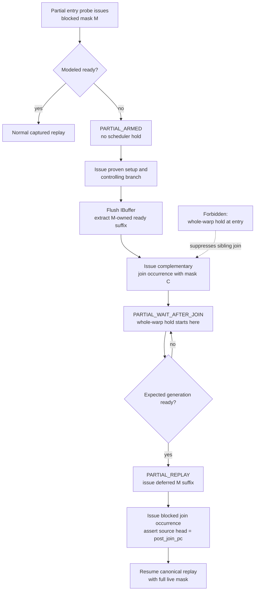

# WaitBlock Simulator: Two Independent Runtime Paths

**Work type:** Simulator runtime design (how the two classified strategies are
executed during trace-driven simulation, including the partial-lane v2 replay
policy).

**Parent index:** [WAIT_BLOCK.md](WAIT_BLOCK.md). The offline classification that
produces the sidecar these paths consume is designed in
[WAIT_BLOCK_POSTPROC.md](WAIT_BLOCK_POSTPROC.md). Shared terminology and hard
invariants are defined once in the parent index and are not repeated here.

The simulator loads two disjoint runtime maps and never shares an action site
between the two strategies.

## 1. Runtime maps

Load two disjoint maps:

```text
missing_wait_by_entry:
    (trace_kernel_id, unique_function_id, entry_probe_pc)
    -> INJECT_MISSING_WAIT record

captured_poll_by_probe:
    (trace_kernel_id, unique_function_id, poll_probe_pc)
    -> FOLD_CAPTURED_POLL record
```

A record cannot appear in both maps for the same runtime action.

The old captured spin-region runtime owner is replaced only after its
`captured_poll_by_probe` entry is installed. This prevents a captured loop from
losing its fold owner.

## 2. Minimal pending state

Only two pending hold modes are required:

```text
NONE
MISSING_WAIT_HOLD
CAPTURED_POLL_HOLD
```

Common state:

```text
strategy and block identity
runtime barrier key
normalized wait state
expected generation
action PC
hold start cycle
```

`CAPTURED_POLL_HOLD` additionally stores:

```text
poll_loop_exit_pc
poll_advance_allowed_pcs
```

There is no deferred-observation state.

## 3. Runtime path A: `INJECT_MISSING_WAIT`

Lookup occurs only at `entry_probe_pc`.

The entry probe executes normally. Runtime then evaluates the modeled wait.

```text
if effective_mask == 0:
    treat the instruction as a predicated-off no-op
    do not require runtime payload
    do not create a hold or advance a cursor

if modeled ready:
    continue normal trace replay

if modeled not-ready and effective_mask == live_mask:
    pin expected generation
    enter MISSING_WAIT_HOLD

if modeled not-ready and effective_mask != live_mask:
    print UNSUPPORTED_PARTIAL_MISSING_WAIT diagnostic
    abort
```

While held, the warp is ineligible and other warps/async engines continue.

On release:

```text
assert current generation == expected generation
clear MISSING_WAIT_HOLD
continue from the existing trace head
```

No IBuffer flush is needed solely for release. No linear or per-PC cursor is
advanced. The captured ready branch executes normally after release.

The partial-mask abort is explicit (`fprintf` plus `abort()` or the repository's
equivalent fatal helper), not a C/C++ `assert()` that can disappear under
`NDEBUG`.

Required partial-miss diagnostic:

```text
cycle
trace kernel and unique function ID
SM, CTA, warp, and entry_probe_pc
active_mask, predicate_mask, effective_mask, and live_mask
barrier address and normalized wait state
current and expected generation
captured ready/poll visit counts
```

This is the entire missing-wait feature and its unsupported-case guard.

> The all-live path above is the v1 baseline. The partial modeled-miss case is
> upgraded from `ABORT` to a deferred-replay capsule by the v2 policy in
> section 10.

## 4. Runtime path B: `FOLD_CAPTURED_POLL`

There is no lookup or action at the WaitBlock entry.

Lookup occurs only when the captured trace reaches `poll_probe_pc`.

The poll probe executes normally.

```text
if effective_mask == 0:
    treat the instruction as a predicated-off no-op
    do not require runtime payload
    do not fold, hold, or advance a cursor

if modeled ready:
    fold residual captured poll-loop occurrences immediately

if modeled not-ready:
    pin expected generation
    enter CAPTURED_POLL_HOLD
```

On release:

```text
assert current generation == expected generation
flush IBuffer and roll back prefetched occurrences
advance residual allowed poll-loop occurrences
assert trace head == poll_loop_exit_pc
clear CAPTURED_POLL_HOLD
resume normal replay at poll_loop_exit_pc
```

This reuses the previously successful captured-spin fold path.

## 5. Exact cursor advance

Cursor advance is used only by `FOLD_CAPTURED_POLL`.

```text
while trace_head_pc != poll_loop_exit_pc:
    assert trace is not exhausted
    assert trace_head_pc in poll_advance_allowed_pcs
    assert current opcode/effect is reviewed
    advance map_warp_traces[pc].num_used_instructions[0]
    advance used_insts

assert trace_head_pc == poll_loop_exit_pc
```

The operation stops before the exit instruction.

The IBuffer flush rolls back prefetched-but-unissued trace occurrences before
the forward skip. Cursor accounting is therefore phase-aware:

```text
cursor_after_flush <= cursor_before_flush
prefetched_rollback = cursor_before_flush - cursor_after_flush
cursor_after_skip >= cursor_after_flush
cursor_after_skip - cursor_after_flush == skipped
trace_head_pc == poll_loop_exit_pc
```

It is invalid to compare `cursor_after_skip - cursor_before_flush` directly
with `skipped`; that net delta also includes the reverse prefetch rollback and
may be negative.

It aborts before consuming:

- `BSYNC`, `BSSY`, or `WARPSYNC`;
- memory, TMA, HGMMA, MUFU, BAR, arrive, or exchange;
- dependency/fence operations;
- indirect control, call, return, exit, or unknown opcode;
- any PC not present in the exact allow set.

The runtime guard is an exact allow check, not a broad denylist.

## 6. Generation and watchdog

Both strategies use the existing generation auditor.

```text
current_gen < expected_gen:
    remain held

current_gen == expected_gen and modeled condition ready:
    release

current_gen > expected_gen:
    abort generation overshoot
```

Generation never force-releases a wait.

The shared wait-hold watchdog threshold is 32,000 cycles. At 32,001 cycles,
emit a full diagnostic and abort.

For long runs, print a low-rate heartbeat every 4,096 held cycles:

```text
cycle, SM, CTA, warp, strategy, block, action PC,
barrier, expected/current generation, held cycles
```

## 7. Scheduler and lifecycle

Wait hold means whole-warp scheduler ineligibility.

`INJECT_MISSING_WAIT` creates a hold only when the current entry occurrence
covers all live lanes. A partial occurrence may replay only when modeled ready;
a partial modeled miss aborts before scheduler state changes.

`FOLD_CAPTURED_POLL` retains the existing poll-site behavior that already
completed K5/K10 before the entry-hold redesign.

Release is owned by one authoritative service. Scheduler sorting,
instrumentation, and stall queries use a non-mutating held-state query.

Before CTA cleanup or warp-slot reuse:

```text
assert pending mode == NONE
assert hold start cycle is clear
assert holds == releases
```

Assertions execute before cleanup resets any state.

## 8. Metrics and debug logs

Keep strategy counters separate.

```text
missing_wait_ready
missing_wait_holds
missing_wait_releases
partial_missing_wait_model_misses

captured_poll_immediate_folds
captured_poll_holds
captured_poll_releases
captured_poll_advanced_occurrences

generation_overshoots
watchdog_aborts
```

A ready `INJECT_MISSING_WAIT` entry is a passthrough, not a fold.
Generation overshoot is not a watchdog event.

Required events:

```text
[WAITBLOCK][missing-wait-hold]
[WAITBLOCK][missing-wait-release]
[WAITBLOCK][UNSUPPORTED_PARTIAL_MISSING_WAIT]
[WAITBLOCK][poll-hold]
[WAITBLOCK][poll-release]
[WAITBLOCK][poll-advance]
[WAITBLOCK][heartbeat]
[WAITBLOCK][abort]
[WAITBLOCK][summary]
```

Poll-advance logs include:

```text
used_insts before/after
per-PC occurrences consumed
skipped opcode counts
expected exit PC
actual landing PC
```

## 9. Feature gating

The v5 runtime has one canonical feature gate and one debug gate:

```text
-wait_block_enable
-wait_block_debug
```

The former `-spin_wait_fold_enable` and `-spin_wait_fold_debug` options are
removed. `FOLD_CAPTURED_POLL` is a strategy selected by v5 sidecar metadata, not
a separately enabled runtime mode. `-spin_wait_observe_enable` remains an
independent read-only measurement option and never creates a hold or advances a
cursor.

With `-wait_block_enable 0`:

- do not require sidecar v5;
- do not build either strategy map;
- do not create pending wait state;
- do not change scheduler eligibility;
- do not flush or advance cursors;
- retain trace replay and metrics exactly relative to the same TMA ownership
  implementation.

With the feature enabled, schema, identity, generation, cursor, or lifecycle
violations abort. Runtime does not silently revert after a hold or cursor
mutation. The partial missing-wait guard is feature-on only; feature-off
remains bit-identical to the same TMA ownership implementation.

## 10. Partial-lane policy and future design boundary

### 10.1 v1 policy: detect and abort

Partial ready-only visits are present in the current trace, but modeled-miss
occurrence cannot be established offline. V1 therefore detects the unsupported
dynamic combination exactly:

```text
captured shape is ready-only
AND effective_mask != live_mask
AND modeled_ready == false
```

V1 behavior is a mandatory diagnostic followed by `abort()`. It must not:

- continue the captured ready path;
- convert the event into a whole-warp wait hold;
- defer blindly to the next all-live occurrence;
- force-release or consume trace occurrences.

This abort is the temporary correctness boundary while partial-lane execution is
designed. It is not the final support mechanism.

Full support requires a separate design for one of:

1. lane-group trace cursors; or
2. a deferred-occurrence queue that preserves blocked-lane instructions and
   their per-PC payloads while allowing disjoint-lane occurrences to issue.

That design must preserve:

- per-lane instruction order;
- the linear and per-PC trace occurrence cursors;
- IBuffer prefetch and rollback;
- branch/reconvergence ordering;
- scoreboard/dependency state;
- execution counters and semantic-work invariants;
- deterministic merge of deferred occurrences after modeled release.

The `UNSUPPORTED_PARTIAL_MISSING_WAIT` abort remained enabled until the v2
design below replaced it. The K5 `.e80` server run that first exercised this v1
boundary is recorded in [WAIT_BLOCK_HISTORY.md](WAIT_BLOCK_HISTORY.md).

### 10.2 Approved v2 partial policy: defer blocked suffix, issue join, then hold

The design review selected a bounded deferred-occurrence implementation. It
does not add general lane-group cursors and it does not permit a whole-warp hold
at the partial entry.

The action remains a sub-policy of a ready-only `INJECT_MISSING_WAIT` record:

```text
partial_modeled_miss_action = DEFER_BLOCKED_SUFFIX_THEN_HOLD
partial_hold_proof_version = 1
```

This metadata changes the mandatory partial action from `ABORT` to a
cursor-owning replay contract and therefore requires a sidecar schema bump.
Schema v4 remains the current implemented format; the approved implementation
must emit and require schema v5.

The entry probe still owns the modeled readiness observation. The scheduler
hold, however, starts only after the complementary lane group has issued its
proven join occurrence.

#### Partial-miss execution flow



The two lane groups have different logical positions while the scheduler hold
is active:

```text
blocked lanes M:
    virtual uncaptured wait arm

complementary lanes C:
    join occurrence already issued

canonical source cursor:
    parked at post_join_pc

deferred replay queue:
    owns every blocked-lane occurrence from captured_ready_pc through the
    blocked join occurrence
```

This distinction is mandatory. The earlier K10 failure demonstrated:

```text
clean:
    0xa9c0 miss
    -> complementary WARPSYNC 0xb2c0 issues
    -> lane 0 reaches captured poll 0xb980
    -> hold and release

failed:
    whole-warp hold at partial entry 0xa9c0
    -> complementary 0xb2c0 never issues
    -> barrier 0x31020 remains at generation 0
    -> watchdog
```

A static branch target at a join proves the sibling lane's logical destination.
It does not prove that the corresponding dynamic join occurrence has already
issued in the linear trace-driven simulator.

#### Post-processing proof

Post-processing combines static CFG/SASS proof with the existing full dynamic
mask scan. It does not attempt to prove EXCH, ARRIVE, TMA, or transitive release
dependencies. Release liveness remains guarded by the runtime generation audit
and 32,000-cycle watchdog.

For each partial-capable ready-only record, emit:

```text
entry_probe_pc
entry_setup_pcs
entry_branch_pc
entry_branch_not_ready_polarity
miss_arm_entry_pc
miss_arm_wait_pcs
miss_arm_loopback_pc
miss_arm_exit_pc
captured_ready_pc

sibling_branch_pc
sibling_branch_target_pc
join_pc
post_join_pc
join_kind
observed_entry_masks
observed_sibling_masks
observed_live_masks

complementary_masks_complete
sibling_join_only
blocked_path_reaches_same_join
linear_capsule_safe
```

The static proof must establish:

1. `entry_probe_pc` defines the predicate consumed by `entry_branch_pc`.
2. The not-ready branch targets `miss_arm_entry_pc`.
3. The not-ready arm is a bounded pure wait/control/backoff region.
4. All arm waits use the same normalized barrier and wait-state expressions as
   the entry.
5. The arm exits to `captured_ready_pc`.
6. A dominating sibling branch sends the complementary path to `join_pc`.
7. The blocked path also reaches `join_pc`.
8. `join_pc` is `WARPSYNC` or a statically matched `BSSY`/`BSYNC`.
9. `post_join_pc` is the first instruction after the join.
10. There is no unresolved indirect control, call, return, or exit inside the
    capsule boundary.

For each validated dynamic partial visit:

```text
M = entry effective_mask
C = live_mask & ~M
```

The dynamic proof must establish:

1. `M` and `C` are both nonzero, disjoint, and their union is `live_mask`.
2. Before the entry, the sibling branch occurrence executes with mask `C` and
   targets `join_pc`.
3. From that branch through the capsule, the only `C` occurrence is the sibling
   join occurrence.
4. Every blocked-path occurrence has raw active mask contained in `M`.
   Ownership uses raw `active_mask`, not `effective_mask`, so predicated-off
   instructions retain their lane-group identity.
5. The blocked and sibling join occurrences use the same `join_pc`, have
   disjoint masks, and their union is `live_mask`.
6. The next occurrence at `post_join_pc` covers `live_mask`.
7. No mixed-mask occurrence, unclassified lane group, or trace exhaustion is
   encountered before `post_join_pc`.
8. Every deferred occurrence retains its complete dynamic payload. Semantic
   instructions are moved to replay storage, never skipped.

The full K5/K10 trace currently has four proven sibling-quiescence regions:

```text
K5  0x93b0:
    sibling branch 0x9220 -> WARPSYNC 0x9500
    post-join 0x9510

K5  0x9930, 0x9aa0:
    sibling branch 0x97b0 -> BSYNC 0x9c20
    post-join 0x9c30

K5  0xab40, 0xabc0, 0xac00:
    sibling branch 0xaaf0 -> BSYNC 0xac80
    post-join 0xac90

K10 0x9ef0, 0xa460, 0xa810, 0xac10, 0xb000:
    sibling branch 0x9ea0 -> WARPSYNC 0xb2c0
    post-join 0xb2d0
```

Across all 4,596 observed partial visits, complementary lanes perform no
semantic work after their branch. They wait at the listed join while lane 0
executes the blocked path. K10 `0xa460` and `0xa810` may revisit the same entry
before the distant `0xb2c0` join; this is a long blocked-lane path, not evidence
of runnable sibling work.

The implemented schema-v5 generator passes a strict K5/K10 full-trace scan:

```text
[wait-block] TOTAL discovered=41 passed=36 failed=0 skipped=5
[wait-block] READY visits all_live=76224 partial=4596
[wait-block] PARTIAL defer_records=11
             join_pending=2076
             join_already_issued=2520
[wait-block] FINAL status=PASS validation_complete=true
```

The pending/already-issued split is visit-specific. A K10 entry may first occur
before the complementary `0xb2c0` occurrence and later repeat after that
occurrence has issued. The simulator must track the region's runtime join state;
it must not infer it from the entry PC alone.

If any static or dynamic condition is not proven, retain:

```text
partial_modeled_miss_action = ABORT
```

#### Runtime state

The partial sub-policy needs one bounded per-warp capsule:

```text
NONE
PARTIAL_ARMED
PARTIAL_EXTRACT
PARTIAL_WAIT_AFTER_JOIN
PARTIAL_REPLAY
```

Common capsule state:

```text
block and action identity
blocked mask M
sibling mask C
barrier key and wait state
expected generation
entry branch PC
captured ready PC
join PC and post-join PC
hold start and heartbeat cycles
owned deferred-occurrence queue
sibling-join-issued flag
source cursor audit coordinates
```

There is still one authoritative linear source cursor. The deferred queue is a
temporary owner of already-extracted occurrences, not a second lane-group trace
cursor.

#### Entry and arming

At `entry_probe_pc`:

```text
effective_mask == 0:
    architectural no-op

modeled ready:
    normal replay

modeled miss and effective_mask == live_mask:
    existing MISSING_WAIT_HOLD

modeled miss and effective_mask != live_mask
and partial proof is absent:
    UNSUPPORTED_PARTIAL_MISSING_WAIT
    abort

modeled miss and effective_mask != live_mask
and partial proof is complete:
    pin barrier key, wait state, expected generation, M, and C
    enter PARTIAL_ARMED
    do not change scheduler eligibility
    do not change either trace cursor
```

`PARTIAL_ARMED` permits the sidecar-listed `entry_setup_pcs` and the controlling
entry branch to issue normally. The captured branch occurrence may be
predicated off because the hardware capture was ready. Runtime treats it as the
control marker for the modeled not-ready arm; it does not redirect the canonical
trace to uncaptured PCs.

If any PC other than the proven setup sequence and branch occurs while armed,
abort before extraction.

#### Blocked-suffix extraction

After the controlling branch issues:

1. Flush the warp IBuffer.
2. Audit that every prefetched traced occurrence rolls both source cursors back.
3. Starting at `captured_ready_pc`, inspect source occurrences in linear order.
4. Move every occurrence owned by `M` into the deferred queue, preserving its
   PC, opcode, active/predicate masks, sync payload, memory payload, and original
   sequence identity.
5. Continue until the complementary `join_pc` occurrence owned by `C` is found.
6. Stop with the canonical source head at `post_join_pc`.

Extraction is not poll folding:

```text
fold:
    consume a proven effect-free occurrence permanently

partial extraction:
    transfer ownership of a semantic occurrence from the source stream to the
    deferred replay queue
```

Every extracted source occurrence advances both authoritative source cursors
exactly once:

```text
map_warp_traces[pc].num_used_instructions[0]++
used_insts++
```

Deferred replay must not advance either source cursor again.

#### Sibling join and hold activation

Issue the complementary join occurrence through the normal pipeline. Only after
that issue succeeds:

```text
sibling_join_issued = true
mode = PARTIAL_WAIT_AFTER_JOIN
begin whole-warp scheduler hold
```

The reordered complementary join and the later replayed blocked join still use
the normal instruction pipeline for timing and accounting, but they bypass the
legacy whole-warp barrier rendezvous update. The capsule itself owns this
two-group rendezvous and prevents `post_join_pc` from issuing until both join
occurrences have issued. Canonical, non-replayed joins keep the existing barrier
behavior unchanged.

At this point the scheduler-level hold is valid:

```text
blocked lanes:
    logically waiting in the uncaptured pure wait arm

complementary lanes:
    have actually issued their join occurrence

runnable lanes:
    none
```

The whole-warp hold must never begin in `PARTIAL_ARMED` or
`PARTIAL_EXTRACT`.

#### Release and deferred replay

The existing generation and watchdog service owns release:

```text
current_gen < expected_gen:
    remain held

current_gen == expected_gen and modeled condition ready:
    enter PARTIAL_REPLAY

current_gen > expected_gen:
    abort generation overshoot
```

On release, issue deferred occurrences through the normal pipelines in their
original blocked-lane order. They retain their captured dynamic payloads and
therefore execute semantic work such as ARRIVE, TMA, local memory, and
WARPSYNC normally.

If a deferred suffix contains a sidecar-owned `FOLD_CAPTURED_POLL`, its
residual polling occurrences are folded inside the deferred replay stream.
They must not advance the canonical source cursor, which already landed at
`post_join_pc` during capsule extraction.

For K5 `0x93b0`, the capsule is:

```text
deferred:
    0x9400 ... 0x9500, mask 0x1

sibling join:
    0x9500, mask 0xfffffffe

canonical landing:
    0x9510, mask 0xffffffff
```

The deferred `0x94d0` ARRIVE and `0x94e0` UTMALDG execute only after release.

When the deferred blocked join occurrence issues:

```text
assert sibling_join_issued
assert deferred queue is empty
assert canonical source head == post_join_pc
clear partial capsule
resume canonical replay at post_join_pc
```

#### Nested partial entries

A long deferred blocked path may contain another ready-only partial entry. This
occurs in the current K5 and K10 traces.

The implementation does not create a second capsule or a second source cursor.
During `PARTIAL_REPLAY`, a later partial modeled miss with the same blocked mask
may suspend the existing replay queue and enter another
`PARTIAL_WAIT_AFTER_JOIN`, because the complementary join has already issued.
After release, replay resumes from the same queue head.

Abort if:

- the nested blocked mask differs;
- a second complementary join is requested;
- the nested record names a different capsule boundary;
- any source-cursor extraction is attempted while replaying an existing
  capsule.

#### Cursor, lifecycle, and runtime guards

Required invariants:

```text
extracted_blocked == replayed_blocked at capsule close
each source occurrence is extracted at most once
each deferred occurrence is issued exactly once
deferred replay never increments a source cursor
sibling join issues exactly once
post_join_pc never issues before both lane groups reach the join
no capsule survives CTA cleanup or warp-slot reuse
```

Any mismatch aborts with:

```text
trace kernel, function, CTA, warp
entry and join PCs
blocked, sibling, and live masks
source cursor before/after flush and extraction
deferred queue size and replay index
expected/current generation
```

Post-processing deliberately does not admit or reject this policy from EXCH,
ARRIVE, TMA, or producer-warp dependency analysis. A release dependency cycle
is a runtime liveness failure and is handled by the existing generation audit,
4,096-cycle heartbeat, and 32,000-cycle watchdog abort.

Before this v2 design was implemented, the v1
`UNSUPPORTED_PARTIAL_MISSING_WAIT` abort remained mandatory.

## 11. Focused tests

Post-processing:

- missing `enhanced_execution_info.json` aborts automatic generation;
- missing `sync_operand_resolver.json` aborts automatic generation;
- an empty resolver with no static wait opcode emits a valid empty v5 sidecar;
- an empty resolver with static wait opcodes aborts;
- `failed=0` cannot produce a strategy-proof strict failure;
- `failed>0` exits before output publication;
- a published sidecar prints the complete `FINAL` summary as the last log line;
- `TRIM_SPIN` runs before strict sidecar generation;
- ready-only/all-live gate emits `INJECT_MISSING_WAIT`;
- ready-only/partial-mask gate emits `INJECT_MISSING_WAIT`, records its masks,
  and declares `partial_modeled_miss_action=ABORT`;
- partial visit and partial-record report counts reconcile with raw trace visits;
- a v2 partial candidate emits
  `partial_modeled_miss_action=DEFER_BLOCKED_SUFFIX_THEN_HOLD` only when all
  static CFG, wait-arm, join, and full-trace mask proofs pass;
- every v2 partial visit has a complementary branch occurrence before the entry,
  a complementary join occurrence, a blocked join occurrence, and a full-mask
  `post_join_pc`;
- a complementary semantic occurrence, mixed pre-join mask, unresolved join,
  mismatched wait arm, or incomplete payload retains `ABORT`;
- the current 4,596 partial visits reconcile with the four reviewed
  sibling-quiescence regions;
- any record owning a foldable captured loop emits
  `FOLD_CAPTURED_POLL`, never `INJECT_MISSING_WAIT`;
- unsafe loop effects or dependency barriers reject poll folding;
- a loopback predicate unrelated to the selected poll rejects poll folding;
- wait probes with different barrier or wait-state operands reject poll folding;
- a non-idempotent `IMAD` rejects poll folding;
- a loopback scoreboard wait on an externally armed barrier rejects poll folding;
- K5/K10 action counts and PC anchors match the reviewed sidecar;
- duplicate kernel/function/action-PC identities are rejected.

Runtime path A:

- ready entry performs no hold and no cursor change;
- ready partial entry performs no hold and replays normally;
- not-ready all-live entry holds and releases at the expected generation;
- under the historical v1 implementation, a not-ready partial entry prints the
  complete diagnostic and aborts before scheduler or cursor mutation;
- release preserves both trace cursors;
- the guard remains disabled when `-wait_block_enable 0`.

Runtime partial v2:

- a partial miss enters `PARTIAL_ARMED` without a scheduler hold;
- only proven entry setup PCs and the controlling branch may issue while armed;
- IBuffer rollback precedes extraction;
- blocked occurrences are moved with complete payloads and are not issued;
- the complementary join occurrence issues before any whole-warp hold begins;
- the canonical source cursor lands exactly at `post_join_pc`;
- release replays every deferred occurrence exactly once without advancing a
  source cursor again;
- semantic, TMA, local-memory, and join occurrences in the deferred queue issue
  normally after release;
- nested partial misses may suspend one existing replay queue only when their
  blocked mask and capsule boundary agree;
- no partial capsule or deferred occurrence survives CTA cleanup or warp-slot
  reuse;
- any extraction, mask, landing, replay-count, generation, or lifecycle
  mismatch aborts.

Runtime path B:

- ready poll folds immediately to the local exit;
- not-ready poll holds, releases, and folds to the local exit;
- both cursors advance consistently;
- the exit instruction is not consumed;
- an unexpected complementary-lane or semantic occurrence aborts before it is
  consumed.

K5:

- `0x74e0` uses `INJECT_MISSING_WAIT`;
- `0x9e80` has no entry action;
- `0xb1f0` uses `FOLD_CAPTURED_POLL`;
- landing PC is `0xb210`;
- `BSYNC 0xa150` executes normally.

K10:

- `0xa9c0` uses `FOLD_CAPTURED_POLL`;
- landing PC is `0xb9a0`;
- `WARPSYNC 0xb2c0` executes normally.

## 12. Implementation order

The two-strategy design, v4 classification, and v5 partial-replay simulator were
implemented and full-trace validated. The detailed step-by-step `[done]` log of
this implementation order, together with each K5/K10 server run
(`.e80`–`.e83`) and the bugs it exposed and fixed, is preserved in
[WAIT_BLOCK_HISTORY.md](WAIT_BLOCK_HISTORY.md). The current authoritative status
and remaining work are tracked by the scope table in
[WAIT_BLOCK.md](WAIT_BLOCK.md).
