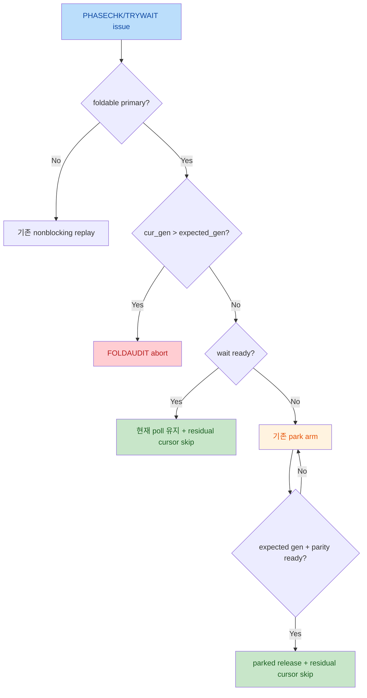

# Spin-wait fold root-cause 확인 및 수정 계획

## Summary

Section 15의 K5 `.e72/.o72` 결과는 `consumer compute pacing`을 고치기 전에
**fold의 immediate-ready 경로를 먼저 바로잡아야 한다**는 것을 보여준다.
K10도 같은 결함을 실행했지만, residual replay가 다음 barrier flip 전에 끝나
deadlock이나 `[FOLDAUDIT]`로 확대되지 않았을 뿐이다.

Holistic review에서 더 선행하는 blocker도 확인됐다. TMA load completion이 exact transfer
identity 없이 warp별 barrier FIFO를 credit하므로 out-of-order completion이 잘못된 barrier를
flip한다. 따라서 기존 K5/K10 barrier timeline은 immediate-ready bug뿐 아니라 TMA credit
misbinding에도 오염되어 있다. Stage 0.1/0.2를 먼저 통과하기 전에는 consumer compute
pacing을 root cause로 판정하지 않는다.

현재 fold 설계는 `primary_wait_pc`에서 다음 두 경로 모두 residual trace poll을
`exit_pc`까지 건너뛰어야 한다.

- not-ready: park 후 barrier가 만족되면 `skip_spin_to_exit(exit_pc)`
- ready-at-issue: 즉시 `skip_spin_to_exit(exit_pc)`

실제 구현은 첫 번째 경로에만 skip이 있다. 두 번째 경로는 generation만 기록하고
capture-time loop를 계속 replay한다. 따라서 이미 만족된 논리적 wait가 다음 barrier
flip까지 재실행되고, 그 뒤 동일 PC에서 새 generation을 기다리며 false park/deadlock에
들어갈 수 있다.

지금은 코드와 기존 문서를 수정하지 않는다. 다음 구현 단계에서는 이 fold semantic
결함만 먼저 고치고 generation audit을 hard assert로 복원한다. 그 결과로도 남는
`[FOLDAUDIT]`만 consumer/TMA/compute pacing 결함의 유효한 증거로 취급한다.

## Current State Analysis

### 1. Section 15의 집계값은 로그와 일치한다

- K10 `.o46`: `gpu_sim_cycle = 133796`, clean exit, 모든 `[FOLDSUM] late_releases=0`
- K5 `.e72`: `[FOLDAUDIT]` 232건
  - 231 `late_fold_release`
  - 1 watchdog abort
- K5 late-release 분포:
  - `0x16c68/0xb370`: 105
  - `0x16c60/0xb370`: 89
  - `0x16c20/0xb0b0`: 14
  - 나머지: 23
- generation overshoot delta는 1/3/5/7로 모두 odd이며 parity 계산 자체는 일관된다.

### 2. 설계와 구현이 ready-at-issue 경로에서 불일치한다

- 설계: `.plan/SPIN_WAIT_SIM_MODELING.md`는 ready primary poll에서 B2 cursor skip을
  수행하도록 명시한다.
- Sidecar loader: `gpu-sim.cc:665-710`은 region을 `(uid, primary_wait_pc)`로 등록한다.
- Ready branch: `sm.cc:2680-2734`는 foldable primary poll이 ready여도
  `m_fold_last_gen`만 갱신하고 pending wait를 clear한다. IBuffer flush와
  `skip_spin_to_exit()` 호출이 없다.
- Skip의 유일한 호출: `sm.cc:2412-2416`, 즉 park 이후
  `service_fold_release()` 경로뿐이다.

### 3. Immediate-ready의 정확한 instruction 순서

`SM::issue_warp()`의 현재 순서는 다음과 같다.

1. `sm.cc:1205`에서 `IBuffer_Remodeled::issued()`가 current primary poll을 IBuffer에서
   제거한다.
2. `sm.cc:1207-1217`에서 그 poll을 issue하고 functional execution을 수행한다.
3. `sm.cc:1252-1253`에서 `handle_sync_instruction()`이 같은 issue cycle에 barrier
   ready 여부를 판정한다.

따라서 ready이면 current poll은 이미 정상적으로 실행된 instruction이다. 올바른
immediate fold는 **같은 issue cycle 안에서** younger prefetched entries만
`flush(false)`로 되돌리고, 현재 trace cursor 다음부터 `exit_pc` 직전까지
`skip_spin_to_exit()`로 소비해야 한다. `exit_pc` 자체는 skip하지 않는다.

그 결과 warp의 **다음 동적 instruction은 `exit_pc`**가 된다. 다만 IBuffer refetch,
scoreboard, scheduler 때문에 `exit_pc`가 반드시 global cycle `N+1`에 issue된다는 뜻은
아니다. earliest subsequent issue opportunity에 실행된다.

### 4. K5 hard abort는 pacing miss가 아니라 ready-exit 누락으로 직접 설명된다

SM29 `0x16c20/0xb0b0` timeline:

1. gen1 open: cycle 49,369
2. producer parity-0 poll immediate-hit: cycle 55,835
3. 추가 immediate-hit 7회: cycle 55,855 ... 55,948
4. gen2 close: cycle 55,950
5. 동일 logical loop가 다시 poll하여 park: cycle 55,961,
   `expected_gen=3`, `barrier_gen=2`
6. 구조상 세 번째 flip이 없어 watchdog abort: cycle 87,962

따라서 Section 16의 “producer가 window를 놓쳤다”는 해석은 이 SM에 대해 사실과
반대다. producer는 gen2보다 115 cycle 먼저 window 안에 도착했다. 첫 hit에서 fold가
설계대로 exit했어야 한다.

### 5. K10에도 같은 latent bug가 있었다

K10 `.e46`의 SM35/global CTA302 producer에서 같은 residual replay가 직접 보인다.

| barrier | gen1 open | first ready hit | last repeated hit | gen2 close | repeated hits |
|---|---:|---:|---:|---:|---:|
| `0x31020` | 116,942 | 117,034 | 119,672 | 124,639 | 185 |
| `0x31028` | 121,213 | 121,388 | 123,757 | 128,296 | 165 |

- 정상 fold라면 각 first ready hit에서 exit해야 하므로, 합계 348회는 실행되면 안 되는
  residual primary polls이다.
- `.o46 [PRODSPIN]`도 global CTA302에서 `ready_run_retries=355`를 기록한다.
  전체 K10은 384 CTA에서 `ready_run_retries=1480`, median 3, max 355다.
- K10에서 audit가 0인 이유:
  - `0x31020` gen1 window는 7,697 cycle이고 residual replay span은 2,638 cycle이다.
    loop가 gen2보다 4,967 cycle 먼저 끝났다.
  - `0x31028` window는 7,083 cycle이고 residual span은 2,369 cycle이다.
    loop가 gen2보다 4,539 cycle 먼저 끝났다.
  - 즉 capture-time branch가 다음 flip 전에 loop를 끝냈으므로 parity가 되돌아오지 않았고,
    다음 logical wait는 정상적으로 gen2에 park/release했다.
- K5 SM29는 first ready hit부터 gen2까지 115 cycle뿐이어서 residual replay가 실제 flip을
  가로질렀다. 동일 결함이 K5에서는 hard failure, K10에서는 cycle over-replay로 나타난다.

따라서 K10의 clean exit와 zero audit은 fold semantic correctness 증명이 아니다.
K10 133,796 cycle도 immediate-ready residual cost가 포함된 값이므로 corrected fold에서
변할 수 있다.

### 6. “348 extra primary polls”의 정확한 의미

이 수치는 fold region을 post-processing이 못 찾았다는 뜻이 아니다.

- K10 sidecar는 두 region을 정상적으로 `foldable=true`로 탐지했다.
  - loop head `0xb960`, `primary_wait_pc=0xb980`, runtime barrier `0x31020`
  - loop head `0xb820`, `primary_wait_pc=0xb840`, runtime barrier `0x31028`
- `-spin_wait_fold_enable=1`도 활성화되어 있었고, 같은 region의 not-ready 방문에서는
  `[FOLD] park`와 `[FOLD] release+skip`이 정상 발생했다.
- 문제는 같은 region을 ready 상태로 처음 방문했을 때 runtime 코드가
  `if (wait_ready)` branch에서 region lookup 후 skip을 하지 않는다는 것이다.

즉 fold는 다음처럼 **부분적으로만 실행**되었다.

| runtime branch | sidecar match | 현재 동작 | 판정 |
|---|---|---|---|
| primary poll not-ready | 성공 | park → flip → release+skip | 구현됨 |
| primary poll ready-at-issue | 성공 | hit 기록 후 capture trace 계속 replay | 누락 |

348은 SM35/global CTA302의 두 producer-side logical waits에서 첫 ready hit 뒤에도
재실행된 primary poll 수의 합이다. post-processing miss가 아니라 runtime ready branch의
semantic action miss다.

### 7. Producer/consumer 범위와 immediate-hit invariant

- K10의 명백한 348회:
  - 전부 `warp=0`
  - producer-side
  - consumer가 empty barrier `0x31020/0x31028`을 flip하기를 기다리는 producer spin
- K5 SM29 hard failure의 8회:
  - 전부 `warp=0`
  - producer-side
  - warp15가 flip하는 cross-warp barrier `0x16c20`의 producer spin
- 전체 K10 로그의 모든 `immediate-hit`가 producer bug라는 뜻은 아니다.
  consumer warp 4-11의 waits와 non-foldable single checks도 정상 immediate-hit을 만들 수
  있다.

Corrected fold의 목표는 **global immediate-hit=0**이 아니다.

Logical foldable region visit별 허용 동작:

1. primary poll이 not-ready:
   - primary miss 1회 실행
   - park
   - barrier flip 시 instruction 재실행 없이 residual cursor skip
   - 그 visit의 primary immediate-hit은 0회
2. primary poll이 ready-at-issue:
   - primary immediate-hit 1회 실행
   - 같은 issue cycle에 residual cursor skip
   - 그 visit의 primary immediate-hit은 정확히 1회
3. 동일 logical visit에서 primary immediate-hit이 2회 이상:
   - 첫 hit에서 exit하지 못했다는 fold invariant 위반

TRYWAIT 등 region의 non-primary wait와 sidecar에서 `foldable=false`인 single check는 이
“visit당 primary hit ≤ 1” invariant의 대상이 아니다.

### 8. 이 자명한 경로가 누락된 이유

- 원래 fold 구현 commit은 “on ready, fast-forward”를 목표로 명시했지만 실제 patch는
  not-ready branch의 park 설정과 `service_fold_release()`만 추가했다. 기존
  `if (wait_ready)` branch에는 skip 처리가 추가되지 않았다.
- 검증이 `[FOLD] park/release+skip` balance 중심이어서, 아예 park하지 않는 ready-at-issue
  path는 `[FOLD]` event와 summary의 검증 대상에서 빠졌다.
- `SYNCDBG immediate-hit`에는 PC/region/exit가 없어서 같은 logical loop의 반복 hit가
  일반 ready event처럼 보였다.
- generation audit 추가 시 immediate hit에서 `m_fold_last_gen`만 갱신해 false generation
  경보를 막았지만, logical loop exit를 수행하지 않는 원래 누락은 그대로 남았다.
- K10은 window가 넓어 clean exit했고, 최초 K5 분석은 “double flip/pacing”에 집중하여
  SM29이 gen2 전에 이미 8회 hit했다는 모순을 원인 판정에 반영하지 못했다.

### 9. Section 15의 systemic pacing 결론도 현재는 오염되어 있다

Offline log scan 결과 231 late-release 중 157건은 같은 SM/barrier의
`expected_gen`에서 이미 immediate-hit 기록이 선행한다. dominant
`0xb370/0x16c60-68`에서는 194건 중 146건이다.

`SYNCDBG immediate-hit`에 wait PC가 없어 이 157건 모두가 동일 region이라고 단정할 수는
없지만, audit stream이 incomplete fold execution의 영향을 크게 받는다는 것은 확실하다.
temporary late-release가 이후 실행을 계속 진행시키므로 첫 오염 이후의 후속 event는
독립 표본도 아니다.

초기 `.e71`의 21개 `0x16c20` poison CTA에는 SM6처럼 첫 parity-0 접근 자체가 gen2
이후인 진짜 missed-window 사례가 존재한다. 그러나 이 run 역시 이전 ready loops의
residual capture-time polls를 replay한 불완전한 fold 위에서 실행되었다. 따라서 그
상대 pacing을 곧바로 consumer WGMMA/MUFU model의 독립 결함으로 귀속할 수 없다.

### 10. 현재 확정 가능한 문제 정의

- 확정:
  - fold ready-at-issue path가 residual poll을 skip하지 않는다.
  - 이 결함이 `.e72`의 유일한 watchdog abort를 직접 만든다.
  - K10도 최소 348개의 명백한 residual primary poll을 실행했다.
  - generation audit은 parity 일관성을 보이지만 입력 execution이 이미 오염되어 있다.
- 아직 미확정:
  - ready-path 수정 후에도 K5가 generation edge를 실제로 놓치는지
  - 남는 miss가 producer path, consumer compute, TMA timing, 또는 shared issue
    contention 중 어디에서 시작되는지
  - K5 +23.1% aggregate error와 inverted role tail이 같은 단일 원인인지

## Proposed Changes

### User-approved scope status

`SKIPPED` means the item is intentionally excluded from the next implementation
pass and must not be implemented unless the user explicitly reopens it.

| Item | Status | Scope decision |
|---|---|---|
| Stage 0.3 startup/provenance | `MINIMAL ONLY` | Keep schema/version, explicit `foldable`, duplicate, non-empty, fold/observe exclusion, extra-metadata, kernel lookup, and CTA-count checks. Skip body-PC/opcode cross-validation and full/untrimmed provenance enforcement. |
| Stage 0.4 generic effect detector | `SKIPPED` | Do not replace the detector with a generic effect/liveness framework in this pass. |
| Stage 0.5 extended lifecycle audit | `PARTIAL ONLY` | Keep CTA-exit pending fold-wait and unassigned TMA-credit checks. Skip additional in-flight/outstanding TMA, per-region balance, cursor-invariant, and BAR-leak assertions. |
| Stage 0.7 barrier re-init epoch | `SKIPPED` | Current FA3 has one EXCH per barrier; do not add generic epoch identity/reset support in this pass. |
| Runtime expected/executed reconciliation | `SKIPPED` | Do not add hot-path per-instruction/per-CTA reconciliation counters. Perform reconciliation offline from existing logs. |
| Full trace or sidecar regeneration | `SKIPPED` | Reuse the existing validated trace and sidecar. Do not regenerate them for this implementation. |
| Compound wait/timeout/acquire generalization | `SKIPPED` | Do not generalize fold semantics to speculative compound waits, timeout exits, or extra acquire/live-out models without a concrete workload. |

### Implementation batching (사용자 승인)

전체 계획을 두 batch로 나누어 구현한다. Batch A(spin-wait root cause)를 먼저
구현하고 K5/K10 12시간 실험으로 검증한 뒤 Batch B(TMA/barrier-timing)로 돌아온다.
이는 상호 의존이 강한 stage를 한 번에 구현하지 않고, root cause 수정 효과를 먼저
독립 검증하기 위한 결정이다.

#### Batch A — Spin-wait root cause 수정 (먼저 구현 → 12시간 실험)

| Stage | 내용 | 이 batch에서의 수준 |
|---|---|---|
| Stage 1 | immediate-ready fold semantic 수정. ready path에서도 `skip_spin_to_exit()`. park/immediate 공통 cursor-skip helper 통합 | FULL |
| Stage 0.10 | immediate-ready path에 `expected_gen` 계산 + `cur_gen > expected_gen` audit abort 추가 | Option A(최소): 기존 per-(warp,barrier) `m_fold_last_gen` 유지, FoldVisitState는 도입하지 않음 |
| Stage 1.1 | `immediate_folds`/`immediate_skipped_insts` 신규 통계 분리. `parks/releases`는 실제 park만 | FULL |
| Stage 1.2 | immediate path diagnostic state를 정확히 한 번만 close, `[FOLD] immediate+skip` 로그 | FULL |
| Stage 1.4 | `body_pcs` sidecar 로드 + `skip_spin_to_exit()` semantic guard + `FoldSkipStats` | FULL |
| Stage 2 | `late_fold_release` continuation 제거 → hard abort 복원, watchdog 유지 | FULL |

Batch A에서 제외(이 batch 한정 SKIP, Batch B/실험 후로 이월):

- Stage 1.3 fold-aware metric integrity (HOL/overlap/mufu/producer_tail) — root cause 수정과 독립. 실험 분석 시 필요하면 Batch B.
- Stage 1.5 runtime reconciliation — 계획상 runtime SKIPPED, 로그 offline 분석.
- Stage 1.6 abort-time emergency dump — 선택적, 핵심 수정에는 불필요.
- Stage 0.10 Option B(FoldVisitState).

Batch A 완료 후: 빌드 확인 → 사용자가 K5/K10 12시간 실험 실행 → root-cause decision gate로 판정.

#### Batch B — TMA & barrier-timing (실험 후 복귀)

| Stage | 내용 |
|---|---|
| Stage 0.1 | TMA completion UID별 exact credit. 먼저 기존 로그/트레이스로 same-warp UID inversion과 partial-consume 걸침 존재를 검증한 뒤 구현 범위 확정 |
| Stage 0.2 | fold release를 SM cycle-start 단일 phase로 이동 |
| Stage 0.3 | fold startup/provenance fail-fast (`MINIMAL ONLY`) |
| Stage 0.5 | lifecycle cleanup assert (`PARTIAL ONLY`) |
| Stage 0.6 | mbarrier active-mask / payload fail-fast |
| Stage 0.8 | watchdog/kernel scope config 분리 |
| Stage 0.9 | mbarrier-only predicate를 named BAR와 분리 |
| Stage 1.3 | (Batch A에서 이월된 경우) fold-aware metric integrity |

Batch B 제외(계획상 SKIPPED 유지): Stage 0.4, 0.7, full trace/sidecar regen, runtime reconciliation.

#### Stage 3/4 (최종)

- Stage 3: corrected run 결과로 pacing 원인 재분류(코드 아님, 분석).
- Stage 4: `.plan/SPIN_WAIT_SIM_MODELING.md` 최종 갱신(모든 구현/검증 완료 후).

### Stage 0. Fold 이전의 barrier-timing blocker를 먼저 제거한다

Holistic review 결과 immediate-ready path보다 먼저 고쳐야 하는 두 timing blocker가
확인됐다. 이 둘이 남아 있으면 corrected fold run의 barrier generation/window 자체가
ground truth가 아니다.

#### Stage 0.1. TMA completion을 transfer UID별 exact barrier credit으로 변경

현재 `ARRIVE_EXPECT_TX`는 `(warp -> pending barrier FIFO)`에 bytes를 넣고, TMA load completion은
`notify_tma_completion(warp_id, bytes)`만 호출한다. 동일 warp의 TMA load가 out-of-order
완료되면 나중 transfer가 앞 barrier를 credit한다.

로그 증거:

- K5 same-warp load completion UID inversion: 32회
- K10 inversion: 5,554회
- pending barrier binding depth: 최대 5
- K5 SM72:
  - `0x16c30` bind @6,989 → uid6 enqueue @7,002
  - `0x16c00` bind @7,286 → uid7 enqueue @7,307
  - uid7이 @8,400에 먼저 완료되지만 FIFO head `0x16c30`을 credit/flip
  - uid6은 @8,510에 완료되어 다음 `0x16c00`을 credit

수정:

- `ARRIVE_EXPECT_TX`는 warp별 **unassigned credit ranges**를 issue order로 생성한다.
- 각 real TMA LOAD가 enqueue될 때 자신의 `transfer_uid/total_bytes`를 pending range에
  issue-order로 배정한다.
  - 한 transfer가 여러 barrier range에 걸치거나
  - 한 barrier expected bytes가 여러 transfer에서 채워지는 경우를 모두 지원
- `TMATransferEntry`가 `vector<{barrier_key, bytes}> completion_credits`를 직접 보유한다.
- completion은 UID에 붙은 exact credit vector만 적용한다. Completion order와 무관하다.
- `notify_tma_completion(warp_id, bytes)`와 anonymous FIFO consumption을 제거한다.
- transfer bytes가 unassigned로 남거나 pending range보다 부족/초과하면 hard assert한다.
- `[TMADBG] load-mbarrier-credit`에
  `uid/barrier/credit_bytes/remaining_for_barrier`를 출력한다.

이 수정이 통과하기 전에는 `0x16c20/0x16c50/empty barrier` pacing 결론을 내리지 않는다.

#### Stage 0.2. Fold release를 SM cycle-start의 단일 phase로 이동

현재 각 subcore가 자기 `issue()` 시작 시 release를 service한다. 앞 subcore가 같은 cycle에
barrier를 flip하면 뒤 subcore는 그 cycle에 release될 수 있지만, 뒤 subcore가 flip하면 앞
subcore는 다음 cycle까지 기다린다. 최대 1-cycle의 subcore-order bias가 생기며, 기존 K5에는
실제로 +1 cycle poison 사례가 있었다.

수정:

1. `m_tma_unit_shared_of_sm->cycle()`까지 완료
2. 모든 hardware warp의 fold release를 SM-level에서 한 번 service
3. 그 뒤 4개 subcore issue

- TMA completion처럼 cycle-start에 도착한 event는 모든 subcore에 동일하게 보인다.
- 같은 cycle의 subcore-issued ARRIVE는 다음 cycle release에 반영된다.
- `Subcore::modify_warp_state()`의 per-subcore release 호출은 제거한다.

### Stage 0.3. Fold startup/provenance를 fail-fast로 만든다 (`MINIMAL ONLY`)

Fold enabled validation run은 다음을 모두 hard-check한다.

- sidecar schema/version 정확 일치
- sidecar가 비어 있지 않음
- explicit `foldable` 필드 존재(legacy fallback 금지)
- `(trace_kernel_id, unique_function_id, primary_wait_pc)` duplicate 없음
- `validated_ctas == trace grid CTA count`
- sidecar body PC/opcode가 현재 enhanced execution info와 일치
  - `SKIPPED`: 다음 재구현에서는 이 cross-validation을 추가하지 않는다.
- full/untrimmed trace provenance 확인
  - `SKIPPED`: 다음 재구현에서는 runtime provenance enforcement를 추가하지 않는다.
- `spin_wait_fold_enable && spin_wait_observe_enable` 조합 금지
- validation bootstrap에서 K5 8개, K10 6개 foldable region을 출력하고 현재 trace와 대조

Runtime lookup key에도 `trace_kernel_id`를 포함한다. 동일 function/PC를 재사용하는 여러 kernel
launch가 마지막 sidecar record로 덮어써지는 것을 막는다.

### Stage 0.4. Detector를 opcode 목록이 아닌 effect contract 기반으로 변경 (`SKIPPED`)

> 사용자 결정으로 다음 재구현 범위에서 제외한다. 아래 내용은 재검토 시 참고할
> historical design이며 현재 구현 항목이 아니다.

현재 K5/K10 foldable 14개 body가 `TRYWAIT/NANOSLEEP/PHASECHK`, 선택적 `IMAD.U32`,
loopback `BRA`만 사용한다는 사실은 regression fixture로 유지하되 generic 허용 목록으로
사용하지 않는다.

Static instruction decoder가 각 opcode를 다음 effect metadata로 분류한다.

```text
InstructionEffects:
  wait_observation             # PHASECHK/TRYWAIT 계열
  backoff_delay_only           # sleep/yield 계열
  register_defs / register_uses
  predicate_defs / predicate_uses
  memory_read/write_space      # local/shared/global/const
  atomic_or_reduction
  async_launch_or_completion
  sync_state_mutation          # ARRIVE/EXCH/BAR
  fence_or_ordering
  control_flow                 # BRA/CALL/RET/EXIT
  nondeterministic_read        # clock/timer/special-state
  scoreboard_arms / scoreboard_waits (ordered)
```

Foldable region의 generic proof:

1. CFG가 하나의 loopback과 하나의 exit만 가지며 CALL/RET/nested side exit가 없음
2. 제거되는 wait는 side-effect 없는 observation/retry임
3. backoff instruction은 fold park가 대체하는 delay-only effect임
4. pure ALU instruction은 모든 register/predicate def가 loop-local이고 exit에서 live-out이 아님
5. memory/atomic/TMA/sync mutation/fence/nondeterministic read가 없음
6. scoreboard arm/wait를 instruction 순서와 predication까지 반영해 한 iteration 실행 전후
   상태가 동일함
7. unknown opcode/effect는 기본적으로 unsafe(fail closed)

따라서 다른 application에서 `IADD/LOP3/SHF` 같은 scratch 계산이 추가돼도 live-out이 없으면
허용할 수 있다. 반대로 이름이 익숙해도 외부 상태나 live-out을 만들면 거부한다.

`STL/LDL` 같은 local memory도 기본 unsafe다. 별도 dead-store/alias/timing proof 없이는
허용하지 않는다.

기존 set-based `barrier_self_tied`는 보조 evidence로만 유지한다. Effect analysis와 runtime
body-PC/occurrence/effect guard(§1.4)가 최종 authority다.

### Stage 0.5. Lifecycle cleanup을 assert-first로 변경 (`PARTIAL ONLY`)

다음 재구현에서는 CTA-exit의 pending fold wait와 unassigned TMA credit 검사만 유지한다.
아래 항목 중 CTA TMA in-flight/outstanding, per-region balance, cursor invariant, BAR leak
추가 검사는 사용자 결정으로 `SKIPPED`다.

CTA exit/slot reuse 전에 다음을 assert한다.

- valid pending fold wait = 0
- 해당 CTA warp의 `m_fold_park_start_cycle` 모두 inactive
- pending unassigned TMA credit range = 0
- 해당 CTA TMA in-flight/outstanding transfer = 0
- per-region parks == parked releases
- immediate/parked cursor invariant PASS
- BAR leak = 0

검증 후에만 barrier/generation/FOLDPACE/TMA state를 clear한다. 현재처럼 cleanup이 문제 state를
조용히 삭제하지 않는다. Warp slot launch에서는 park timestamp와 fold-local state를 명시적으로
reset한다.

### Stage 0.6. MBARRIER active-mask와 required payload를 fail-fast로 처리

- `active_count()==0`인 MBARRIER instruction은 named BAR와 동일하게 no-op 처리한다.
- foldable primary 또는 required EXCH/ARRIVE가 active인데 sync site/runtime payload가 없으면
  budgeted warning이 아니라 unbudgeted fatal이다.
- predicated-off PHASECHK/EXCH/ARRIVE가 barrier state를 바꾸거나 warp를 park/skip하지 못하게 한다.

### Stage 0.7. Barrier re-init epoch를 명시한다 (`SKIPPED`)

> 사용자 결정으로 다음 재구현 범위에서 제외한다. 현재 FA3의 barrier별 EXCH 1회
> contract를 사용하며 generic re-init epoch는 구현하지 않는다. 아래 내용은 향후
> cross-application 확장 참고용이다.

현재 EXCH는 count만 reset하고 `phase/gen/flip history/m_fold_last_gen`을 유지한다. 같은 barrier
key가 CTA 안에서 두 번 init되면 이전 generation epoch를 상속한다.

- EXCH는 이 모델에서 shared-memory mbarrier object의 init/reset instruction이다.
  `semantic_raw`에서 expected arrival count를 설정하고 arrive/tx accumulator를 초기화한다.
- 현재 FA3 contract는 barrier별 EXCH 정확히 1회라 repeated-init path가 실행되지는 않는다.
  그러나 두 번째 EXCH 자체를 금지하지 않고 generic epoch reset을 구현한다.
- EXCH마다:
  - `init_epoch++`
  - 새 epoch의 phase/gen/flip history를 ISA-defined 초기값으로 reset
  - `(warp,barrier,old_epoch)` consumed-generation state 제거
  - pending wait와 TMA completion credit에 epoch를 포함
- Assert 대상은 “두 번째 EXCH”가 아니라 invalid re-init이다.
  - old epoch pending wait가 존재
  - old epoch에 아직 배정되지 않은 TMA credit이 존재
  - old epoch TMA transfer가 in-flight인데 epoch identity 없이 새 barrier에 도달 가능
  - barrier state reset 전에 old/new epoch를 구분할 수 없음
- old TMA transfer는 자신의 old epoch key만 credit해야 하며, new epoch barrier에는 절대
  적용되지 않는다. 이 identity가 보장되면 repeated EXCH는 정상 동작으로 허용한다.

### Stage 0.8. Watchdog와 kernel scope를 명시한다

- observe 400K / fold 32K hardcoded threshold를 분리된 config option으로 만든다.
- validation log bootstrap에 실제 threshold를 출력한다.
- park start는 cycle 0 sentinel 대신 `{active, start_cycle}` 구조를 사용한다.
- fold totals/FOLDPACE/work counters/debug budgets를 kernel launch UID별로 scope/reset한다.
- multi-kernel run에서 이전 kernel count나 소진된 budget을 상속하지 않는다.

### Stage 0.9. Mbarrier-only predicate를 named BAR와 분리한다

`warp_parked_on_mbarrier_spin()`은 현재 generic `warp_waiting_at_barrier()`를 호출해 named BAR
wait까지 true로 반환할 수 있다. 이 함수는 오직 valid `m_pending_sync_waits` fold park만
검사하도록 분리한다. Metric의 `mbarrier_spin` bucket에 named BAR가 섞이지 않게 한다.

### Stage 0.10. Generation을 poll이 아니라 logical visit 단위로 관리한다

#### 현재 맞는 부분

- phase flip 한 번마다 `phase ^= 1`, `gen++` 하는 산술은 맞다.
- initialized epoch에서 `phase == (gen & 1)` invariant도 맞다.
- parity `p` wait의 expected generation 수식도 맞다.

  ```text
  lower_bound = no previous consume ? 0 : last_consumed + 1
  expected = first g >= lower_bound where (g & 1) != p
  ```

따라서 첫 parity-1 wait가 gen0 immediate-hit이고 첫 parity-0 wait가 gen1을 기다리는 것은
정상이다.

#### 현재 틀리거나 증명되지 않은 부분

1. Immediate-ready primary wait는 `expected_gen`을 계산/검사하지 않고
   `last_gen = current_gen`으로 덮는다. 이미 generation을 놓친 경우도 정상 consume처럼
   세탁한다.
2. Sidecar region에는 entry TRYWAIT와 primary PHASECHK가 둘 다 있지만 runtime lookup은
   primary만 등록한다.
3. Single-shot visit에서는 entry TRYWAIT가 logical wait를 완료하고 primary PHASECHK가
   predicated-off일 수 있다. 이 경우 consumed generation이 기록되지 않는다.
   - K5 `0xacb0`: single-shot 285회
   - K10 `0xb4e0`: single-shot 1,837회
4. Absent/uninitialized barrier의 `sync_barrier_gen()`은 0을 반환한다. parity-1 first wait의
   `expected_gen=0`과 같아져 현재 release path가 readiness 확인 없이 조기 release할 수 있다.
5. `late_fold_release`는 stale expected generation을 commit하고 계속 실행해 후속 audit을
   연쇄 오염시킨다.

#### 수정: per-warp `FoldVisitState`

Sidecar의 모든 `wait_pcs`를 region에 매핑하고 warp별 logical visit state를 둔다.

```text
FoldVisitState:
  active
  trace_kernel_id / uid / region_id
  barrier_key
  parity
  expected_gen
  entry_wait_pc
  primary_wait_pc
```

동작:

1. Entry TRYWAIT 진입:
   - 새 visit을 열고 expected generation을 한 번 계산해 pin
   - ready면 즉시 audit → residual skip → generation commit → visit close
   - not-ready면 visit을 유지하고 primary까지 진행
2. Primary PHASECHK:
   - entry에서 pin한 key/parity/expected와 정확히 같은지 assert
   - ready면 immediate fold
   - not-ready면 같은 expected generation으로 park
3. Entry에서 not-ready였는데 primary가 predicated-off/missing runtime인 채 exit하려 하면
   trace/model predicate mismatch로 hard abort
4. `m_fold_last_gen`은 logical visit이 정상 fold/exit된 뒤에만 commit
5. 같은 visit의 반복 poll은 새로운 expected generation을 만들지 않음

모든 foldable wait에서 공통 audit:

```text
cur_gen > expected_gen  -> missed edge, hard abort
wait_ready && cur_gen == expected_gen -> 정상 consume
wait_ready && cur_gen < expected_gen  -> invariant failure
!wait_ready && cur_gen < expected_gen -> 정상 대기
!wait_ready && cur_gen == expected_gen:
    initialized barrier라면 parity inconsistency
    uninitialized barrier라면 계속 대기
```

Barrier object에는 `initialized`를 추가한다. `recompute_ready/flip`은 initialized이고
`expected_arrive_count > 0`일 때만 허용한다. Current FA3에서는 barrier별 EXCH 1회를
assert하고, EXCH가 phase/gen/history를 epoch 시작값으로 명시적으로 설정한다.

#### Offline structural proof

실행 전 trace checker로 14개 foldable region 전체에 대해 다음을 증명한다.

- region visit boundary와 entry/primary/exit 순서
- single-shot/multi-iteration visit 수
- 각 visit의 runtime barrier address와 parity
- `(warp,barrier,epoch)`별 wait visit이 successive expected generation을 소비
- 의도적으로 건너뛰는 generation이 없음

이 proof와 runtime `FoldVisitState`가 모두 통과해야 generation audit을 신뢰한다.

### Stage 1. Fold semantic을 설계와 일치시킨다

파일:

- `simulator-remodeled/gpu-simulator/gpgpu-sim/src/gpgpu-sim/remodeling/sm.cc`
- `simulator-remodeled/gpu-simulator/gpgpu-sim/src/gpgpu-sim/remodeling/sm.h`

- `handle_sync_instruction()`에서 `wait_ready`를 분기하기 전에 현재 instruction에 대해
  sidecar wait-site lookup을 한 번 수행한다. Lookup key는
  `(trace_kernel_id, uid, wait_pc)`이며 entry TRYWAIT와 primary PHASECHK를 구분한다.
  Primary site에서는:
  - lookup success
  - `region.foldable == true`
  - 현재 instruction이 PHASECHK/TRYWAIT wait
  를 만족하면 `is_foldable_primary=true`다.
- Fold path에서는 sidecar/runtime drift를 조용히 허용하지 않는다.
  `region.primary_wait_pc == inst.pc`와
  `region.primary_wait_kind == inst.sync_kind`를 assert한다.
- exact control flow:

  ```text
  wait_ready = is_sync_wait_satisfied(...)
  is_foldable_primary = fold_enable
                        && lookup(uid, inst.pc, region)
                        && region.foldable

  if is_foldable_wait_site:
      expected_gen = open_or_get_fold_visit(...)
      if cur_gen > expected_gen:
          FOLDAUDIT abort                         # edge already passed
      if wait_ready:
          assert(cur_gen == expected_gen)          # ready mapping consistency
          skip_fold_cursor_to_exit(region.exit_pc) # no park
          commit_consumed_gen(expected_gen)
          record_immediate_fold()
          close_fold_visit()
      else if is_foldable_primary:
          # cur_gen < expected_gen is the normal park case.
          # cur_gen == expected_gen can occur only before a visible/initialized
          # barrier object; do not release until parity readiness is true.
          arm_existing_fold_park(...)
      else:
          continue_to_primary_with_pinned_visit()
  else:
      keep_existing_nonblocking_wait_behavior()
  ```



- foldable ready wait이면 이미 실행된 primary poll은 유지한다. 같은 issue cycle 안에서
  IBuffer의 younger entries를 flush한 뒤 기존 B2
  `skip_spin_to_exit(region.exit_pc)`로 아직 실행되지 않은 residual loop occurrences를
  소비한다. `exit_pc`는 소비하지 않고 다음 dynamic instruction으로 남긴다.
- foldable not-ready wait이면 현재 park arm path를 그대로 사용한다. 새로운 wait/park
  mechanism은 만들지 않는다.
- park-release와 immediate-ready가 기존 cursor skip 로직을 공통 helper로 사용하게 하여
  두 경로의 의미가 다시 갈라지지 않게 한다. Helper의 책임은 의도적으로 좁힌다.
  - 공통 helper 전용: IBuffer `flush(false)`, B2 cursor skip, post-skip
    `trace_shd_warp_t::get_pc() == exit_pc` assert, skipped count 반환
  - helper가 하지 않는 것: generation commit, pending wait clear, wait/release/park counter,
    park duration, histogram
  - parked caller 전용: consumed generation commit, `m_sync_debug_wait_released++`,
    parked duration, `parks/releases` balance, pending wait clear, parked-release log
  - immediate caller 전용: consumed generation commit, immediate-fold counter/log,
    existing ready-branch의 wait-released accounting과 pending clear를 정확히 한 번만 유지
- Immediate path는 `handle_sync_instruction()` 안에서 cursor를 skip한 뒤 정상적으로
  `SM::issue_warp()`에 복귀한다. 현재 PHASECHK의 scoreboard reservation, control-bit stall,
  completion/icount 처리를 생략하는 early return은 추가하지 않는다.
- ready-at-entry에서 가짜 pending wait를 만든 뒤 다음 cycle에
  `service_fold_release()`를 호출하는 방식은 사용하지 않는다. 그 사이 barrier가 다시
  flip할 수 있고, 실제로 park하지 않은 visit을 park 통계에 섞기 때문이다.
- immediate-ready에서도 parity-aware `expected_gen`을 계산하고:
  - `cur_gen == expected_gen`: 정상 skip
  - `cur_gen > expected_gen`: hard `[FOLDAUDIT]` abort
  - `cur_gen < expected_gen`인데 `wait_ready=true`: 내부 불변식 위반으로 abort
- not-ready에서는 `cur_gen < expected_gen`이 정상이며 그대로 park한다.
- `service_fold_release()`는:
  - `cur_gen > expected_gen`: hard `[FOLDAUDIT]` abort
  - `cur_gen < expected_gen`: parked 유지
  - `cur_gen == expected_gen`이지만 `is_sync_wait_satisfied()==false`: barrier가
    absent/uninitialized인 상태이므로 parked 유지
  - generation equality와 parity readiness가 모두 맞을 때만 release+skip
- `m_fold_last_gen[warp][barrier]`는 immediate/parked 어느 경로든 cursor skip이 성공한
  뒤에만 `expected_gen`으로 commit한다. 여러 wait PC가 하나의 barrier를 공유하는 현재
  per-`(warp,barrier)` ordering은 유지한다.
- feature-off path는 그대로 유지한다.

Sidecar JSON 생성 형식은 이미 `body_pcs/loopback_bra_pc/exit_pc`를 제공하므로 변경하지
않는다. 다만 simulator loader와 runtime record는 현재 `body_pcs`를 버리므로
`gpu-sim.cc`, `tma_types.h`, `trace_driven.{h,cc}` 변경이 추가로 필요하다(§1.4).

### Stage 1.1. Fold 통계 불변식을 분리한다

파일:

- `simulator-remodeled/gpu-simulator/gpgpu-sim/src/gpgpu-sim/remodeling/sm.h`
- `simulator-remodeled/gpu-simulator/gpgpu-sim/src/gpgpu-sim/remodeling/sm.cc`

Immediate fold는 실제 park/release가 아니므로 기존 `releases`에 합산하지 않는다.

- 기존 의미 유지:
  - `parks`: 실제 park 횟수
  - `releases`: parked wait가 정상 release된 횟수
  - `avg_park = park_cycles_total / releases`
  - clean exit에서 `parks == releases`
- 신규:
  - SM-global `immediate_folds`
  - SM-global `immediate_skipped_insts`
  - `FoldPaceStats.immediate_folds`
  - `FoldPaceStats.immediate_skipped_insts`
- 전체:
  - `total_folds = releases + immediate_folds`
  - 기존 `skipped_insts`는 parked와 immediate skip의 합
  - `immediate_skipped_insts <= skipped_insts`

`[FOLDSUM]`과 `[FOLDPACE]`에 신규 필드를 추가한다. 이렇게 해야 immediate fold를
관측하면서도 기존 park latency와 balance invariant를 훼손하지 않는다.

### Stage 1.2. Diagnostic state를 정확히 닫는다

- Immediate path는 기존 ready branch에서 다음을 한 번만 수행한다.
  - `m_sync_debug_wait_released++`
  - CTA `m_wait_released_by_cta_slot++`
  - open sync-wait histogram episode가 있으면 bucket 후 clear
  - `producer_spin_ready_instrument_enable`이면 현재 logical ready-run을 fold exit에서
    close한다. 그렇지 않으면 다음 logical wait의 첫 ready hit가 이전 visit의
    `ready_run_retries`로 잘못 집계될 수 있다.
- Parked release는 issue되는 closing poll이 없으므로, 현재
  `m_sync_first_miss_barrier/m_sync_first_miss_cycle` episode를 실제 release cycle로
  bucket하고 clear한다. 같은 barrier의 다음 wait가 stale start cycle을 상속하지 않게
  한다.
- Immediate fold마다 budgeted `[FOLD] immediate+skip` line을 남긴다:
  `cyc/sm/warp/role/cta/barrier/wait_pc/exit_pc/expected_gen/barrier_gen/skipped`.
  완전성 판정은 budgeted event 수가 아니라 `[FOLDSUM]/[FOLDPACE]` aggregate를 사용한다.

### Stage 1.3. Fold-on metric integrity를 복구한다

현재 config는 `headofline`, `overlap`, `mufu_lockstep`, `producer_tail`,
`cta_stall_breakdown`, `spin`, `producer_spin_ready`, `sync_wait_hist`를 모두 켠다.
이 중 일부는 fold-park를 인식하지 못하므로 corrected-fold timing을 분석하기 전에 함께
고쳐야 한다.

파일:

- `simulator-remodeled/gpu-simulator/gpgpu-sim/src/gpgpu-sim/remodeling/subcore.cc`
- `simulator-remodeled/gpu-simulator/gpgpu-sim/src/gpgpu-sim/remodeling/subcore.h`
- `simulator-remodeled/gpu-simulator/gpgpu-sim/src/gpgpu-sim/remodeling/sm.cc`
- `simulator-remodeled/gpu-simulator/gpgpu-sim/src/gpgpu-sim/remodeling/sm.h`
- `simulator-remodeled/gpu-simulator/gpgpu-sim/src/gpgpu-sim/gpu-sim.cc`

#### 1.3.1 Parked warp를 ready/eligible population에서 제외

각 valid-head warp에 대해 side-effect 없는
`warp_parked_on_mbarrier_spin(warp_id)`를 한 번 계산하고 metric 경로에서 재사용한다.

- `scan_head_of_line_when_blocked()`:
  - parked warp를 `n_ready`에서 제외
  - `total_num_next_stage_notready_mbarrier_spin`으로 별도 집계
- issue-loop `tail_readonly` eligible/not-selected 재검사:
  - side effect를 피하려고 programmer barrier를 무조건 ready로 만드는 현재 규칙을
    fold-park에는 적용하지 않음
  - parked warp를 `n_eligible_this_cycle`과 `n_not_selected_this_cycle`에서 제외
- `mufu_lockstep`:
  - parked warp를 일반 `valid_head/head_other` population에서 제외
  - 필요하면 `mufu_ls_parked_mbarrier` 별도 counter로만 기록

#### 1.3.2 Parked warp-cycle에 전용 원인 부여

- overlap warp-cycle:
  - `total_num_warpcyc_stalled_mbarrier_spin` 추가
  - parked warp는 `stalled_any`에 포함하되 반드시 이 reason에도 포함
  - K10 `.o46`의 `stalled_any - 기존 reason 합 = 10,561,092`가
    `mbarrier_spin cycle = 10,644,458`과 거의 일치하는 현재 미분류 상태를 제거
- Step0/SM-idle:
  - `STEP0_R_MBARRIER_SPIN` bit 추가
  - `SB_ONLY_MBARRIER_SPIN` sole-block reason 추가
  - parked fold wait를 generic `OTHER/MULTI`로 숨기지 않음
- producer tail:
  - `ProducerTailCounters.stall_mbarrier_spin` 추가
  - producer warp 자체의 non-mutating park 상태를 직접 확인해 이 bucket에 귀속
  - 다른 warp의 subcore-wide reason OR만으로 producer stall 원인을 추정하지 않음

#### 1.3.3 Poll metric과 logical-fold metric을 섞지 않음

- 기존 CTA `wait_pending/wait_released`는 **issued poll outcome**으로 유지한다.
  - immediate ready primary는 `released` 1회
  - parked primary는 `pending` 1회
  - skipped retry/closing poll은 어느 쪽에도 재구성하지 않음
- 이 둘을 logical wait episode 수나 fold-on/off 비교값으로 사용하지 않는다.
- logical wait는 `[FOLDPACE] parks/releases/immediate_folds`를 정본으로 사용한다.
- parked release에서 CTA `wait_released`를 인위적으로 증가시켜 poll metric과 episode
  metric을 혼합하지 않는다.

#### 1.3.4 Trace provenance diagnostic을 fold-aware하게 변경

현재 `[TRIMCHK] verdict`는 runtime-issued spin count가 50K 미만이면
`LIKELY-TRIMMED`라고 출력한다. Fold는 full input trace를 load한 뒤 runtime poll을
제거하므로 이 verdict는 corrected fold에서 거짓이 될 수 있다.

- fold enabled:
  - issued spin raw counts는 계속 출력
  - verdict는 `FOLD-RUNTIME; input trace provenance is not inferable from issued count`
  - trace full/trimmed 판정은 trace-load contract/manifest에서만 수행
- fold disabled:
  - 기존 threshold verdict 유지 가능

#### 1.3.5 Instruction metric의 단위를 정확히 맞춤

- `skipped_insts`는 dynamic **warp instruction entry** 수다.
- `gpgpu_n_tot_w_icount`도 retired warp instruction 수이므로 단위가 맞는다.
- `gpu_sim_insn`은 active-lane 합이므로 raw `skipped_insts`와 직접 비교하지 않는다.
- strict reconciliation:

  ```text
  matched_fold_off_gpgpu_n_tot_w_icount
  - corrected_fold_on_gpgpu_n_tot_w_icount
  == sum(final_cumulative_FOLDSUM.skipped_insts per SM)
  ```

- 반드시 같은 binary/trace/config에서 fold flag만 바꾼 matched A/B를 사용한다.
  과거 K10 `.o42`와 audit `.o46`을 직접 비교하면 2,764 차이가 나지만, matched
  fold-off `.o44`의 21,004,633과 `.o46`의 19,912,232 차이 1,092,401은
  `[FOLDSUM] skipped_insts` 합 1,092,401과 정확히 일치한다.
- `[FOLDSUM]`은 SM-global cumulative라 CTA별 384줄을 모두 더하지 않고, SM별 마지막/최대
  132줄만 합산한다.

#### 1.3.6 의도된 metric 변화와 invariant를 분리

의도적으로 변하는 값:

- cycle, IPC
- issued/retired warp instruction과 active-lane instruction
- issued PHASECHK/NANOSLEEP/BRA/IMAD
- spin-winner, ready-retry, power activity
- producer/consumer drain 및 tail timing

변하면 안 되는 semantic 값:

- HGMMA/MUFU/TMA/BAR instruction count
- semantic memory instruction/access count
- TMA bytes/requests/completions
- barrier arrive/flip structure와 unresolved/leak count

### Stage 1.4. Runtime cursor-skip semantic guard를 추가한다

현재 `skip_spin_to_exit(exit_pc)`는 linear cursor가 `exit_pc`를 만날 때까지 모든 entry를
무조건 넘긴다. Sidecar의 `body_pcs`를 runtime에 로드하지 않으며, per-PC trace occurrence가
없거나 소진돼도 `used_insts`는 증가한다. 12시간 run에서 semantic work를 조용히 잃을 수
있는 가장 큰 위험이므로 hard guard가 필요하다.

파일:

- `simulator-remodeled/gpu-simulator/gpgpu-sim/src/gpgpu-sim/remodeling/tma_types.h`
- `simulator-remodeled/gpu-simulator/gpgpu-sim/src/gpgpu-sim/gpu-sim.cc`
- `simulator-remodeled/gpu-simulator/trace-driven/trace_driven.h`
- `simulator-remodeled/gpu-simulator/trace-driven/trace_driven.cc`

변경:

- `SpinWaitRegionRecord`에 sidecar의 `body_pcs`를 로드한다.
- 허용 skip PC set은 정확히 `body_pcs + loopback_bra_pc`다.
- 각 dynamic entry를 advance하기 전에 다음을 모두 assert한다.
  - 현재 linear PC가 허용 set에 존재
  - `map_warp_traces`에 PC entry가 존재
  - `num_used_instructions < num_traced_instructions`
  - 현재 occurrence의 opcode/memory/sync/BAR class가 fold 허용 class
- 하나라도 실패하면 cursor를 advance하기 전에 unbudgeted `[FOLDSKIP_AUDIT]`를 출력하고
  abort한다.
- `STL/LDL`도 실제 local-memory side effect이므로 새 foldable region에서는 허용하지 않는다.
  - detector의 `local_mem_ops_in_body`가 비어 있어야 `foldable=true`
  - 현재 K5/K10 foldable 14개 region은 모두 `local_mem_ops_in_body=[]`라 기존 대상은
    변하지 않는다.

`skip_spin_to_exit()` 반환값을 `FoldSkipStats`로 확장한다.

```text
FoldSkipStats:
  warp_insts
  active_lane_insts
  phasechk_trywait
  nanosleep
  imad_scratch
  loopback_bra
  local_memory
  semantic_memory
  hgmma
  mufu
  tma_family
  bar_arrive_exch
  other
```

필수 invariant:

- `local_memory == 0`
- `semantic_memory == 0`
- `hgmma == 0`
- `mufu == 0`
- `tma_family == 0`
- `bar_arrive_exch == 0`
- `other`는 사전에 검토된 scratch/control opcode만 허용

### Stage 1.5. Semantic-work reconciliation은 실험 후 offline으로 수행한다 (`RUNTIME IMPLEMENTATION SKIPPED`)

Simulator hot path에 expected/executed aggregate나 opcode별 committed counter를 추가하지
않는다. 매 instruction issue 및 CTA trace load에서 추가 집계를 수행하면 12시간 실험 자체를
느리게 만들 수 있고, 이 검사는 기존 로그를 사후 합산해 수행할 수 있다.

사용할 기존 출력:

- input trace expected: CTA별 `[TRACECHECK]`
- executed warp/active-lane count: `gpgpu_n_tot_w_icount`, `gpu_sim_insn`
- executed HGMMA/MUFU/TMA/BAR/memory: 기존 simulator/Phase2/BAR 통계와 matched fold-off log
- skipped: `[FOLDSUM]` 및 `FoldSkipStats`

Offline identities:

```text
trace_warp_insts == retired_warp_insts + skipped_warp_insts
trace_active_lanes == retired_active_lanes + skipped_active_lanes
trace_hgmma == executed_hgmma
trace_mufu == executed_mufu
trace_tma_family == executed_tma_commands
trace_bar_runtime == executed_bar_runtime
trace_memref_records == executed_memref_records
trace_memref_lane_uses == executed_memref_lane_uses
semantic_skipped == 0
```

Known trace anchors:

| Kernel | HGMMA | MUFU | TMA-family |
|---|---:|---:|---:|
| K5 | 349,056 | 1,926,144 | 6,432 |
| K10 | 835,584 | 1,671,168 | 30,336 |

- `[FOLDWORK] status=PASS`는 runtime cursor guard가 건너뛴 instruction에 semantic/local
  memory work가 없었다는 뜻으로만 사용한다.
- 전체 expected/executed 일치는 run 후 분석 스크립트 또는 표 계산으로 판정한다.
- `[FOLDAUDIT]` 중단 run은 execution이 미완성이므로 전체 work equality에 사용하지 않는다.

### Stage 1.6. 12시간 one-shot debug coverage를 완성한다

기존 cycle-stamped `[SYNCDBG]`, `[TMADBG]`, `[BARDBG]` schema와 현재 budget 크기는 causal
timeline에 충분하다. 새로운 raw event stream을 더 만들지 않고, 다음 proof gap만 채운다.

#### Successful fold event

`[FOLD] park`, `[FOLD] release+skip`, `[FOLD] immediate+skip`에는 causal chain 복원에 필요한
cycle/SM/CTA/warp, barrier/wait/exit PC, expected/current generation, skipped count와 landing
PC만 유지한다. 이미 `[FOLDSUM]`에 있는 opcode breakdown을 각 event에 중복 출력하지 않는다.

#### Abort-time emergency dump

Barrier마다 최근 8개 flip `(gen, cycle)` fixed ring을 diagnostic-only로 유지한다.
`[FOLDAUDIT]` 또는 watchdog abort 직전에 stderr로 unbudgeted 출력:

- `[FOLDAUDIT_CTX]`: expected/current generation, parity, park start, current cursor,
  recent 8 flip history, barrier arrive/tx state
- `[FOLDSUM_ABORT]`: 해당 SM/CTA의 parks/releases/immediate/skipped/open pending waits
- `[FOLDPACE_ABORT]`: offending `(warp,barrier,wait_pc)` pace state
- `[FOLDWORK] status=INCOMPLETE`: abort 시점까지의 skipped semantic counts
- stdout에 의존하지 않고 stderr를 flush한 뒤 abort

이렇게 해야 K5처럼 first hard failure에서 CTA teardown summary가 나오지 않아도 원인 분석이
가능하다.

#### Log completeness

새로 추가한 SYNC/TMA/FOLD logger의 `attempted/emitted/dropped/remaining_budget`을 clean
exit와 abort dump에 출력한다. 기존 BAR logger에는 별도 hot-path counter를 추가하지 않는다.

- validation run acceptance: SYNC/TMA/FOLD의 모든 `dropped == 0`
- critical audit/work/skip-violation line은 budget과 무관하게 항상 출력
- 기존 K10 raw log가 약 162만 줄이므로 더 큰 raw stream보다 aggregate proof를 우선

### Stage 2. Diagnostic override를 제거한다

파일:
`simulator-remodeled/gpu-simulator/gpgpu-sim/src/gpgpu-sim/remodeling/sm.cc`

- `cur_gen > expected_gen`의 `action=late_fold_release` continuation을 제거하고
  원래 accuracy-first hard assert/abort로 복원한다.
- watchdog의 `cur_gen < expected_gen` abort는 유지한다.
- generation counter는 release mechanism으로 사용하지 않는다.

### Stage 3. Corrected-fold 결과로만 pacing 원인을 다시 분류한다

새 run에서 `[FOLDAUDIT]`가 남을 때만 다음 순서로 분석한다.

1. 첫 abort 이전 timeline만 사용한다. late-release continuation으로 오염된 후속 event는
   사용하지 않는다.
2. 해당 wait가 이전에 같은 logical generation에서 ready였는지 확인한다.
3. producer arrival, consumer empty-barrier flip, TMA enqueue/complete, cross-warp arrive를
   한 causal chain으로 비교한다.
4. 그 뒤에만 `HW_VS_SIM_SFU.md`의 consumer WGMMA/MUFU overlap 결함과 연결한다.

### Stage 4. 모든 구현과 검증이 끝난 후 모델링 문서를 최종 갱신한다

대상 파일:
`.plan/SPIN_WAIT_SIM_MODELING.md`

이 작업은 Stage 0~3 구현과 static/K5/K10 검증을 모두 끝낸 뒤 마지막으로 수행한다.
중간 구현 상태나 아직 검증되지 않은 가설을 최종 결론처럼 문서화하지 않는다.

다음 내용을 실제 최종 코드와 실험 결과를 기준으로 기록한다.

1. 문제와 root cause
   - 최초 deadlock/double-flip 증상
   - TMA completion UID/barrier credit binding 오류
   - immediate-ready fold 누락과 generation/visit bookkeeping 오류
   - subcore 순서 의존 release, cursor/sidecar safety, metric attribution 문제
   - corrected run으로 유지되거나 폐기된 consumer-pacing 가설
2. 최종 구현
   - 파일/함수별 변경 내용과 control/data flow
   - TMA exact credit mapping, SM cycle-start release phase
   - generation/epoch 및 immediate/parked fold semantics
   - sidecar detector/effect contract와 runtime cursor guard
   - fold-aware metric 및 abort/summary logging
   - feature-off와 unsupported-region fallback 동작
3. 최종 검증
   - 실행 binary/trace/config/commit과 K5/K10 log 경로
   - cycle, HW 오차, `[FOLDAUDIT]`, `[FOLDWORK]`, `[FOLDSUM]`,
     `[FOLDPACE]`, TMA unresolved/command, BAR leak 결과
   - HGMMA/MUFU/TMA/BAR/memory semantic-work 보존과 metric reconciliation
   - clean-exit `PASS`와 abort-time `INCOMPLETE`의 구분
4. 제한사항과 지원 범위
   - 현재 지원하는 trace mode, ISA/barrier scope, spin-region proof 조건
   - fold하지 않고 원래 replay로 fallback하는 unsupported pattern
   - 반복 EXCH epoch와 cross-application 확장 범위

Section 15의 raw count와 과거 실험은 historical evidence로 보존하되, Section 16의
“root cause is consumer compute pacing, not fold”처럼 corrected implementation 이전에 나온
결론은 최종 결과에 따라 명시적으로 정정하거나 `superseded`로 표시한다. 문서에 적은
파일명, 함수명, config key, log tag, counter equation이 최종 코드와 일치하는지 대조한
뒤에만 이 계획을 완료로 처리한다.

## Assumptions & Decisions

- 정확성이 completion보다 우선이다. force-release는 사용하지 않는다.
- generation은 audit 전용이며 mbarrier release semantics를 대체하지 않는다.
- Section 15의 수치는 맞지만 현재 root-cause attribution은 유효하지 않다.
- K10의 133,796 cycle은 regression anchor이지만 K5 ready-path 결함을 반증하지 않는다.
  K10은 barrier window가 충분히 넓어 같은 결함이 hard failure로 드러나지 않았다.
- Corrected K10 cycle은 133,796과 bit-identical할 필요가 없다. 현재 값에는 최소 348개의
  명백한 residual primary poll과 그 loop-body 비용이 포함되어 있다.
- consumer compute pacing 변경은 corrected fold 결과가 이를 요구하기 전까지 out of scope다.
- 현재 계획 단계에서는 plan 파일 외 어떤 코드/설정/기존 문서도 수정하지 않는다.

## Verification

### Static verification

1. Foldable ready primary poll과 parked release가 모두 동일한 B2 skip path를 탄다.
2. `skip_spin_to_exit()`는 logical wait당 정확히 한 번만 호출된다.
3. feature-off에서는 새 branch/helper가 실행되지 않는다.
4. `cur_gen > expected_gen`은 continuation 없이 abort한다.
5. foldable region visit별 primary immediate-hit 수는 0(not-ready/park path) 또는
   1(ready-at-issue path)이다. 별도 runtime visit tracker/assert는 추가하지 않고
   PC-qualified event와 aggregate counter로 검증한다.
6. `cur_gen < expected_gen && !wait_ready`는 정상 park이며 abort하지 않는다.
7. cursor helper 복귀 후 current PHASECHK의 scoreboard/stall/completion 처리가 정상 수행된다.
8. clean exit에서:
   - `parks == releases`
   - `total_folds == releases + immediate_folds`
   - `immediate_skipped_insts <= skipped_insts`
9. Fold-off Gate 0:
   - 같은 binary/trace/config에서 fold flag만 0으로 둔 matched run 사용
   - patch 전/후 fold-off semantic work/count와 cycle이 bit-identical
   - K5 Opt 11-A 83,308 / K10 Opt 11-A 136,898은 historical reference로만 사용
10. Fold-on metric:
   - HOL ready/eligible/not-selected population에 parked warp가 없음
   - 모든 parked warp-cycle이 `mbarrier_spin` reason으로 귀속
   - MUFU valid-head population에서 parked warp가 제외됨
   - producer tail의 parked cycle이 `stall_mbarrier_spin`에 귀속
   - poll counters와 logical-fold counters를 교차 사용하지 않음
11. Offline instruction reconciliation:
   - single-run trace expected warp count ==
     `gpgpu_n_tot_w_icount + skipped_warp_insts`
   - single-run trace expected active-lane count ==
     `gpu_sim_insn + skipped_active_lane_insts`
   - matched fold-off/on A/B도 같은 identity를 독립 확인
12. Semantic work:
   - `[FOLDWORK] status=PASS`로 skipped semantic/local-memory work가 0임을 확인
   - K5/K10 HGMMA/MUFU/TMA anchor exact match
   - BAR/memory expected == executed
   - 모든 FoldSkipStats semantic/local-memory field == 0
13. Debug completeness:
   - `[FOLD]` 세 경로에 barrier/wait/gen 및 skip landing 정보 존재
   - clean exit 또는 abort에서 SYNC/TMA/FOLD logger `dropped=0`
   - abort 시 `[FOLDAUDIT_CTX]`, `[FOLDSUM_ABORT]`, `[FOLDPACE_ABORT]`,
     `[FOLDWORK] status=INCOMPLETE` 존재

### Focused K5 log acceptance

SM29의 corrected timeline은 다음을 만족해야 한다.

- cycle 55,835의 첫 ready observation에 immediate release+skip 발생
- 기존 cycle 55,855 ... 55,948 residual polls가 실행되지 않음
- cycle 55,961의 `0xb0b0` park가 사라짐
- gen3 watchdog abort가 사라짐

전체 K5:

- 목표: clean exit와 `[FOLDAUDIT]=0`
- 실패 시: temporary continuation 없이 첫 genuine audit abort만 수집
- HGMMA/MUFU/TMA/BAR semantic work count는 fold 허용 범위 밖에서 변하지 않음
- 감소 가능한 것은 foldable spin region의 control/body instruction
  (PHASECHK/TRYWAIT/NANOSLEEP/IMAD/loopback BRA)뿐임
- HGMMA/MUFU/TMA/BAR/semantic memory instruction은 감소하지 않음

### K10 regression

- clean exit
- `[FOLDAUDIT]=0`
- SM35/global CTA302의 `0x31020` first ready hit(117,034)와 `0x31028` first ready
  hit(121,388) 직후 residual hit 348개가 사라짐
- cycle 변화는 133,796 대비 보고하되 bit-identity를 요구하지 않음
- HW target 132,901과의 오차를 다시 계산
- 모든 `[FOLDSUM]`에서 parks/releases balance와 watchdog 0
- K10 consumer foldable primary(`wait_pc=0xb510`, warp 4-11)에서도
  immediate/parked 두 경로가 동일한 cursor invariant를 만족하는지 확인
- `[PRODSPIN] ready_run_retries`는 보조 지표로만 사용하고, immediate fold의 정본 count는
  PC-qualified `[FOLD] immediate+skip`과 `[FOLDPACE] immediate_folds`로 판정

### Root-cause decision gate

- corrected K5가 zero-audit로 끝나면 문제는 fold ready-path 누락이었으며 consumer compute
  model 변경은 하지 않는다.
- corrected K5가 첫 접근부터 `cur_gen > expected_gen`으로 abort하면 그 event만 pacing
  root-cause 분석 대상으로 삼는다.
- corrected K5가 `cur_gen < expected_gen` watchdog으로 abort하면 missing producer/consumer
  edge의 구조적 causal chain을 다시 추적한다.

## Batch A 실험 결과 (2026-08-14)

Batch A 구현(commit `cdc8e9c`) 후 K5/K10 12시간 실험을 실제로 돌렸다. config는
`SM90_H100_L2_50MB_80GB/gpgpusim.config` 그대로(`-spin_wait_fold_enable 1`,
`-spin_wait_fold_debug 1`, `-spin_wait_observe_enable 0`).

로그 경로:

- K10: `.../H100_80GB-OnlyKernel10/*.o48`(stdout), `*.e48`(stderr)
- K5: `.../H100_80GB-OnlyKernel5/*.o74`(stdout), `*.e74`(stderr)

### K10 — clean exit, zero audit (PASS)

- clean exit(`exit detected`), 소요 6h 33m(23,597s), rate 5 cycle/s
- `gpu_sim_cycle = 134,817` (이전 133,796 대비 +1,021; bit-identity 요구하지 않음)
- `[FOLDAUDIT]=0`, `[FOLDSKIP_AUDIT]=0`
- FOLDSUM aggregate: `parks=11,184 releases=11,184 immediate_folds=4`
  `total_folds=11,188 skipped=2,573,457 imm_skipped=742 late=0 watchdog=0`
- `parks == releases` balance 성립. 이전 348개 residual primary poll이 사라졌고
  immediate path가 정상 동작(`[FOLD] immediate+skip` 이벤트 확인).
- 판정: K10에서 root cause(immediate-ready 누락)는 해결됨. consumer compute model
  변경 불필요.

### K5 — `[FOLDAUDIT]` abort 1건 (generation-tracking 결함)

- abort 1건으로 중단. 실행 시작 ~전날 23:00, abort 로그 기록 01:15 → 약 2h15m 소요,
  `cyc=37,435`에서 중단(K10 134,817 대비 약 1/4 지점).
- crash 로그의 signal 11 / `F2FP.BF16.F32.PACK_AB undefined instruction` /
  `get_instruction_regions_to_prewarm` segfault는 우리 `abort()` 호출 이후 다른
  OpenMP 스레드가 계속 돌다 발생한 후유증 노이즈다. 진짜 원인은 아래 단일
  `[FOLDAUDIT]` hard abort(Stage 2가 의도대로 동작).

```
[FOLDAUDIT][SM125] cyc=37435 warp=0 role=producer cta=0 global_cta=125
  barrier=0x16c60 wait_pc=0xb370 exit_pc=0xb390
  expected_gen=2 barrier_gen=3     # cur_gen(3) > expected_gen(2), 1 초과
  prev_flip_gen=2 prev_flip_cyc=30011 current_flip_gen=3 current_flip_cyc=33627
  action=abort : double-flip
```

#### 이것은 pacing 결함이 아니라 generation bookkeeping 결함이다

barrier 주소 `0x16c60`은 정적으로 서로 다른 여러 spin region이 공유한다
(sidecar `barrier_operand_text` 기준):

- `wait_pc=0xb250` region: `[R5+URZ+0x60]`, foldable=True
- `wait_pc=0xb370` region: `[R5+URZ+0x16860]`, foldable=True (abort한 wait)
- `wait_pc=0xb190` 등: `[R5+URZ+0x60]`, foldable=False

이들이 런타임에는 모두 barrier 주소 `0x16c60`으로 resolve된다. warp0의 causal chain:

1. cyc 20649: foldable `0xb250` release+skip → `m_fold_last_gen[0][0x16c60]=1` commit
2. cyc 30075: `immediate-hit warp=0 barrier=0x16c60 parity=1` — gen2 소비. 그러나 이
   wait는 `foldable=False` region이라 `m_fold_last_gen`을 **갱신하지 않음**
3. cyc 33681: `immediate-hit warp=0 barrier=0x16c60 parity=0` — gen3 소비. 역시
   non-foldable이라 미갱신
4. cyc 37434: foldable `0xb370`이 같은 barrier를 park → `expected_gen`을 stale한
   `last_gen=1` 기준으로 `2`로 계산. 실제 barrier는 이미 gen3 → false double-flip abort

즉 **여러 wait_pc(일부 non-foldable)가 하나의 barrier 주소를 공유**할 때,
non-foldable wait가 소비한 generation이 per-(warp,barrier) consumed-gen에 반영되지
않아 이후 foldable wait의 `expected_gen`이 낮게 계산된다. 이는 §Current State
Analysis 3과 §Stage 0.10 #2/#4가 예측한 케이스이며, Batch A에서 채택한 Stage 0.10
Option A(최소 audit)의 알려진 한계다. `[FOLD] immediate+skip` 이벤트가 warp0/0x16c60에
대해 0건인 것이 그 직접 증거다.

#### Decision gate 판정

- K10: fold ready-path 누락이 원인 → 해결.
- K5: 남은 abort는 consumer compute pacing이 아니라 **shared-barrier generation
  tracking 결함**. corrected K5의 `cur_gen > expected_gen` abort지만, 그 event의
  expected_gen 자체가 stale하므로 pacing root cause로 귀속하지 않는다. 먼저 이
  gen-tracking을 고친 뒤 재실험해야 한다.

### 다음 단계 (K5 gen-tracking fix, Batch A 연장)

**결정: 옵션 A 채택 (2026-08-14).** commit 예정.

#### 옵션 A (채택) — 모든 wait에서 shared-barrier consumed-gen 갱신

`handle_sync_instruction()`의 immediate `wait_ready` 분기에서, foldable primary가
아닌 satisfied wait(non-foldable spin, entry TRYWAIT, 기타 PHASECHK/TRYWAIT)도
per-(warp,barrier) consumed-gen(`m_fold_last_gen[warp][key]`)을 관측한 gen으로
monotonic하게 갱신한다.

- 근거: 여러 wait_pc가 같은 런타임 barrier 주소로 resolve될 때, 그 barrier의 flip은
  어느 wait가 관측하든 동일한 generation 소비다. foldable wait만 기록하면 non-foldable
  wait가 소비한 gen이 누락되어 이후 foldable wait의 expected_gen이 stale해진다.
- 성질: audit 전용 bookkeeping. issue/timing/replay 동작은 바뀌지 않는다(satisfied
  wait는 원래도 즉시 통과). `observed_gen > 기존값`일 때만 갱신하므로 같은 gen 반복
  poll은 idempotent.
- 범위: PHASECHK/TRYWAIT의 `wait_ready` 경로 안에서만, mbarrier key로만 갱신. named BAR
  등은 건드리지 않는다.

#### 옵션 B (미채택) — FoldVisitState. 알려진 한계와 해결책

옵션 A는 "이 warp가 이 barrier에서 마지막으로 관측한 gen"만 poll 단위로 유지한다.
다음 케이스에서는 옵션 A가 부정확할 수 있다.

- **Single-shot visit** (§Stage 0.10 #3): 소스 loop가 1회만 도는 방문에서 entry
  TRYWAIT가 logical wait를 완료하고 primary PHASECHK가 predicated-off되면, 그 visit의
  gen 소비 순서/경계가 poll 단위 갱신만으로는 모호해질 수 있다.
  - K5 `0xacb0` single-shot 285회, K10 `0xb4e0` 1,837회 관측.
- **Entry/primary 결합 부재**: runtime lookup이 primary_wait_pc만 등록하므로 entry
  TRYWAIT와 primary PHASECHK가 "같은 논리적 wait"임을 시뮬레이터가 알지 못한다. 두
  site의 parity/expected가 일치하는지 교차검증할 수 없다.
- **Uninitialized barrier의 gen=0 모호성** (§Stage 0.10 #4): absent barrier의
  `sync_barrier_gen()==0`이 parity-1 first wait의 expected_gen=0과 충돌할 수 있다.

해결책 (옵션 B 구현 시):

1. per-warp `FoldVisitState{active, uid, region_id, barrier_key, parity,
   expected_gen, entry_wait_pc, primary_wait_pc}`를 둔다.
2. 모든 `wait_pcs`(entry+primary)를 region에 매핑해 runtime lookup에 등록한다.
3. entry TRYWAIT 진입 시 visit을 열고 expected_gen을 한 번 pin. ready면 즉시
   audit→skip→gen commit→visit close. not-ready면 primary까지 유지.
4. primary PHASECHK에서 entry가 pin한 key/parity/expected와 일치하는지 assert.
5. entry not-ready였는데 primary가 predicated-off/missing인 채 exit하려 하면
   trace/model predicate mismatch로 hard abort.
6. `m_fold_last_gen` commit은 logical visit이 정상 fold/exit된 뒤에만. 같은 visit의
   반복 poll은 새 expected_gen을 만들지 않는다.
7. barrier object에 `initialized` 플래그를 추가하고 `recompute_ready/flip`을
   initialized && `expected_arrive_count>0`일 때만 허용해 gen=0 모호성을 제거한다.

옵션 B는 옵션 A가 하는 일을 포함하며 single-shot/entry-primary/uninitialized까지
엄밀하게 처리한다. 현재 FA3 K5/K10에서는 옵션 A로 abort가 해소되는지 먼저 확인하고,
다른 워크로드에서 위 케이스가 실제 audit로 재현되면 옵션 B로 승격한다.

## 옵션 A 재실험 결과 (2026-08-14, K5 .e75/.o75)

옵션 A(commit `0e5d4b9`) 후 K5 재실험. **여전히 abort 1건**이지만, `0x16c60`의
double-flip(cur_gen > expected)이 아니라 `0x16c20`의 **반대 방향** 위반이다.

```
[FOLDAUDIT][SM131] cyc=39982 warp=0 path=immediate barrier=0x16c20 wait_pc=0xb0b0
  expected_gen=3 barrier_gen=1
  : ready-at-issue with cur_gen < expected_gen — internal invariant violation
```

### 이건 옵션 A 버그가 아니라 generation-per-wait 모델의 구조적 부정합이다

로그로 확정한 `0x16c20` 사실:

- arrive는 **평생 1회** (cyc36457, warp15 arrive=1/1) → flip은 gen0→1 한 번뿐.
  이 barrier는 전체 실행에서 **gen1까지만** 도달하며 gen2/gen3에 절대 가지 않는다.
- producer warp0은 같은 barrier를 parity를 바꿔가며 폴링한다:
  - cyc 7376: parity=1 → gen0에서 satisfied (phase=0)
  - cyc 39955/39970: parity=0 → gen1에서 satisfied (phase=1)
  - cyc 39982 `0xb0b0`: parity=0 → gen1에서 satisfied (phase=1)
- `last_gen`은 (옵션 A로 올바르게) 1. 다음 parity=0 wait의 expected는 "gen1 이후 첫
  parity=0 satisfied" = **gen3**. 산술은 정확하다. 그러나 barrier는 영원히 gen1이므로
  `cur_gen(1) < expected(3)`.

즉 `0x16c20`은 **single-flip, multi-observer producer barrier**다: producer loop의
여러 wait_pc(모두 정적 `0x16820`→런타임 `0x16c20`으로 aliasing)가 **한 번의 flip 이후
같은 최종 상태(gen1/phase1)를 반복 관측**한다. generation-per-wait 모델은 "각 satisfied
wait = 새로운 flip 소비"로 가정하므로, 하나의 flip을 공유 관측하는 이 패턴을
double/triple-count하여 expected가 실제 flip 수를 앞질러 나간다.

이 결함은 옵션 A로도 옵션 B(FoldVisitState)로도 곧바로 잡히지 않는다. 두 옵션 모두
"satisfied ⇒ 새 gen 소비" 전제 위에 있기 때문이다. 첫 실험(.e74)은 abort를 꺼서
(진단 목적) 이 불일치가 있어도 계속 돌았고 다른 지점(`0x16c60`)에서 죽었을 뿐, 이
SM131 불일치는 그때도 잠재해 있었다.

### K5에서 확정된 abort 두 종류

1. `0x16c60`: `cur_gen > expected` (shared-barrier consumed-gen 누락) — 옵션 A로 해소 대상.
2. `0x16c20`: `cur_gen < expected` (single-flip multi-observer double-count) — gen 모델
   전제 자체의 부정합. 별도 설계 필요.

### 해결 방향 후보 (미결정)

- **(1) expected_gen을 flip 수가 아니라 "관측 가능한 phase"로 재정의**: 같은 flip을
  반복 관측하는 wait는 새 gen을 요구하지 않도록, expected를 "이 parity를 만족시키는
  현재/직전 flip"으로 계산. per-wait 증가를 제거.
- **(2) generation audit을 이 barrier class에서 비활성**: single-flip(또는 관측자
  다수) barrier로 판별되면 gen 비교를 skip하고 `is_sync_wait_satisfied`만으로 fold.
- **(3) logical visit 경계에서만 gen 증가**: 같은 logical wait의 반복 poll이 gen을
  올리지 않도록(옵션 B의 visit 개념 확장), 서로 다른 wait_pc라도 같은 flip을 관측하면
  1회만 소비로 계산.

세 방향 모두 "satisfied ⇒ 새 gen 소비" 전제를 완화한다. 어느 것이 producer/consumer
양쪽에서 안전한지 추가 분석이 필요하다.

## generation과 원래 deadlock의 관계 재확인 (git 히스토리 기준, 2026-08-14)

"gen을 유지해야 하나 — 원래 deadlock이 gen 때문이었나?"를 git 히스토리로 확정했다.

커밋 순서:

- `423c0a2` sim: implement producer/consumer spin-wait collapse — **gen 없는 최초 fold**.
  not-ready면 park, ready면 skip. phase(`is_sync_wait_satisfied`)만으로 동작.
- `51856ab` docs: record first collapse run — **"K5 deadlocked on the first collapse-ON
  run (K10 passed)."** 즉 **gen 도입 전에 이미 K5 deadlock 존재.**
- `228f18a` sim: add spin-wait generation audit — deadlock 진단용으로 gen 추가.
- `f4e92ba` continue folding after poison / `929fd0f` docs: consumer pacing 귀속.

결론:

1. **gen은 deadlock을 만들지도 막지도 않았다.** gen 없는 phase-only 최초 버전에서 이미
   K5가 deadlock했다. gen은 그 deadlock의 원인을 설명하려고 나중에 붙인 audit이다.
2. **원래 deadlock의 진짜 root cause = immediate-ready fold 누락**(§4). ready인데
   fold-exit를 안 하고 residual replay → 그 사이 barrier flip → 다음 loop가 not-ready
   park → 안 오는 flip을 기다려 hang. `51856ab`가 당시 "producer pacing miss"로 본 것을
   §4가 "producer는 window에 115cyc 먼저 도착, residual replay가 window를 넘겼다"로 정정.
3. 따라서 deadlock 방지의 주체는 gen이 아니라 **fold가 제때 exit하는 것**(Stage 1)이다.

### K10 clean exit는 Batch A 증거가 아니다 (정정)

K10은 §5대로 **Batch A 이전에도 clean exit + `[FOLDAUDIT]=0`**이었다(barrier window가 넓어
residual replay가 다음 flip 전에 끝남). 따라서 corrected K10의 clean exit는 Stage 1이
무언가를 고쳤다는 증거가 될 수 없다. **유일한 증거는 K5**: 예전 deadlock 지점
(`0x16c20` park→no-flip hang)을 Batch A 수정 후 통과하는지가 판별자다.

### 현재 `.e75` abort가 예전 deadlock이 아니라는 방증

- `.e75`의 `0x16c20` abort는 `path=immediate`, wait_ready=true이고 warp0은 그 barrier에서
  **한 번도 park하지 않았다**(park 이벤트 0건). 예전 deadlock은 not-ready **park → hang**
  이었으므로, 지금은 warp가 ready로 통과한다 = **immediate fold 수정이 예전 park→hang을
  실제로 제거했다는 방증**이다.
- 남은 abort는 hang이 아니라 gen audit의 오탐(`cur_gen < expected`, single-flip을 여러
  wait가 반복 관측)일 뿐이다.

### 로그로 확정: Stage 1이 예전 deadlock을 제거했다 (.e75 전수 확인)

K10 clean exit가 아니라 **K5 `.e75`의 `0x16c20` 지점 전수 스캔**으로 확정한다.

| 항목 | 예전 (deadlock, §4 SM29) | 지금 (.e75) |
|---|---|---|
| `0x16c20` producer **park** 이벤트 | residual replay 후 park → hang | **0건** (전 SM) |
| `0x16c20` release+skip | park이 안 풀려 hang | 0건 (park 자체가 없음) |
| `0x16c20` 통과 방식 | park → no-flip → watchdog abort(cyc 87,962) | **immediate-hit(ready)으로 통과** |
| `0x16c20` immediate-hit 발생 SM | — | **132개 SM 전부** |

예전 deadlock의 본질은 "`0x16c20`에서 producer가 **park**한 뒤 오지 않는 flip을 기다려
hang"이었다. `.e75`에는 `0x16c20` park 이벤트가 **단 1건도 없다**(전체 park 2553건은 모두
다른 barrier). producer는 park 없이 immediate-hit(ready)으로 통과한다. 즉 Stage 1의
immediate fold 수정이 예전 park→hang(진짜 deadlock)을 제거했다는 **직접 증거**다.

지금 abort는 그 통과 도중 immediate path의 gen audit이 오탐(`cur_gen<expected`)한 것이며,
skip 실행 전에 abort하므로 `immediate+skip` 이벤트가 남지 않는다(전체 0건). deadlock이
아니라 audit 계산 결함이다.

### 함의: gen audit 완화의 정당성

gen은 deadlock 방지에 불필요하고(방지는 phase 기반 release + Stage 1 fold-exit가 담당),
현재는 오탐으로 오히려 "Batch A가 진짜 deadlock을 고쳤는지"의 검증을 막고 있다. 따라서
gen audit의 `cur_gen < expected` 오탐을 제거해야 K5를 끝까지 돌려 예전 deadlock 지점
통과를 확인할 수 있다. gen의 유일한 잔존 가치인 `cur_gen > expected`(진짜 double-flip
= 실제 정확성 결함) 감지는 유지한다.

## 확정된 gen audit 규칙 (immediate/park 통일) + S4 로그 점검

### 규칙 (immediate와 park를 동일하게 취급)

wait가 barrier를 처음 관측하는 순간 한 번만 expected를 계산하고 이후 고정한다.
`gen`은 flip이 일어날 때만 +1 되며 expected와 독립이다.

```
wait 도착(첫 관측) 시:
  ready (phase != parity)     -> expected = 현재 gen        (이미 일어난 이 flip을 관측)
  not-ready (phase == parity) -> expected = 현재 gen + 1    (아직 안 온 다음 flip을 기다림)
gen += 1  (flip 발생 시에만)
audit: 만족 시점에 gen == expected 면 정상, gen > expected 면 double-flip(abort)
```

- immediate/park를 분기하지 않는다. "도착 시 ready면 +0, not-ready면 +1"이 유일한 차이이며
  이는 자연스럽게 통일된다.
- `last_consumed + 1`로 매번 강제하던 기존 방식을 폐기한다. 그것이 같은 flip을 여러 wait가
  반복 관측할 때 expected를 앞질러 올려 `0x16c20` 오탐(`cur_gen < expected`)을 만들었다.
- 이 규칙에서 immediate는 정의상 `expected == 현재 gen`이라 절대 오탐 abort하지 않는다.
  `0x16c20`과 `0x16c60` 오탐이 모두 사라진다.

### S4 위험(놓친 flip 미검출) 로그 점검 결과 — K5/K10

immediate가 항상 `expected=현재gen`이면, producer가 자기 flip을 놓친 채 도착 순간
이미 ready인 경우(S4)를 감지하지 못할 이론적 사각지대가 있다. 이를 K5 `.e75`, K10 `.e48`
로그로 점검했다.

- immediate-hit 로그에는 `wait_pc`가 없어 같은 barrier를 공유하는 서로 다른 논리 wait를
  구분할 수 없다. 따라서 "warp별·barrier별 관측 gen 점프"는 진짜 놓침과, 다른 wait_pc의
  정상 관측을 구분하지 못한다(과다 계수).
- naive gen 점프(≥2): K5 306, K10 364. parity-aware 같은-parity 슬롯 건너뜀(≥4): K5 59,
  K10 323. 그러나 이 수치는 위 착시로 인해 상한(over-count)이다.
- **결정적 방증**: K10은 이 점프들이 모두 존재하는데도 **원래의 엄격한 gen audit
  (`last_consumed + 1`)에서 `[FOLDAUDIT]=0`으로 clean exit**했다. 만약 이 점프들이 진짜
  놓친 flip이었다면 원래 audit이 `cur_gen > expected`로 abort했어야 한다. abort가 없었으므로
  이들은 실제 결함이 아니라 서로 다른 wait_pc가 같은 barrier를 공유하며 각자 정상 관측한
  패턴이다.

### 결론: 사용자 규칙으로 진행 안전

- **하드 위험(false abort / deadlock) = 0**: immediate는 정의상 오탐하지 않고, `0x16c20`/
  `0x16c60` 오탐이 사라진다.
- **소프트 위험(S4 미검출)**: 이론적으로만 존재. K5/K10에서 진짜 놓침으로 확인된 사례가 없고
  (K10 엄격 audit이 clean), 설령 발생해도 abort가 아니라 조용한 미검출이라 실행을 막지 않는다.
- deadlock 방지(원래 목표: phase release + Stage 1 fold-exit)와 오탐 제거를 모두 달성한다.
- 임시 분석 스크립트(check_s4.py/check_s4b.py)는 점검 후 삭제했다.

## 후속 관측 — `.e76`/`.o76` K5 런 (2026-08-14): gen 오탐은 사라졌으나 진짜 park deadlock은 잔존

gen-audit 규칙 변경(immediate/park 통일, `last_consumed+1` 폐기) 이후 커밋된
빌드(`f225fa4` "anchor fold expected_gen to live barrier gen")로 K5 fwd 를 다시 돌린
`.e76`/`.o76` 결과다. 실행 파일:
`sim_run_12.8/.../H100_80GB-OnlyKernel5/...-63a73d452237.e76`.

### 결과 요약

- **FOLDAUDIT 총 1건**, 종류는 `late_fold_release`가 **아니라 watchdog abort 하나**뿐이다.
  즉 이전 K5 `.e72`의 231건 `late_fold_release` + gen 오탐(`cur_gen<expected`)은 **모두
  사라졌다** → 규칙 변경의 오탐 제거 목표는 실제로 달성됐다.
- 그러나 **`0x16c20` / `wait_pc=0xb0b0` 의 진짜 park deadlock은 그대로 남아** SIGABRT(signal 6)
  로 죽었다. 이어진 signal 11은 abort 이후 teardown에서 뒤따른 것.

```
[FOLDAUDIT][SM62] cyc=86170 warp=0 role=producer cta=0 global_cta=62
  barrier=0x16c20 wait_pc=0xb0b0 exit_pc=0xb0d0
  expected_gen=3 barrier_gen=2 prev_flip_cyc=45770 current_flip_cyc=53815
  parked_cyc=32001 threshold=32000
  : paired consumer flip never arrived within the watchdog window
    — model gap (never force-release).
```

### SM62 barrier `0x16c20` timeline (self-deadlock 확정)

```
cyc=45770  arrive warp=15 pc=0x8240 -> phase flip gen 0->1   (producer 자신이 flip)
cyc=53815  arrive warp=15 pc=0x8240 -> phase flip gen 1->2   (producer 자신이 flip)
cyc=54169  [FOLD] park warp=0 wait_pc=0xb0b0 expected_gen=3 barrier_gen=2
           (이후 flip 없음 -> gen 2에서 정지)
cyc=86170  watchdog abort (parked_cyc=32001 > threshold 32000)
```

- `0x16c20`은 producer **자신의 arrive**(`pc=0x8240`)로만 flip된다 (총 2 flip). gen=3을 만들려면
  producer가 세 번째 arrive를 해야 하는데, 그 전에 같은 producer가 `0xb0b0`에서 gen=3을
  기다리며 park된다 → **자기 자신을 막는 self-deadlock**. force-release 금지 정책에 의해 abort.
- 이는 progress 문서 Opt-12의 "K5 deadlock 근본원인(`0x16c20`, `0xb0b0`↔gen, gen1→gen2 window,
  21/132 poison CTA)"과 **동일한 결함**이다. gen-anchor 커밋은 audit 오탐만 제거했을 뿐
  **park 진입 조건 자체(fold가 producer를 자기 flip 전에 park시킴)는 고치지 못했다.**

### 함의

1. **규칙 변경은 성공적이나 불충분**: 오탐(`cur_gen<expected`) 및 `late_fold_release`는 0으로
   내려갔다. 남은 유일한 이벤트가 진짜 deadlock이라는 점에서, 이제 이 abort는 **audit 계산
   결함이 아니라 fold semantic의 실제 결함**으로 확정된다 (Summary의 "그 결과로도 남는
   `[FOLDAUDIT]`만 유효한 증거로 취급한다"는 기준 충족).
2. **다음 root cause = park 진입 시점**: producer가 자기가 flip시켜야 할 barrier(`0x16c20`)의
   *다음* generation을 기다리며 fold-park 하는 것이 문제. `0x16c20`처럼 **wait 주체와 flip
   주체가 같은(self-tied, producer-only-arrive) barrier**는 `foldable` 게이트에서 제외하거나,
   park 대신 fold-exit(residual skip)로 즉시 통과시켜야 한다.
3. **이전 assert cycle 통과 여부**: park 시작 `cyc=54169`, abort `cyc=86170`. progress 문서의
   과거 K5 deadlock(@85,333)과 사실상 동일 지점 — **통과하지 못했다.**
