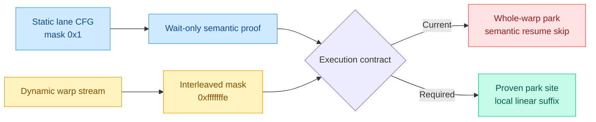
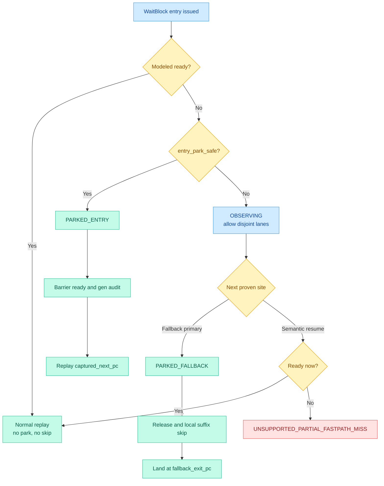
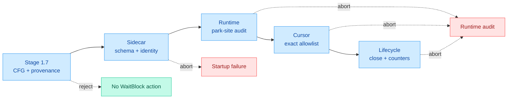

# Debug Session: k10-wait-fold-deadlock
- **Status**: [OPEN]
- **Issue**: The Stage 1.7/1.8 wait-block implementation introduces a deadlock in FA3 Kernel 10, which completed before the implementation.
- **Debug Server**: http://127.0.0.1:7777/event
- **Log File**: `.dbg/trae-debug-log-k10-wait-fold-deadlock.ndjson`

## Reproduction Steps
1. Inspect the Kernel 10 `*.e51` and `*.o51` logs under the provided `H100_80GB-OnlyKernel10` run directory.
2. Compare sidecar generation and runtime behavior with Kernel 5 `*.e78` and `*.o78`.
3. Identify the first wait-block or barrier state divergence that leaves Kernel 10 without forward progress.

## Hypotheses & Verification
| ID | Hypothesis | Likelihood | Effort | Expected signal | Evidence |
|----|------------|------------|--------|-----------------|----------|
| H1 | Stage 1.7 falsely classifies a Kernel 10 ready-path CFG as a foldable wait block. | High | Low | K10 sidecar contains a wait block whose fallback is not wait-only or does not converge. | **Rejected for the 35-record admission policy.** Type-2 fold blocks intentionally belong to the unified WaitBlock model; their admission and legacy-region absorption are not themselves regressions. |
| H2 | Stage 1.7 emits an incorrect `resume_pc` or skip range for a valid K10 wait block. | High | Low | Runtime park/skip lands at a PC that bypasses required setup or barrier operations, or differs from CFG convergence. | **Confirmed as a proof/executor contract mismatch.** The dynamic path proof ignores disjoint lane groups, while the runtime skip advances one linear warp cursor and cannot ignore them. |
| H3 | Stage 1.8 mutates park, metric, or barrier-generation state even when the entry TRYWAIT reports ready. | Medium | Medium | K10 log shows wait-block runtime state changes on a ready gate before the deadlock. | **Rejected.** Ready entries take `wb ready-passthrough`; the failing K10 entry was a modeled miss. |
| H4 | Stage 1.8 matches a sidecar wait block to the wrong runtime region, kernel, CTA, warp, or barrier. | Medium | Medium | Runtime event metadata disagrees with sidecar entry/barrier identity at the first divergence. | **Rejected.** Function id 8, entry `0xa9c0`, and runtime barrier `0x31020` match the intended sidecar record. |
| H5 | Stage 1.8 treats every admitted entry as a whole-warp-safe park site even when only one divergent lane group executes the entry. | High | Low | A partial-mask entry is followed by disjoint-mask work before the safe fallback wait site or resume. | **Confirmed.** K10 `0xa9c0` and K5 `0x9e80` execute with mask `0x1` and have `0xfffffffe` work interleaved before resume. |

## Instrumentation Design
The first business-code patch must be instrumentation-only. Add these observation
points before changing park or skip behavior:

1. Entry decision: block id/kind, PC, active/predicate masks, modeled readiness,
   selected strategy, current cursor, and expected/current generation.
2. Deferred visit transition: entry miss, captured fallback reached, fallback
   primary reached, or semantic resume reached.
3. Park decision: park-site role, current PC/mask, entry mask, and whether the
   sidecar's mask/linear-suffix proof passed.
4. Release decision: park-site role, pre-skip PC, local release target, skipped
   PC classes, landing PC, generation, and park duration.
5. Watchdog dump: all warp head PCs/active masks/pending modes, named-BAR wait
   state, relevant mbarrier arrive/tx/gen state, and recent flips.
6. Per-block summary: entry hits, deferred visits, entry/fallback parks,
   releases, unsupported partial-fast-path misses, skipped instructions, and
   watchdogs.

## Log Evidence
1. `.e51:86459`: K10 watchdog at SM24/warp0, entry `0xa9c0`, barrier `0x31020`, `gen=0` for 32,001 cycles.
2. K10 `.e48` clean-run timeline: the same modeled miss stayed nonblocking; consumer warps later issued eight `0x45e0` ARRIVEs and flipped `0x31020` gen0 to gen1.
3. K10 trace CTA24: `0xa9c0` executes with `active_mask=0x1`; before lane 0 reaches `0xa9e0`, lane 1-31 execute `WARPSYNC.ALL 0xb2c0` with mask `0xfffffffe`. Stage 1.8 parks the entire warp at the lane-0 gate.
4. `.e78:45456`: K5 runtime skip from entry `0x9e80` toward `0x9ea0` aborts on `BSYNC 0xa150`, which is absent from `allowed_block_pcs`.
5. K5 trace CTA0: the `0x9e80` lane-0 visit has 221 linear entries before resume, including 145 disjoint-mask entries and seven `BSYNC 0xa150` occurrences. Stage 1.7 ignores those entries while Stage 1.8 cannot.
6. Sidecar v3 reports `discovered=42 passed=35 failed=0 skipped=7`. This is intentional: the unified WaitBlock database includes Type-2 fold blocks to simplify Stage 1.9.
7. All eight intended Type-1 targets are full-warp, have no disjoint interleave, and captured only path A:
   K5 `0x13b0/0x35e0/0x3750/0x5a50/0x5bc0/0x74e0`; K10 `0x1900/0x4fa0`.
8. Debug-server evidence: `.dbg/trae-debug-log-k10-wait-fold-deadlock.ndjson`
   lines 1-6. Line 5 supersedes the original line-1 interpretation that treated
   the 35-record admission policy itself as a defect.
9. K10 clean `.e48`: the same warp executes the disjoint `0xb2c0` lane group,
   then parks at legacy primary `0xb980` at cycle 12,758 and releases at cycle
   22,756 when `0x31020` reaches gen1. K10 `.e51` instead parks at `0xa9c0` at
   cycle 9,129, before `0xb2c0`, and remains at gen0 through the watchdog.
10. The K5 linear sequence `0xb1e0(mask=0x1) -> 0xa150(mask=0xfffffffe) ->
    ... -> 0xb1f0(mask=0x1)` is SIMT lane-group interleaving, not evidence of a
    same-lane CFG edge from `0xb1e0` to `0xa150`.

## Verification Conclusion
The 35-record unified WaitBlock model and Type-2 absorption are intentional and
should be retained. The regression is in the Stage 1.7-to-1.8 execution contract:

- Stage 1.7 proves one lane group's semantic path by ignoring disjoint masks, but
  does not emit whether the entry is a safe whole-warp park site.
- Stage 1.8 assumes every admitted `entry_wait_pc` is whole-warp safe and parks
  the entire warp on a modeled miss.
- Stage 1.8 also tries to skip to `resume_pc` with one linear warp cursor, which
  necessarily encounters disjoint-lane work that the offline proof ignored.
- K10 `0xa9c0` therefore parks lane 1-31 together with waiting lane 0 before
  `WARPSYNC.ALL 0xb2c0`. K5 `0x9e80` later tries to skip across lane 1-31
  `BSYNC 0xa150`.
- The static lane-0 fallback sequences `0xb1c0..0xb210` and
  `0xb940..0xb9a0` are not disproven by these linear trace interleavings. The
  defect is using a lane-group proof as authority for a whole-warp park and
  whole-warp linear skip.

Two independent static-proof gaps remain relevant but are not the direct K10
watchdog trigger: wait-condition equivalence currently compares only immediate
offset plus single-register shape, and `captured_next_pc` is emitted as the
convergence PC rather than the immediate traced successor described by the plan.

Recommended repair boundary:

1. Do not revert `179c31a`; retain all 35 WaitBlock records and Type-2 ownership.
2. Extend Stage 1.7 to emit explicit runtime sites and mask proofs:
   `entry_park_safe`, `park_wait_pcs`, and a linearly contiguous
   `release_skip_pcs` suffix.
3. A full-warp Type-1 block whose fallback is uncaptured may park at entry. All
   eight current Type-1 targets satisfy this invariant and captured path A only.
4. A partial-mask Type-2 block must not park at entry. If the captured path enters
   the fallback, park at its proven fallback primary wait and preserve the old
   fold timing while using the unified WaitBlock record/runtime.
5. Release may skip only a suffix proven against the actual linear cursor. A
   Type-2 fallback release lands at the fallback's local exit, not the semantic
   block resume beyond interleaved disjoint-lane work.
6. A partial-mask captured-fast-path visit whose modeled entry misses cannot be
   repaired safely by the current whole-warp scheduler. It must fail closed or
   remain unsupported until a lane-group-aware deferred wait is designed; entry
   parking is not an acceptable approximation.
7. A mask-filtered offline path is insufficient authority for linear skipping.
   Complete the CFG-aware wait-condition provenance proof and correct
   `captured_next_pc` while updating the Stage 1.7 schema contract.

## Refined Failure Matrix

| Kernel | Symptom | Immediate cause | What remains valid |
|--------|---------|-----------------|--------------------|
| K5 `.e78` | `[WAITBLOCK_SKIP_AUDIT]` at `BSYNC 0xa150` | Release from a lane-0 Type-2 visit skips toward semantic `resume_pc` with the whole warp's linear cursor and encounters lane 1-31 work. | Lane-0 fallback `0xb1c0..0xb210`, wait-condition proof target, and Type-2 WaitBlock ownership. |
| K10 `.e51` | Watchdog at `0xa9c0`, barrier `0x31020` stuck at gen0 | A partial-mask Type-2 entry parks the entire warp before disjoint `WARPSYNC.ALL 0xb2c0` and before the legacy-safe primary `0xb980`. | Fallback `0xb940..0xb9a0`, Type-2 admission, and event-based park at the fallback primary. |

### Figure 1: observed failure split

```mermaid
flowchart TB
    subgraph K5["K5: release-time cursor failure"]
        K5A["0x9e80<br/>lane 0 entry"] --> K5B["park and release"]
        K5B --> K5C["skip toward 0x9ea0"]
        K5C --> K5D["encounter BSYNC 0xa150<br/>lanes 1-31"]
        K5D --> K5E["WAITBLOCK_SKIP_AUDIT"]
    end

    subgraph K10["K10: issue-time park failure"]
        K10A["0xa9c0<br/>lane 0 entry"] --> K10B["whole-warp park"]
        K10B --> K10C["WARPSYNC 0xb2c0<br/>cannot execute"]
        K10C --> K10D["0x31020 remains gen0"]
        K10D --> K10E["32K watchdog"]
    end

    classDef entry fill:#d0ebff,color:#0d47a1,stroke:#339af0;
    classDef risk fill:#fff3bf,color:#8a4b00,stroke:#f59f00;
    classDef fail fill:#ffe3e3,color:#9c1c1c,stroke:#fa5252;
    class K5A,K10A entry;
    class K5B,K5C,K5D,K10B,K10C,K10D risk;
    class K5E,K10E fail;
```



The failures share one contract defect but not one runtime symptom:

- K5 reaches release and fails while skipping.
- K10 never reaches release because it parks at an unsafe earlier site.

The K10 comparison is especially strong:

```text
clean .e48:
  a9c0 miss -> disjoint b2c0 executes -> park b980 @ 12758
  barrier gen0->1 -> release b980 @ 22756

regressed .e51:
  park a9c0 @ 9129 -> b2c0 never executes
  barrier remains gen0 -> watchdog @ 41130
```

This shows that park/release itself is not invalid for `0xa9c0`'s logical block.
Moving the park from the fallback primary to the partial-mask entry is the
behavioral regression. A final watchdog dump is still required to document the
cross-warp/named-BAR dependency chain, but it is not necessary to reinterpret the
block as non-wait-only.

## Trace Interpretation

Dynamic protobuf streams are linear warp issue streams, not one scalar CFG path.
Different active masks can be interleaved:

```text
K5:
  b1e0 mask=0x1
  a150.. mask=0xfffffffe
  b1f0 mask=0x1

K10:
  b970 mask=0x1
  b2c0 mask=0xfffffffe
  b980 mask=0x1
```

### Figure 2: semantic proof versus executable cursor



Therefore:

- `b1e0 -> a150` is not a same-lane direct CFG edge.
- The raw union of dynamic PCs between entry and resume is not the fallback body.
- Static CFG extraction should remain lane-semantic and mask-aware.
- Runtime skip safety needs an additional proof over the actual linear cursor.
- A semantic lane path can be foldable even when the warp-linear interval also
  contains non-foldable work from a disjoint lane group.

## Proposed Sidecar Contract

Retain all 35 admitted WaitBlocks and the absorbed Type-2 spin regions. Extend
each record so semantic ownership and executable runtime actions are distinct:

```text
WaitBlockRecord:
  block_id
  block_kind                    # COMPOUND_FALLBACK | CAPTURED_SPIN
  entry_wait_pc
  captured_next_pc             # immediate traced successor, not convergence
  semantic_resume_pc
  entry_observed_active_masks
  entry_park_safe
  entry_park_reason
  fallback_entry_pc
  fallback_primary_wait_pc
  fallback_loopback_pc
  fallback_exit_pc              # local OOL exit before semantic resume
  semantic_allowed_pcs          # mask-aware lane CFG
  park_sites[]:
    pc
    role                        # ENTRY | FALLBACK_PRIMARY
    active_mask_contract
    release_target_pc
    release_skip_pcs            # linear contiguous suffix only
  canonical_wait_condition
  proof_evidence
  observed_path_counts
```

Required Stage 1.7 proofs:

1. Semantic CFG: every lane path is wait/control/backoff only and converges at
   `semantic_resume_pc`.
2. Wait equivalence: barrier address and wait-state expressions have equal
   CFG-aware reaching-definition provenance.
3. Entry park safety: whole-warp park is permitted only when the entry mask
   contract proves it cannot suppress another divergent lane group.
4. Park-site safety: a fallback primary belongs to the same logical wait and
   uses the same runtime barrier/parity.
5. Linear release safety: from each park site, every cursor occurrence skipped
   before `release_target_pc` is in `release_skip_pcs`; no disjoint-mask or
   semantic instruction can occur in that interval.
6. Type-2 local exit: fallback release targets `fallback_exit_pc`, not a semantic
   resume beyond interleaved lane work.
7. Unsupported geometry fails closed with an explicit taxonomy reason; it does
   not silently inherit `park_on_model_miss=true`.

## Proposed Runtime

Use one unified WaitBlock database/runtime while preserving the proven park
geometry of each block.

```text
WaitBlockVisitState:
  mode = NONE | OBSERVING | PARKED_ENTRY | PARKED_FALLBACK
  block_id
  barrier_key / wait_state / expected_gen
  entry_pc / entry_active_mask
  park_site_pc / release_target_pc
```

### Figure 3: proposed unified runtime state machine



Entry handling:

```text
modeled ready:
  execute entry normally
  do not park or skip

modeled miss + entry_park_safe:
  execute entry once
  park as PARKED_ENTRY

modeled miss + !entry_park_safe:
  open OBSERVING visit
  do not park the whole warp
  continue the captured trace so disjoint lane groups can run
```

Observed Type-2 fallback:

```text
OBSERVING reaches fallback_primary_wait_pc:
  assert same block/barrier/parity/expected generation
  if ready:
    fold only the residual local fallback suffix to fallback_exit_pc
  else:
    park as PARKED_FALLBACK
```

Release:

```text
PARKED_ENTRY:
  clear park after readiness/gen audit
  resume normal replay at captured_next_pc
  do not skip toward semantic_resume_pc

PARKED_FALLBACK:
  clear park after readiness/gen audit
  skip only release_skip_pcs
  assert landing == fallback_exit_pc
  resume normal replay, including any later disjoint lane work
```

Partial-mask captured fast path:

```text
OBSERVING reaches semantic_resume_pc without reaching a safe park site:
  if modeled wait is now ready:
    close visit and continue
  else:
    hard abort as UNSUPPORTED_PARTIAL_FASTPATH_MISS
```

The last case requires lane-group-aware deferred execution to support fully. A
whole-warp park at the partial entry is not an acceptable fallback.

## Rejected Alternatives

### Raw dynamic fallback extraction

Do not define the fallback as every dynamic PC between gate miss and resume. It
mixes disjoint lane groups and would incorrectly classify K5's lane-0 wait as
containing `BSYNC` and unrelated semantic work.

Dynamic traces remain useful for:

- active-mask/path classification;
- validating semantic CFG membership per lane group;
- proving park-site and linear skip geometry.

### Global no-skip release

Useful only as a short diagnostic experiment. It avoids K5's immediate audit but
replays residual captured polls after modeled readiness. Those retries can cross
another barrier flip and recreate the generation/pacing defect fixed by Batch A.

The final implementation must retain local, proven cursor skipping.

### Reverting Stage 1.7

Do not revert the unified 35-record detector solely because K5/K10 failed. The
admission architecture is intentional and useful for Stage 1.9. Correct the
record/executor contract and strengthen its proofs in place.

## Implementation Sequence

1. Add instrumentation only; rerun the shortest K10 reproduction to capture the
   watchdog warp-head/named-BAR dependency dump.
2. Update Stage 1.7 schema/proofs while preserving:
   `discovered=42 passed=35 failed=0 skipped=7`, all 35 block ids, and all 14
   Type-2 ownership mappings.
3. Review generated per-block execution strategies. Required anchors:
   - K5 `0x74e0`: `ENTRY`, full-warp safe.
   - K5 `0x9e80`: no entry park; fallback primary `0xb1f0`, local exit `0xb210`.
   - K10 `0xa9c0`: no entry park; fallback primary `0xb980`, local exit `0xb9a0`.
4. Implement the unified visit state and site-specific release behavior.
5. Run static/unit checks locally. The user performs the server build and
   long-running K5/K10 simulations.
6. Compare pre-fix and post-fix logs before any debug cleanup.

## Verification Plan

Static acceptance:

- Sidecar remains version 3 or receives an explicit schema bump; old records are
  rejected when required execution fields are absent.
- Counts remain `42/35/0/7`.
- All 14 absorbed Type-2 regions retain one WaitBlock owner.
- All eight Type-1 targets remain full-warp/path-A-only entry-park blocks.
- K5 `0xa150` and K10 `0xb2c0` are never in any `release_skip_pcs`.
- `captured_next_pc` is the immediate successor and differs from semantic resume
  where required.
- Wait-condition provenance is canonical and equal at all gate/fallback waits.

K5 runtime acceptance:

- `0x74e0` modeled miss parks once at entry and releases once.
- No `0x8240` coarse ARRIVE occurs before the modeled gate release.
- `0x9e80` never whole-warp parks at entry.
- Fallback park/release uses `0xb1f0 -> 0xb210`.
- `BSYNC 0xa150` executes normally and is never skipped.
- No `[WAITBLOCK_SKIP_AUDIT]`, watchdog, or generation overshoot.

K10 runtime acceptance:

- `0xa9c0` does not park at entry.
- The `0xfffffffe` `WARPSYNC.ALL 0xb2c0` occurrence executes.
- Warp 0 parks, if still needed, at `0xb980`.
- Barrier `0x31020` reaches gen1 and releases the wait before 32,000 cycles.
- Consumer `0x45e0` ARRIVEs remain present.
- Kernel exits cleanly with zero wait-block audits.

Cross-kernel invariants:

- Feature-off behavior remains bit-identical.
- Parks equal releases at clean exit, with no open visit at CTA teardown.
- Runtime landing audits pass for every local skip.
- HGMMA/MUFU/TMA/BAR/memory semantic-work counts are preserved.
- Only proven wait/control/backoff instructions are skipped.
- Watchdog threshold remains 32,000 cycles.

## Additional Risk Audit

Scope: code changes in `6c82fcd..9b2668e`, excluding documentation/config prose.
Two independent validators reviewed every candidate. `High` means both
validators confirmed the issue; `Medium` means one validator confirmed it and
the main-agent call chain independently supports it.

| ID | Severity | Confidence | Current exposure | Finding |
|----|----------|------------|------------------|---------|
| R1 | Major | High | Direct K5/K10 failure | Mask-filtered lane proof is used to authorize whole-warp park and one linear cursor skip. |
| R2 | Major | High | Current mixed A/C blocks | Absorbed Type-2 primary folds are disabled, while ready entries only passthrough; a captured C-path can replay residual polls with no owner left to fold them. |
| R3 | Major | High | Unproven for current records | Wait-condition proof compares only immediate offset and single-register shape; barrier-base/wait-state reaching definitions and dynamic payload equality are not proven or checked at runtime. |
| R4 | Major | High | All 35 records define GPRs | WaitBlock admission has no GPR live-out proof and no block-level scoreboard proof before those instructions become skippable. |
| R5 | Major | High | Latent; K5/K10 fids differ | Runtime lookup omits `trace_kernel_id`; duplicate `(funcid, entry_pc)` records silently overwrite each other. |
| R6 | Major | High | Latent; current v3 is valid | Feature-on startup accepts a missing/malformed/partial sidecar, ignores `wait_block_report.failed`, and automated generation does not enforce strict WaitBlock acceptance. |
| R7 | Major | High | Latent; current masks match | Dynamic validation uses `active_mask`, not runtime-effective `active_mask & predicate_mask`. |
| R8 | Major | High | Latent with stale/bad sidecar | Runtime skip accepts unknown, reconvergence, fence, dependency, call/return, and other control opcodes as `other` if the PC appears in the sidecar. |
| R9 | Medium | Medium | Lifecycle invariant gap | CTA cleanup erases matching pending waits before warp-slot reuse checks, so an open WaitBlock can be hidden instead of asserted. |
| R10 | Minor | High | All 35 records | `captured_next_pc` equals `resume_pc` and is not the immediate traced successor required by its schema; runtime never validates it. |
| R11 | Minor | High | Current summaries | Ready passthroughs are counted as `total_folds`, and generation overshoots are counted as watchdog hits. |
| R12 | Major | High | Latent; current targets happen to match | Fallback extraction accepts any predicated backward BRA without proving it consumes the wait predicate or targets the fallback loop body. Uncaptured Type-1 paths cannot dynamically expose this error. |

### Figure 4: fail-closed control layers



### R2: Type-2 owner gap

The generator demotes every absorbed legacy region:

```text
spin_region.foldable = false
spin_region.absorbed_by_wait_block = owner
```

Runtime lookup for the owner is installed only at `entry_wait_pc`. On a modeled
ready entry, runtime performs `wb ready-passthrough` and does not skip. If the
captured trace is path C, it later reaches the fallback primary, but:

- no WaitBlock lookup exists at that primary;
- the legacy record is now `foldable=false`;
- residual capture-time polls replay unchanged.

The current sidecar has ten mixed A/C Type-2 blocks, including K5 `0x9e80` and
K10 `0xa630`. This can restore the immediate-ready residual replay defect that
Batch A fixed.

### R3/R4/R12: proof completeness

Current `prove_candidate()` runs only:

```text
offset/register-shape wait check
closed opcode/effect check
wait-predicate disposition scan
```

It does not run:

- CFG-aware reaching definitions for barrier base and wait state;
- dynamic `barrier_addr/semantic_raw` equality;
- GPR kill-before-read liveness;
- block-level scoreboard arm/wait balance;
- exact wait-predicate ownership of the fallback backedge.

All 35 emitted blocks contain at least one `dst_first` instruction, so GPR
liveness is not an academic edge case. Type-1 fallbacks are captured only on the
ready path, making their static proof the sole authority.

### R5/R6: startup identity and fail-closed loading

WaitBlock generation is per trace kernel, but C++ storage is keyed only by:

```text
(unique_function_id, entry_wait_pc)
```

The loader uses assignment rather than duplicate insertion checks. It also
returns before schema validation when the sidecar cannot be loaded, skips
malformed records, and does not reject `wait_block_report.failed > 0`.

Required startup contract:

1. Key records by `(trace_kernel_id, unique_function_id, entry_wait_pc)`.
2. Abort on duplicate keys, missing sidecar, malformed kernel/record arrays,
   missing required proof fields, or nonzero `failed`.
3. Require nonempty records for a fold-enabled target kernel unless the sidecar
   explicitly reports `discovered=0`.
4. Make automated sidecar generation enforce the same acceptance result.

### R8: runtime defense gap

`wait_block_skip_to_resume()` has a semantic-family denylist and otherwise
accepts the occurrence as `stats.other`. A stale sidecar could therefore make
runtime skip `BSYNC`, `BSSY`, `WARPSYNC`, `DEPBAR`, fences, indirect control,
calls/returns, or a newly introduced unknown opcode.

Runtime must use an exact allow contract:

```text
actual occurrence opcode/effect == sidecar reviewed effect
AND effect in {wait, backoff, reviewed pure setup, direct branch}
```

Anything else aborts before cursor advancement.

### R9: lifecycle order

`register_cta_thread_exit()` calls `clear_sync_barrier_state_for_cta()`, which
currently resets every matching `m_pending_sync_waits` entry. The later
`reinit()` assertion cannot observe the erased mode. Move the open-wait assertion
before cleanup and also assert the WaitBlock visit state and park-start state are
closed.

## Required Focused Tests

Generator unit tests:

1. Same immediate offset but different barrier-base provenance -> reject.
2. Different wait-state registers with unequal reaching definitions -> reject.
3. Fallback scratch definition read before overwrite at resume -> reject.
4. External scoreboard wait or async arm inside skip set -> reject.
5. Backedge using another predicate or targeting before fallback entry -> reject.
6. `active_mask != predicate_mask`, including effective-zero entry -> classify
   with the effective mask.
7. Type-1 captured A-only and Type-2 mixed A/C fixtures -> emit the intended
   park sites and local release targets.
8. Duplicate function/PC across two trace kernel ids -> produce distinct records.

Loader/runtime unit tests:

1. Missing/unparseable/v2/partial-v3/nonzero-failed sidecar with feature on ->
   abort before simulation.
2. Duplicate runtime key -> abort, never overwrite.
3. Runtime barrier address/parity differs from canonical proof -> abort.
4. Sidecar allows `BSYNC`, `WARPSYNC`, `DEPBAR`, fence, semantic memory, or an
   unknown opcode -> abort before cursor movement.
5. Type-2 ready entry plus captured C path -> fallback primary remains owned and
   residual polls fold to the local exit.
6. CTA teardown with `OBSERVING`, `PARKED_ENTRY`, or `PARKED_FALLBACK` visit ->
   abort before state cleanup.
7. Summary separates passthroughs, immediate folds, parks, releases, generation
   overshoots, and watchdogs.

## Current Decision

- Keep the debug session `[OPEN]`.
- Keep all debug artifacts and the server until post-fix user confirmation.
- Do not modify business logic until the instrumentation patch and this design
  are reviewed.

## V4 Full-Trace Post-Processing Result (2026-08-18)

This section supersedes the earlier proposed universal WaitBlock runtime and its
`35-record` v3 acceptance target. The v3 counts above remain historical evidence.

The failed Stage 1.7/1.8 implementation was reverted. Full-CTA strict
post-processing now succeeds with the two-strategy v4 design:

```text
discovered=43 passed=36 failed=0 skipped=7
INJECT_MISSING_WAIT=22
FOLD_CAPTURED_POLL=14
metadata_only=0
ready-only all-live visits=76,224
ready-only partial visits=4,596
ready-only records with partial visits=11
```

The additional v4 ready-only record is K10 `0xa810`. V3 rejected it because its
uncaptured wait arm contains local-memory work. That rejection is not applicable
to `INJECT_MISSING_WAIT`: the runtime action uses the entry probe and never
executes or consumes the uncaptured wait arm.

K5 strategy split:

```text
INJECT_MISSING_WAIT=12
FOLD_CAPTURED_POLL=8
partial visits=948
```

K10 strategy split:

```text
INJECT_MISSING_WAIT=10
FOLD_CAPTURED_POLL=6
partial visits=3,648
```

The K5 `0x96c0` entry-path dynamic proof still escapes, but it is not a v4
failure: its captured poll is independently and fully owned by
`FOLD_CAPTURED_POLL` at `0xb0b0`. Entry-path proof is not a runtime contract for
that strategy.

The generated candidate passes schema, report-accounting, duplicate-key,
strategy-shape, sync-payload, fold-owner, local-exit, and exact-advance-set
audits. It is written to:

```text
traces/extra_info/spin_wait_sidecar.v4.candidate.json
```

Simulator v4 remains intentionally unimplemented. Partial modeled misses remain
an explicit diagnostic-abort boundary pending a separately reviewed lane-group
execution design.
